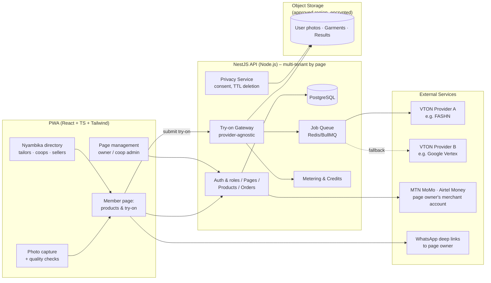
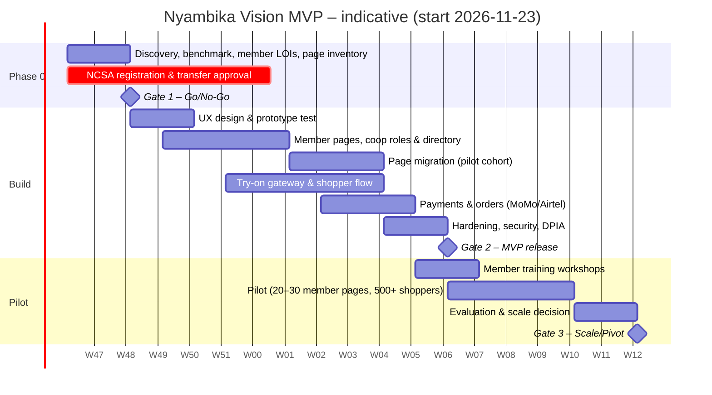

# Nyambika Vision — Feasibility Study Report

**AI-Powered Virtual Fashion Fitting Room**

| | |
|---|---|
| Document type | Feasibility Study |
| Prepared by | Project Management Office |
| Date | 10 November 2026 |
| Inputs | [proposal.md](proposal.md), [research-report.md](research-report.md) |
| Currency basis | RWF 1,477 = US$1 (5 Nov 2026). All costs are estimates. |
| Status | Draft v1.1 for steering-committee decision (updated to keep Nyambika's member-page management model) |

---

## 1. Executive Summary

### Decision requested
Approve **Phase 0 (2-week discovery and validation)** and conditionally approve the **MVP build and pilot (16 weeks in total)**, subject to the go/no-go gates in §11.

### Guiding principle: modernise, don't replace
Nyambika already hosts **tailors, sewing cooperatives and sellers, each with their own page** for promoting their clothing. **That management model stays.** Members keep and manage their own pages, products, customers and sales. Nyambika remains the host, curator and promoter. Nyambika Vision adds AI try-on, AI product photos, digital payments and analytics **inside each member's page** (see §2.5).

### Verdict: CONDITIONALLY FEASIBLE
| Dimension | Score (1–5) | Summary |
|---|---|---|
| Technical | **4.0** | Feasible with hosted try-on APIs. 3D, AR and photo-based sizing aren't ready for MVP. |
| Market | **3.0** | Real need and a clear local gap, but a small online base. Buying happens on social channels. The existing member base gives Nyambika a head start on the supply side. |
| Financial | **2.5** (Rwanda-only) / **3.5** (with B2B + EAC) | Thin per-order margins. Seller-paid try-ons and regional or API revenue are needed to break even. |
| Legal & regulatory | **3.0** | Achievable, but NCSA registration and cross-border transfer authorisation are on the critical path. |
| Operational | **3.0** | Page migration, catalogue quality and member training (especially for cooperatives) take real effort. |
| Schedule | **3.0** | The 7-week plan isn't realistic for the proposed scope. 12 weeks to MVP plus a 4-week pilot is achievable. |
| Social & ethical | **4.0** | Strong local-industry benefit. Bias and privacy risks are manageable with the controls in §8. |
| **Weighted overall** | **3.2 / 5** | **Feasible with a reduced scope, member pages at the centre and gate conditions.** |

*Weights: Technical 20%, Market 20%, Financial 20%, Legal 15%, Operational 10%, Schedule 10%, Social 5%.*

### Key numbers
| Item | Estimate |
|---|---|
| Project budget (Phase 0 → pilot end, 18 weeks incl. evaluation) | **≈ US$52,900 (≈ RWF 78 million)** incl. 15% contingency |
| Total funding needed for 18-month runway | **≈ US$107,000–130,000 (≈ RWF 158–192 million)** |
| Cost per try-on generation | ≈ RWF 111 (US$0.075). Falls to ≈ RWF 72 with volume pricing. |
| Commission-only break-even | ≈ 17 try-ons per completed order |
| Monthly operating cost after launch | ≈ RWF 10.5 million (≈ US$7,100) |
| Indicative break-even | ≈ 270 paid member pages + ≈ 3,000 orders/month + 1–2 B2B or API clients (around month 18–24) |

### What changes from the proposal
1. **Management model:** The proposal's marketplace framing is replaced by Nyambika's **member-page model**. Each tailor, cooperative and seller keeps and manages their own page. Payments go to the page owner by default.
2. **Scope:** The MVP is modernised member pages with try-on, AI product photos, and MoMo/Airtel/WhatsApp contact or checkout, plus **migration of existing pages**. 3D, AR, size recommendation and the AI assistant move to Phases 2–3.
3. **Revenue:** Page plans. Members pay for and receive try-on allowances and AI product photography on their page. Shoppers get a free weekly quota.
4. **Timeline:** 7 weeks becomes **12 weeks to MVP plus a 4-week pilot**, with a 2-week validation phase first.
5. **New workstreams:** data-protection compliance, a local try-on quality benchmark, page migration, and member training.

---

## 2. Project Definition

### 2.1 Objective
Modernise Nyambika's existing member pages (tailors, sewing cooperatives, sellers) with a mobile-first (PWA) virtual try-on experience, piloted in Kigali. Shoppers should be able to see a member's garments on their own photo and order from or contact that member directly. The pilot should prove technical quality, user demand and unit economics before scale-up, without disrupting how members manage their pages today.

### 2.2 In scope (MVP)
| # | Capability |
|---|---|
| S1 | Shopper and member accounts (phone number + OTP), with page roles: **owner, staff, cooperative admin, cooperative member** |
| S2 | **Member page management**: each tailor, cooperative or seller manages their own page (profile, story, location, contacts), products, variants, sizes, prices, stock and orders |
| S2a | **Cooperative pages**: member profiles, item-to-maker attribution, shared or individual payment accounts, admin approval of member listings |
| S2b | **Nyambika directory**: browse and search pages by type (tailor, cooperative, seller), location and style. Products stay inside their member's page. |
| S2c | **Migration** of existing member pages, products and images, with page links kept or redirected |
| S3 | **AI product-photo generation** (garment → on-model image) for member listings |
| S4 | Shopper photo capture or upload with **on-device quality checks** and **explicit consent** |
| S5 | **AI virtual try-on** through a provider-agnostic gateway, async queue and result caching |
| S6 | Colour or variant switching (re-generate for each variant) |
| S7 | Shareable try-on result and page or product links (WhatsApp, Instagram) pointing back to the **member's page** |
| S8 | Ordering on the member's page: **payment straight to the page owner's MTN MoMo or Airtel Money account** (default), or "Contact on WhatsApp". Optional Nyambika checkout (Phase 2, subject to a regulatory check). |
| S9 | Free try-on quota, shopper credit packs and **try-on allowances per page** (metering) |
| S10 | Privacy controls: auto-deletion, "delete my photos", consent log |
| S11 | Nyambika host admin: member and page verification, content standards and moderation, featured pages, platform metrics |
| S11a | Page analytics for each member: page visits, try-ons, contacts and orders |
| S12 | English and Kinyarwanda UI (French in Phase 2) |

### 2.3 Out of scope (deferred)
| Feature | Target phase | Reason |
|---|---|---|
| Smart size recommendation (photo-based) | Phase 2 (manual measurement profile first) | Accuracy is unproven and size charts are missing |
| AI fashion assistant | Phase 2 | Needs structured catalogue data first |
| 3D garment viewer (Three.js, Tripo) | Phase 3 | Low impact on purchase decisions; cost and complexity |
| AR fitting | Phase 3+ | Not mature for full-body garments on mid-range Android |
| Own GPU inference / self-hosted models | Phase 3 | Only justified at scale or if localisation requires it |
| Stripe and international shipping | Phase 3 | Needed only for export or diaspora sales |
| Public API licensing | Phase 3 | Needs a stable product and an SLA first |

### 2.4 Assumptions
- A1. The team is Kigali-based, with salaries at local market rates.
- A2. Hosted try-on APIs remain available at about US$0.05–0.08 per image.
- A3. NCSA registration and cross-border transfer authorisation can be obtained within about 30 working days.
- A4. At least 20–30 **existing Nyambika members** (including ≥ 3 cooperatives) volunteer for the pilot.
- A5. Delivery and fulfilment stay with page owners, as they do today. Nyambika doesn't run logistics in the MVP.
- A6. Existing page content (profiles, product images, contacts) can be exported or captured for migration.
- A7. Payments go straight to page owners' merchant accounts. Nyambika doesn't hold member funds in the MVP.

### 2.5 Operating and management model (preserved from traditional Nyambika)

| Layer | Who | Responsibilities |
|---|---|---|
| **Host** | Nyambika | Platform, hosting, member verification, content standards, directory and promotion, AI services, data protection compliance, support and training |
| **Page owner** | Tailor / seller / cooperative (legal entity) | Owns and manages **their page**: products, prices, stock, photos, orders, customer communication, delivery, payments received |
| **Cooperative admin** | Appointed by the cooperative | Manages the cooperative page, approves members' listings, manages the shared payment account and allowance |
| **Cooperative member** | Individual maker | Adds their own items (attributed to them) for admin approval, sees their own sales |
| **Page staff** | Optional, added by the owner | Helps manage listings and orders |
| **Shopper** | Public | Browses the directory and pages, tries on, contacts or orders from the page owner |

**RACI (key processes)**

| Process | Nyambika host | Page owner | Coop admin | Coop member |
|---|---|---|---|---|
| Member admission and page verification | **A/R** | C | C | I |
| Page content and product listings | C (standards) | **A/R** | A/R (coop page) | R (own items) |
| AI product photos and try-on allowance use | R (service) | **A** | A | R |
| Orders, payment receipt, delivery | I | **A/R** | A/R | R (own items) |
| Customer disputes | C (mediation) | **A/R** | A/R | C |
| Data protection (shopper photos) | **A/R** | I | I | I |
| Page plan billing | **A/R** | R (pays) | R (pays) | I |

*A = Accountable, R = Responsible, C = Consulted, I = Informed.*

**Design rules that follow from the model**
1. Every product, order, try-on and analytics record **belongs to a page**.
2. Shoppers always land on, and buy from, **a member's page**. The directory exists to send traffic to pages.
3. Members' existing customer relationships, WhatsApp numbers and MoMo accounts are kept.
4. Shopper photos are processed by Nyambika as controller and are **never shared with page owners**. Page owners see only results the shopper chooses to share.

---

## 3. Market Feasibility

### 3.1 Demand indicators
| Indicator | Evidence | Assessment |
|---|---|---|
| Problem exists | Fit and visualisation uncertainty is the top driver of apparel returns internationally (53–70%). In Rwanda it shows up as hesitation to buy and post-delivery disputes. | ✅ Probable. Validate locally. |
| Reachable users | ~5.5M internet users. 34% of households own a smartphone. Cheap data (US$0.41–0.81/GB). | ⚠ Concentrated in urban Kigali, ages 18–35 |
| Supply side | **Nyambika's existing hosted members** (tailors, cooperatives, sellers with their own pages), plus a growing SME and cooperative fashion sector under Made in Rwanda. Most lack digital tools. | ✅ Strong. The supply side already exists. |
| Competition | No VTON platform in Rwanda. Google try-on not available in East Africa. | ✅ Open, but probably only for 2–3 years |
| Market size | Online fashion ≈ US$12–94M. Try-on-influenced GMV in years 1–3 ≈ US$0.25–4.7M/yr. | ⚠ Small. Needs EAC and B2B expansion. |

### 3.2 Positioning
> **For** Rwandan tailors, sewing cooperatives and fashion sellers **who** promote their clothing on their own Nyambika page, **Nyambika Vision** upgrades that page with AI try-on and AI product photos, **so that** their customers can see outfits on themselves and order directly from them through MoMo or WhatsApp. **Unlike** generic global AI apps or centralised marketplaces, it keeps each maker's own page and customer relationship, is built and tested for Rwandan users and African fabrics, and protects users' photos under Rwandan law.

### 3.3 Go-to-market (pilot)
1. **Existing members first:** invite 20–30 current Nyambika members (≥ 8 tailors, ≥ 8 sellers, ≥ 3 cooperatives) to a pilot cohort. Migrate their pages, and give them free AI product photos and a free Pro page plan during the pilot.
2. **Member-led distribution:** members share their upgraded page and try-on links on WhatsApp and Instagram, so customer acquisition costs are low.
3. **Cooperative support:** on-site training workshops in Kinyarwanda, with help capturing product photos. Partner with cooperative unions or NGO programmes where possible.
4. **Influencer seeding:** 5–10 local fashion creators post try-on content featuring members' pages.
5. **Event:** launch alongside a Kigali fashion event or a designer collective, showcasing pilot members.
6. **Rollout to all members** after Gate 3, in waves. Members who don't opt in keep their existing pages, which are migrated as basic pages.

**Market feasibility: 3.0/5.** There's enough demand to pilot, but scale beyond Kigali needs proof.

---

## 4. Technical Feasibility

### 4.1 Target architecture (MVP)

### 4.2 Technical feasibility by component
| Component | Feasibility | Key considerations |
|---|---|---|
| Multi-tenant member pages and roles | ✅ High | Page as the tenant. Role-based access (owner, staff, coop admin, coop member). Item-to-maker attribution. Page-level allowances and analytics. |
| Migration of existing pages | ⚠ Medium | Depends on the format and quality of current page data. Needs an inventory (Phase 0), a scripted import, manual fixes, URL redirects, and page-owner sign-off. |
| PWA frontend | ✅ High | Optimise for 2–3 GB RAM Android phones. Compress images to ~300–500 KB. Offline-tolerant catalogue. |
| Photo quality checks | ✅ High | MediaPipe pose landmarks or simple heuristics (full body, front-facing, lighting). Fall back to server-side checks on weak devices. |
| Try-on gateway | ✅ High | Wraps two or more providers behind one interface. Retries, timeouts and fallback. Caches by hash of (user photo, garment, variant). |
| Async processing | ✅ High | Queue with status polling or push. Target p50 ≤ 15 s, p95 ≤ 30 s. |
| AI product photos | ✅ High | Same provider family (product-to-model). Big value to sellers. |
| Payments | ✅ Medium–High | Default: payment request to **the page owner's own MoMo or Airtel merchant code** (no funds held by Nyambika). Use the MTN Collections API or an aggregator where members want automated confirmation. Webhook reconciliation per page. |
| Kinyarwanda UX | ✅ High | Content and translation task, not technical. |
| Local quality (bias) | ⚠ **Medium, unproven** | Must pass the local benchmark gate (§11). Fallback: provider switch, garment-type restrictions, prompt and pre-processing tuning. |
| Data residency | ⚠ Medium | Depends on NCSA authorisation. Plan B is local object storage, with only transient transfer to the provider under a zero-retention agreement. |

### 4.3 Technical risks and controls
| Risk | Control |
|---|---|
| Provider outage or price change | Multi-provider gateway, monthly cost review, a 3-month credit buffer |
| Poor-quality seller garment images | Onboarding photography guide, a low-cost light-box kit, automatic background removal, rejecting images below the quality threshold |
| Identity or skin-tone alteration in outputs | Automated face-similarity and skin-tone drift check before showing a result. Auto-retry or block, and log it to a bias register. |
| Latency on poor networks | Progressive loading, notification when the result is ready, small result thumbnails first |
| Abuse (uploading other people's photos, inappropriate content) | Consent attestation, NSFW and minor detection filters, rate limits, report button |

**Technical feasibility: 4.0/5.**

---

## 5. Operational Feasibility

### 5.1 Project organisation
| Role | FTE (build) | Key responsibilities |
|---|---|---|
| Project / Product Manager | 1.0 | Scope, schedule, stakeholders, gates, pilot management |
| Tech Lead (senior full-stack) | 1.0 | Architecture, backend, security, code quality |
| Full-stack Developer | 1.0 | Member page management, cooperative roles, migration scripts, orders, payments |
| Frontend / PWA Developer | 1.0 | Shopper app, photo capture, performance |
| AI Integration Engineer | 1.0 | Try-on gateway, benchmark, quality and bias checks, metering |
| UI/UX Designer | 1.0 (weeks 1–8), 0.5 after | Research, journeys, prototype, Kinyarwanda UX |
| QA Engineer | 0.5 | Test plans, device lab, UAT |
| Member Success Officer (pilot) | 1.0 (weeks 10–18) | Migrate and onboard pilot members, run cooperative training workshops, help with catalogue photography, collect feedback |
| Legal counsel and DPO | External | NCSA registration, DPIA, terms, privacy policy |

**Governance:** a steering committee (sponsor, PM, Tech Lead, Nyambika business lead, and **one member representative each from tailors, cooperatives and sellers**) meets every two weeks. Gate reviews happen at weeks 2, 12 and 18. The PM sends weekly status reports covering RAG status, burn and risks.

### 5.2 Operational readiness requirements
- **Page migration plan:** inventory, data mapping, import, review by each owner, go-live per page, and redirects from old links. Old pages stay live until the owner signs off.
- **Updated membership/hosting agreement:** page ownership, content and IP rights in AI photos, page plan terms, and data handling. Cooperatives sign as a legal entity and nominate an admin.
- Member onboarding playbook (photo standards, size chart template, pricing, how to use try-on on your page), plus **Kinyarwanda training workshops** for cooperatives.
- Customer support over WhatsApp Business, in Kinyarwanda and English, for both members and shoppers.
- Dispute policy: the try-on is a preview. Disputes over fit and quality are settled between the page owner and the buyer, with Nyambika mediating under its host rules.
- Incident response plan (privacy breach notification to NCSA).
- Monitoring dashboards: generation success rate, latency, cost per order, bias-check failures.

**Operational feasibility: 3.0/5.** Page migration, catalogue quality and member training are the hardest operational problems, more so than the software. Starting from existing members, who already trust Nyambika, lowers the adoption risk.

---

## 6. Schedule Feasibility

### 6.1 Proposal vs. revised schedule
| Phase | Proposal | Revised | Reason for change |
|---|---|---|---|
| Discovery & validation | — | **2 weeks** | Benchmark, legal filing, member-page inventory and member LOIs are gate inputs |
| Design | 1 week | 2 weeks (overlapping) | Includes user testing of the prototype (members and shoppers) and Kinyarwanda content |
| Core platform | 2 weeks | 4 weeks | Multi-tenant member pages, cooperative roles, directory, AI photos and metering |
| Page migration | — | 3 weeks (overlapping) | Import existing pages, owner review, redirects |
| AI integration | 2 weeks | 5 weeks (overlapping) | Gateway, queue, consent, caching, quality and bias checks |
| Shopping | 1 week | 3 weeks (overlapping) | Production MoMo onboarding has an external review step |
| Testing | 1 week | 2 weeks | Security test, DPIA sign-off, device testing |
| Pilot | (in testing) | **4 weeks** | Real sellers and shoppers. Measures demand and economics. |
| Evaluation | — | 2 weeks | Scale or pivot decision |
| **Total** | **7 weeks** | **12 weeks to MVP · 16 weeks to pilot end · 18 weeks to decision** | |

### 6.2 Revised timeline (weeks)

*The Christmas and New Year period (late Dec – early Jan) reduces capacity. Allow about one week of slippage within contingency.*

### 6.3 Critical path
1. **NCSA registration → transfer authorisation → processing of real user photos.** File in week 1. The pilot can't start without it.
2. **Local benchmark → provider selection → gateway build.**
3. **Page inventory → migration of pilot pages → owner sign-off.** The pilot can't start until pilot members' pages are live on the new platform.
4. **MTN MoMo production approval → automated payment confirmation.** If delayed, members use their existing MoMo merchant codes and WhatsApp, as they do today.

**Schedule feasibility: 3.0/5.** Achievable with the revised timeline. The proposal's 7-week plan isn't.

---

## 7. Legal and Regulatory Feasibility

| Requirement (Law No. 058/2021) | Status | Plan | Owner | Due |
|---|---|---|---|---|
| Register as data controller with NCSA | Not started | File application in week 1 | PM + counsel | W1 |
| Cross-border transfer and storage authorisation | Not started | Include in the application. List providers and countries. | Counsel | W1 → ~W7 |
| Sensitive-data assessment (images, measurements) | Not started | Get a legal opinion. Design for explicit consent. No face templates. | Counsel | W2 |
| Data Protection Officer | Not started | Appoint an outsourced DPO | Sponsor | W2 |
| DPIA | Not started | Complete before the pilot | DPO + Tech Lead | W11 |
| Privacy policy, terms, consent copy (EN/RW) | Not started | Plain-language photo promise | Counsel + UX | W8 |
| Vendor data-processing agreements (zero-retention, no training) | Not started | Required for every try-on provider | Tech Lead | W4 |
| Business registration, tax, e-commerce Trust Seal | — | Through RDB and the ICT Chamber | Sponsor | Before pilot / after launch |
| Payment flow review (central collection could be a regulated payment service) | Not started | Default to direct payment to page owners. Take legal advice before any Nyambika-held checkout. | Counsel | W4 |
| Updated member hosting agreement (page ownership, content/IP, data roles) | Not started | Draft and sign with pilot members, including cooperatives as legal entities | Counsel + PM | W8 |

**If transfer authorisation is delayed:** run a **closed pilot** with explicitly consenting testers under a research protocol, keep stored photos on Rwanda-hosted storage, and limit external transfer to transient, zero-retention calls. Confirm this with counsel.

**Legal feasibility: 3.0/5.** It's achievable, but it can't be skipped and it sets the timeline.

---

## 8. Social, Ethical and Environmental Feasibility

| Topic | Assessment | Controls |
|---|---|---|
| Local industry benefit | ✅ Gives tailors, cooperatives and SMEs digital selling tools on their own pages, and supports Made in Rwanda | Free basic page for every existing member. Sponsored plans for cooperatives. Partnerships with designer associations and cooperative unions. |
| Inclusion of cooperatives (mostly women) | ✅ Positive if supported | Kinyarwanda-first UX, on-site training, attribution so each maker is credited for their items |
| Algorithmic bias (skin tone, body type, African fabrics) | ⚠ Documented risk (AfriVTON-Bench, StyleMyCrown) | Local benchmark gate, automated drift checks, a public fairness statement, quarterly re-testing |
| Privacy and dignity | ⚠ Full-body photos are sensitive | Consent, auto-delete (default 30 days), photos never shown to sellers, no use for model training without opt-in |
| Body image and wellbeing | ⚠ Possible harm | No "body scoring". Neutral language. No beautification filters on the user's body. |
| Minors | ⚠ | 18+ for photo upload (or parental consent). Minor-detection filter. |
| Misleading representations | ⚠ | "AI preview" watermark on shared images. Fit disclaimer. |
| Environmental | ✅ Neutral to positive | Fewer wasted purchases and deliveries. Compute footprint is small at pilot scale. |

**Social feasibility: 4.0/5.**

---

## 9. Risk Assessment and Mitigation

Scale: Likelihood (L) and Impact (I) from 1 to 5. Score = L × I.

| ID | Risk | L | I | Score | Mitigation | Owner |
|---|---|---|---|---|---|---|
| R1 | NCSA registration or transfer authorisation delayed or refused | 3 | 5 | **15** | File in W1, engage counsel, local-storage Plan B, closed research pilot | PM |
| R2 | Try-on quality unacceptable for Rwandan users or kitenge | 4 | 4 | **16** | Phase 0 benchmark gate, multiple providers, garment-type restrictions, drift checks | AI Eng |
| R3 | Shoppers unwilling to upload photos | 3 | 4 | **12** | Privacy-first UX, test consent copy, offer AI model avatars as an alternative | UX |
| R4 | Try-on costs exceed revenue | 4 | 4 | **16** | Quotas, seller allowances, caching, volume pricing, monthly cost-per-order KPI | PM |
| R5 | Garment images unsuitable | 4 | 3 | **12** | Photo standards, light-box kits, background removal, onboarding support | Member Success |
| R6 | Too few members adopt the upgraded pages | 2 | 4 | 8 | Start with existing members, 20 LOIs before build, free pilot Pro plan, member representatives on the steering committee | PM |
| R7 | Scope creep (3D, AR, assistant) | 4 | 3 | **12** | Signed scope baseline, change-control board | PM |
| R8 | MoMo production approval delay | 3 | 2 | 6 | Start early, aggregator fallback, WhatsApp checkout | Tech Lead |
| R9 | Global competitor (Google) enters EAC | 2 | 4 | 8 | Build the local moat: sellers, tailor tools, local benchmark, payments | Sponsor |
| R10 | Key person loss (AI engineer) | 2 | 4 | 8 | Documentation, paired work, vendor-managed models | Tech Lead |
| R11 | Privacy breach | 2 | 5 | 10 | Encryption, least privilege, TTL deletion, penetration test, incident plan | Tech Lead / DPO |
| R12 | Holiday-season capacity loss | 4 | 2 | 8 | Plan around it, use contingency buffer | PM |
| R13 | Existing members resist change or lack digital skills (especially cooperatives) | 3 | 4 | **12** | Keep the familiar page concept, Kinyarwanda training, assisted setup, basic page stays free, no forced upgrade | Member Success |
| R14 | Migration disrupts members' page visibility or loses content | 3 | 4 | **12** | Inventory and backup, old pages live until owner sign-off, URL redirects, migrate in waves | Tech Lead |
| R15 | Disputes inside a cooperative over page control, attribution or shared payments | 3 | 3 | 9 | Admin nominated in writing by the cooperative, item-to-maker attribution, per-member sales visibility, Nyambika mediation rules | PM |
| R16 | Central checkout triggers payment-services regulation | 2 | 4 | 8 | Payments go straight to page owners by default. Legal review before offering Nyambika checkout. | Counsel |

**Top risks (score ≥ 15):** R2 bias/quality, R4 unit economics and R1 regulatory. All three are tested in Phase 0 before major spending.

---

## 10. Financial Feasibility

### 10.1 Project budget (Phase 0 → Gate 3, 18 weeks)

**Personnel** (monthly gross in RWF; local market rates from Mctaba and Levels.fyi Kigali data)

| Role | Monthly (RWF) | Months | Total (RWF) |
|---|---|---|---|
| Project / Product Manager | 1,800,000 | 4.0 | 7,200,000 |
| Tech Lead | 2,200,000 | 4.0 | 8,800,000 |
| Full-stack Developer (pages, roles, migration) | 1,000,000 | 4.0 | 4,000,000 |
| Frontend / PWA Developer | 1,000,000 | 4.0 | 4,000,000 |
| AI Integration Engineer | 2,000,000 | 4.0 | 8,000,000 |
| UI/UX Designer | 900,000 | 3.0 (FTE-equivalent) | 2,700,000 |
| QA Engineer (0.5 FTE) | 800,000 | 2.0 (FTE-equivalent) | 1,600,000 |
| Member Success Officer | 600,000 | 2.0 | 1,200,000 |
| **Subtotal** | | | **37,500,000** |
| Employment overhead (social security, benefits, equipment) – 15% | | | 5,625,000 |
| **Personnel total** | | | **43,125,000 (≈ US$29,200)** |

**Non-personnel**

| Item | US$ | RWF |
|---|---|---|
| Cloud hosting, environments, monitoring (4 months) | 1,000 | 1,477,000 |
| Try-on API: benchmark (~3,000 gens) + pilot (~25,000 gens) | 2,200 | 3,249,400 |
| Legal: counsel opinion, NCSA filing, DPIA support, terms, outsourced DPO | 4,000 | 5,908,000 |
| Primary research (participant incentives, survey) | 1,200 | 1,772,400 |
| Member onboarding kits (light boxes, backdrops) and photography support | 2,000 | 2,954,000 |
| Cooperative training workshops (venue, transport, materials) and page-migration support | 1,500 | 2,215,500 |
| Pilot marketing (creators, social ads, launch event) | 3,500 | 5,169,500 |
| Software tools and licences | 800 | 1,181,600 |
| Test devices (3 low/mid-range Android phones) | 600 | 886,200 |
| **Non-personnel total** | **16,800** | **24,813,600** |

**Summary**

| | US$ | RWF |
|---|---|---|
| Personnel | 29,200 | 43,125,000 |
| Non-personnel | 16,800 | 24,813,600 |
| Subtotal | 46,000 | 67,938,600 |
| Contingency (15%) | 6,900 | 10,190,800 |
| **Total project budget** | **≈ 52,900** | **≈ 78,129,400** |

> For comparison, the proposal's 7-week plan with the same team would cost about RWF 18–20M in personnel alone. That's cheaper, but it would deliver neither the compliance, the benchmark nor the pilot evidence an investment decision needs.

### 10.2 Proposed page plans (to be validated in Phase 0)
Pricing follows the traditional model: **each member pays for their own page**. Commission applies only to orders paid through the optional Nyambika checkout (Phase 2). Direct MoMo or WhatsApp orders to the page owner carry no commission.

| Plan | Price / month | Includes |
|---|---|---|
| Basic Page | Free (every existing member keeps a page) | Own page, 10 products, 20 shopper try-ons/month, 5 AI product photos |
| Pro Page | RWF 25,000 | 100 products, 150 try-ons, 30 AI photos, page analytics, 5% commission on Nyambika checkout orders |
| Business Page | RWF 60,000 | Unlimited products, 400 try-ons, 100 AI photos, embeddable widget, 5% commission on Nyambika checkout orders |
| Cooperative Page | RWF 60,000 (sponsored or discounted rates through partner programmes) | Business features + up to 25 member profiles, maker attribution, shared allowance, coop admin role |
| Shopper | Free | 5 try-ons/week |
| Shopper credit pack | RWF 3,000 | 20 extra try-ons (RWF 150 each, above the RWF 111 cost) |
| Enterprise / API | From RWF 1.5M | Custom volume, SLA, white-label |

### 10.3 Unit economics
- **Pro page:** RWF 25,000 − (50% use of 180 generations × RWF 111 ≈ RWF 10,000) ≈ **RWF 15,000 contribution/month**.
- **Business or Cooperative page:** RWF 60,000 − (50% × 500 × RWF 111 ≈ RWF 27,750) ≈ **RWF 32,250/month**.
- **Per order through Nyambika checkout:** AOV RWF 30,000 × 6% blended commission = RWF 1,800 − MoMo fee ≈ RWF 450 − free-quota try-ons not covered by sellers (~4 × RWF 111) ≈ **RWF 900 contribution/order**.

### 10.4 Post-launch operating cost (monthly)
| Item | RWF / month |
|---|---|
| Lean team (PM/BD, Tech Lead, Developer, 0.5 AI Eng, Member Success, 0.3 Designer) + 15% overhead | 7,940,000 |
| Infrastructure | 590,000 |
| Marketing | 1,480,000 |
| Compliance, DPO, admin | 440,000 |
| **Fixed operating cost** | **≈ 10,450,000 (≈ US$7,100)** |

### 10.5 Scenarios at month 18 (monthly)
| Driver | Conservative | Base | Optimistic |
|---|---|---|---|
| Pro pages | 80 | 200 | 400 |
| Business / Cooperative pages | 10 | 30 | 70 |
| Orders via Nyambika checkout / month | 800 | 2,500 | 6,000 |
| Enterprise/API clients | 0 | 1 | 3 |
| **Contribution (RWF)** | | | |
| Pro subscriptions | 1,200,000 | 3,000,000 | 6,000,000 |
| Business / Cooperative subscriptions | 322,500 | 967,500 | 2,257,500 |
| Order commissions | 720,000 | 2,250,000 | 5,400,000 |
| Shopper credits (net) | 200,000 | 600,000 | 1,500,000 |
| Enterprise/API | 0 | 1,500,000 | 4,500,000 |
| **Total contribution** | **2,442,500** | **8,317,500** | **19,657,500** |
| Fixed cost | 10,450,000 | 10,450,000 | 10,450,000 |
| **Monthly result** | **−8,007,500** | **−2,132,500** | **+9,207,500** |

**Interpretation**
- **Break-even is around 270 paid member pages + 3,000 checkout orders/month + 1–2 B2B clients.** That sits between the base and optimistic scenarios, and probably arrives in months 18–24.
- Commission depends on members choosing the optional Nyambika checkout (Phase 2). If most members keep taking payment directly, as they do today, **page plans have to carry the model**. Without commission the base case gets worse by about RWF 2.25M a month, so the page-plan pricing and conversion of existing members are the key things to validate.
- In the conservative case, a **Rwanda-only consumer model doesn't sustain itself.** It needs either (a) a pivot to B2B-only tools (cut the fixed cost to about RWF 6M) or (b) Kenya and Uganda expansion.
- The **page-plan and enterprise lines** drive viability. Commissions alone don't.

### 10.6 Sensitivity (impact on base-case monthly result)
| Variable change | Effect on monthly result |
|---|---|
| Try-on cost −35% (volume pricing at ~US$0.049) | +≈ RWF 1.6M (close to break-even) |
| Try-on cost +40% | −≈ RWF 1.8M |
| Paid member pages −30% | −≈ RWF 1.2M |
| No orders through Nyambika checkout (all direct to page owners) | −≈ RWF 2.25M |
| AOV RWF 20,000 instead of 30,000 | −≈ RWF 0.75M |
| +1 enterprise/API client | +RWF 1.5M |
| Free shopper quota 10/week instead of 5 | −≈ RWF 1.1M |

### 10.7 Funding requirement
| Use | US$ |
|---|---|
| Project budget (Phase 0 → Gate 3) | ≈ 52,900 |
| Operating burn, months 5–12 (avg ≈ RWF 7M/month net) | ≈ 38,000 |
| Operating burn, months 13–18 (avg ≈ RWF 4M/month net) | ≈ 16,000 |
| **Total for 18-month runway** | **≈ 107,000** (seek **US$110–130k** for buffer) |

**Possible sources:** the Nyambika ecosystem budget, BRD startup grants (€3M programme), Rwanda Innovation Fund (Angaza Capital), the Digital Hub project (RWF 700M+ for 2025/26), angel investors, and AI-provider startup credit programmes.

**Financial feasibility: 2.5/5 for Rwanda-only consumer, 3.5/5 with the member-page plan, B2B and EAC strategy.**

---

## 11. Stage Gates and Success Criteria

### Gate 1: End of Phase 0 (week 2) → approve build
| Criterion | Threshold |
|---|---|
| Local try-on benchmark (100+ garments, 30+ Rwandan subjects, local panel) | ≥ **70% "acceptable"** overall, ≥ 60% on kitenge/patterned, ≤ **2%** identity or skin-tone alteration |
| Member demand | ≥ **20 signed letters of intent from existing Nyambika members** (including ≥ 3 cooperatives), of which ≥ 10 willing to pay ≥ RWF 15,000/month for an upgraded page after the pilot |
| Migration readiness | Inventory of all existing pages done. Migration approach confirmed for the pilot cohort. |
| Shopper willingness | ≥ **50%** of surveyed target users willing to upload a photo under the proposed privacy terms |
| Regulatory | NCSA application filed. Counsel confirms a viable transfer or storage path. |
| Cost | Confirmed provider price ≤ **RWF 120/generation** |

*No-go response:* if quality fails, test other providers or restrict to garment types that pass, and repeat the benchmark once. If demand fails, modernise member pages with AI product photos only and leave out shopper try-on (Option C).

### Gate 2: MVP release (week 12) → approve pilot
- All in-scope features (S1–S12) accepted. No open critical or high defects.
- All pilot-cohort pages migrated and signed off by their owners. Old links redirect.
- Penetration test passed. DPIA signed off. NCSA certificate (or approved closed-pilot protocol) in place.
- p50 try-on time ≤ 15 s, p95 ≤ 30 s. Generation success rate ≥ 95%.

### Gate 3: Pilot end (week 18) → approve scale-up
| KPI | Target |
|---|---|
| Active member pages (incl. ≥ 3 cooperatives) / try-on-ready SKUs | ≥ 20 / ≥ 300 |
| Pilot members who manage their page themselves (without Nyambika help) by week 4 | ≥ 70% |
| Shoppers completing ≥ 1 try-on | ≥ 500 |
| Try-on → "Order" or "Contact page owner" click rate | ≥ 25% |
| **Try-ons per completed order** | **≤ 15** |
| Pilot members converting to a paid page plan | ≥ 30% |
| Member satisfaction ("my page works better than before") | ≥ 75% |
| Shopper satisfaction ("this helped me decide") | ≥ 70% |
| Privacy incidents | 0. 100% of photos deleted on schedule. |
| Bias-check failure rate in production | ≤ 2% |

---

## 12. Alternatives Considered

| Option | Description | Cost | Assessment |
|---|---|---|---|
| A. Proposal as written | Full feature set (incl. 3D, AR, assistant) in 7 weeks | Low upfront, high hidden risk | ❌ **Not feasible.** Scope, compliance and quality risks are unaddressed. |
| **B. Modernised member pages (recommended)** | Keep Nyambika's page model and add try-on, AI product photos, and MoMo/WhatsApp to the page owner. Migrate existing pages. Gates. 16-week pilot. | ≈ US$52.9k | ✅ **Best risk/value balance.** Keeps the traditional management model and produces investment-grade evidence. |
| C. Member page tools only | Migrated pages with AI product photos and page analytics. No shopper try-on. | ≈ US$30–35k | ◑ Cheaper and faster to revenue, but weaker differentiation. **This is the fallback if Gate 1 try-on quality or demand fails.** |
| E. Central marketplace (as the proposal implies) | Pooled catalogue and central checkout, with sellers as vendors | Similar to B | ❌ **Rejected.** It breaks Nyambika's member-page management model and members' customer relationships, and adds payment-regulation exposure. |
| D. Wait | Monitor the market | Nil | ❌ Gives up a 2–3 year local first-mover window |

---

## 13. Product Roadmap Beyond MVP (indicative)
| Phase | Timing | Scope |
|---|---|---|
| Rollout | Months 5–6 | Migrate all remaining members' pages in waves, plus cooperative training across the network |
| Phase 2: Grow | Months 5–9 | Measurement profile and size-chart mapping, AI fashion assistant, tailor "visualise custom design" flow on tailor pages, optional Nyambika checkout (after legal review), French UI, advanced page analytics |
| Phase 3: Expand | Months 10–18 | Kenya/Uganda launch, embeddable widget and API licensing, Stripe and diaspora sales, optional 3D viewer for select garments, evaluating self-hosted permissive models for cost and residency |
| Phase 4: Differentiate | 18+ months | Fine-tuned model on consented local data (African fabrics), accessory AR, enterprise integrations |

---

## 14. Conclusion and Recommendation

Nyambika Vision is **technically achievable today**, **timely** given the local gap, and **well aligned** with Rwanda's fashion-industry policy. It is strongest as a **modernisation of Nyambika's existing member pages**, where tailors, cooperatives and sellers keep and manage their own pages, rather than as a new marketplace. Its feasibility depends on three conditions the original proposal doesn't address:

1. **Regulatory clearance** under Law 058/2021, especially cross-border processing of user photos.
2. **Proven output quality for Rwandan users and African garments.**
3. **A page-plan revenue model** that keeps try-on costs below the revenue they generate.

**The PMO recommends that the steering committee:**
1. **Confirm the operating principle:** Nyambika remains the host, and each tailor, cooperative and seller keeps and manages their own page (§2.5).
2. **Approve Phase 0 now** (2 weeks, ≈ US$6–8k of the total budget): benchmark, primary research, member-page inventory, member LOIs and NCSA filing.
3. **Conditionally approve Option B** (≈ US$52.9k in total, 18 weeks), with release of build funds tied to Gate 1.
4. **Approve the revised scope baseline** (§2.2–2.3) and a change-control process to prevent scope creep.
5. **Start fundraising** for an 18-month runway of US$110–130k, positioned as the modernisation of Nyambika's tailor, cooperative and seller pages with AI try-on.
6. **Revise the original proposal** (remove AI-chat artefacts and tracking links, add the compliance and economics sections) before any external circulation.

---

## Appendix A: Key Assumptions Register
| # | Assumption | Value used | Validation method |
|---|---|---|---|
| AS1 | Try-on cost per generation | RWF 111 (US$0.075) | Provider quotes in Phase 0 |
| AS2 | Average order value | RWF 30,000 | Seller interviews and order data |
| AS3 | Blended commission | 6% | Seller willingness-to-pay interviews |
| AS4 | MoMo collection fee | ~1.5% | MTN and Airtel official schedule |
| AS5 | Seller allowance use | 50% | Pilot telemetry |
| AS6 | Exchange rate | RWF 1,477/US$ | Re-check at budget approval |
| AS7 | Senior developer salary | RWF 2.0–2.2M/month | Local recruitment market |
| AS8 | NCSA processing time | ~30 working days | Counsel / NCSA |
| AS9 | Share of existing members converting to a paid page plan | ≥ 30% of pilot cohort | Pilot telemetry |
| AS10 | Existing page content can be exported or captured | Yes | Phase 0 page inventory |
| AS11 | Share of orders using the optional Nyambika checkout | Base case 2,500/month by month 18 | Phase 2 pilot of checkout |

## Appendix B: Sources
See the full source list in [research-report.md](research-report.md#sources). Key references for this study:
- [FASHN – API pricing](https://help.fashn.ai/plans-and-pricing/api-pricing)
- [Pixazo – Google Virtual Try-On API pricing](https://www.pixazo.ai/blog/introducing-google-virtual-try-on-api-on-pixazo-api)
- [NeurIPS 2026 – AfriVTON-Bench](https://neurips.cc/virtual/2026/179355)
- [DLA Piper – Data Protection in Rwanda](https://www.dlapiperdataprotection.com/?c=RW&t=law)
- [Hogan Lovells – Rwandan data protection law](https://hoganlovells.com/en/publications/key-features-of-the-new-rwandan-data-protection-law)
- [TechCabal – Rwanda internet penetration 2025](https://techcabal.com/2025/06/12/rwanda-internet-penetration-rate/)
- [Trade.gov – Rwanda eCommerce](https://trade.gov/country-commercial-guides/rwanda-ecommerce)
- [MTN Rwanda MoMo Developer](https://momodeveloper.mtn.co.rw/products)
- [Kolonell – MoMo API fees in Kigali](https://kolonell.com/en/blog/rwanda-mtn-airtel-momo-api-fees-kigali-2026)
- [Mctaba – Software developer salaries in Rwanda](https://mctaba.com/learn/rwanda/software-developer-salaries-rwanda)
- [Fundsforngos – Rwanda startup funding 2026](https://news.fundsforngos.org/2026/01/13/rwandas-path-from-startup-ambition-to-digital-business-success/)
- [Currency.Wiki – USD/RWF](https://currency.wiki/usd-rwf?amount=50)
