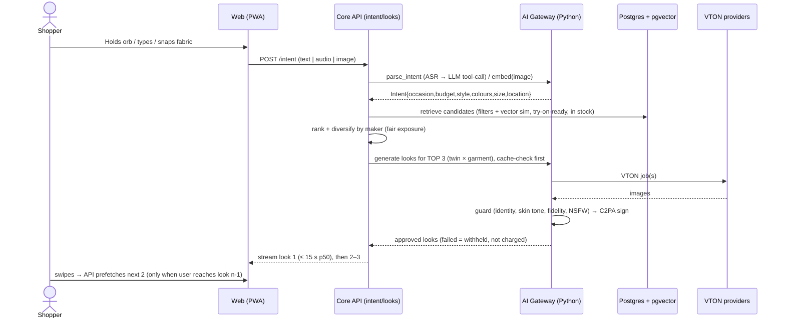
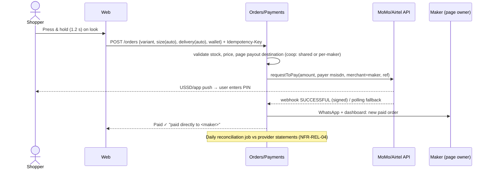
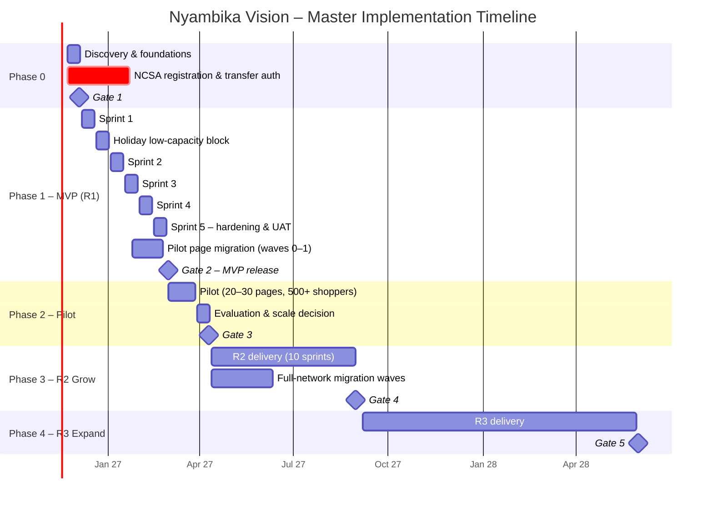

# Nyambika Vision — Implementation Plan

**Phased delivery plan for the Nyambika Platform and the Nyambika Vision 2.0 AI-native experience**

| | |
|---|---|
| Document ID | NYA-IMP-001 |
| Version | 1.0 (Baseline for approval) |
| Date | 11 November 2026 |
| Prepared by | Project Management Office: Senior Project Manager / Full-stack Lead |
| Inputs | [proposal.md](proposal.md) · [research-report.md](research-report.md) · [feasibility-study.md](feasibility-study.md) · [srs.md](srs.md) (NYA-SRS-001 v1.0) · [Prototype v1](nyambika-vision-customer-prototype.mp4) · [Prototype v2](nyambika-vision-2-ai-native-prototype.mp4) and [screens](prototype-v2/screens/) |
| Status | For steering-committee approval |
| Plan baseline start | **Monday 23 November 2026** |

---

## Table of Contents
1. [Executive Summary](#1-executive-summary)
2. [Scope Baseline and Reconciliation (SRS ↔ Prototype v2)](#2-scope-baseline-and-reconciliation-srs--prototype-v2)
3. [Delivery Approach](#3-delivery-approach)
4. [Solution Architecture for Implementation](#4-solution-architecture-for-implementation)
5. [Phase Plan Overview](#5-phase-plan-overview)
6. [Phase 0: Discovery, Validation and Foundations (W1–W2)](#6-phase-0--discovery-validation-and-foundations-w1w2)
7. [Phase 1: MVP Build, R1 (W3–W14)](#7-phase-1--mvp-build-r1-w3w14)
8. [Phase 2: Pilot and Evaluation (W15–W20)](#8-phase-2--pilot-and-evaluation-w15w20)
9. [Phase 3: R2 "Grow" (Months 6–10)](#9-phase-3--r2-grow-months-610)
10. [Phase 4: R3 "Expand: Immersive and Open" (Months 11–19)](#10-phase-4--r3-expand-immersive-and-open-months-1119)
11. [Phase 5: R4 "Future" (Month 20+)](#11-phase-5--r4-future-month-20)
12. [Work Breakdown: Epics and Backlog](#12-work-breakdown--epics-and-backlog)
13. [Team, Roles and RACI](#13-team-roles-and-raci)
14. [Engineering Standards and DevOps](#14-engineering-standards-and-devops)
15. [Quality Assurance and AI Evaluation Strategy](#15-quality-assurance-and-ai-evaluation-strategy)
16. [Data, Migration and Cutover Plan](#16-data-migration-and-cutover-plan)
17. [Security, Privacy and Compliance Implementation](#17-security-privacy-and-compliance-implementation)
18. [Budget and Resourcing by Phase](#18-budget-and-resourcing-by-phase)
19. [Risk Management (Implementation RAID)](#19-risk-management-implementation-raid)
20. [Governance, Reporting and Change Control](#20-governance-reporting-and-change-control)
21. [KPIs and Success Measures by Phase](#21-kpis-and-success-measures-by-phase)
22. [Appendices](#22-appendices)

---

## 1. Executive Summary

### 1.1 What we will build
A **page-based fashion platform**. Nyambika hosts tailors, sewing cooperatives and sellers, and each member owns and manages their own page. The customer experience is the **AI-native v2 design**: *Mirror → Ask/Snap → See it on you → Hold to buy*. It replaces search boxes, lists and checkout forms with a private digital twin, intent from voice or camera, a stream of looks rendered on the shopper, and a single press-and-hold purchase **paid directly to the maker**.

### 1.2 How we will deliver it
| Phase | Window | Outcome | Gate |
|---|---|---|---|
| **0 · Discovery and foundations** | W1–W2 (23 Nov – 4 Dec 2026) | Local AI benchmark, member LOIs, NCSA filing, page inventory, repo and CI skeleton | **Gate 1:** approve build |
| **1 · MVP build (R1)** | W3–W14 (7 Dec 2026 – 26 Feb 2027) | 5 sprints + holiday low-capacity block: modernised member pages, photo twin, Muse intent (text + RW voice beta), Looks stream, hold-to-buy, member studio, admin, migration | **Gate 2:** approve pilot |
| **2 · Pilot and evaluation** | W15–W20 (1 Mar – 9 Apr 2027) | 20–30 member pages, 500+ shoppers, KPIs measured | **Gate 3:** scale or pivot |
| **3 · R2 "Grow"** | Months 6–10 (Apr – Aug 2027) | Live morph, tailor custom orders, Ask-your-circle, wardrobe, 3D garment + AR view, full Kinyarwanda voice Muse, optional checkout | Gate 4 |
| **4 · R3 "Expand"** | Months 11–19 (Sep 2027 – May 2028) | 3D twin + AR mirror, 3D Maker Space shelf, VR showroom, agentic commerce, native shell + live activities, EAC readiness | Gate 5 |
| **5 · R4 "Future"** | Month 20+ | Physics drape, fit heatmaps, tailor pattern-to-3D, local fine-tuned model | — |

### 1.3 Key numbers
| Item | Value |
|---|---|
| Time to MVP release (Gate 2) | **14 calendar weeks** (12 working weeks + 2-week holiday low-capacity block) |
| Time to scale decision (Gate 3) | **20 calendar weeks** → 9 April 2027 |
| Phase 0–2 budget | **≈ US$52,900** (feasibility baseline, unchanged). The US$3,600 holiday extension and ~US$800 v2 AI services are drawn from contingency (§18). |
| Core team (Phase 1) | 8 roles / ~7.5 FTE (PM, Tech Lead, Full-stack, Frontend, AI Engineer, UI/UX, QA 0.5, Member Success) |
| R2 / R3 indicative gross cost | ≈ US$42k / ≈ US$91k (§18) |

### 1.4 Decisions requested
1. Approve **Phase 0** start on 23 Nov 2026.
2. Approve the **scope reconciliation** in §2 and raise **SRS v1.1** change requests CR-01 to CR-09.
3. Approve the **calendar extension** of Gate 2 from 15 Feb to **1 Mar 2027** (holiday period), funded from contingency.
4. Confirm the **hosting location decision owner and deadline** (OI-03, due end of Phase 0).

---

## 2. Scope Baseline and Reconciliation (SRS ↔ Prototype v2)

The SRS (v1.0) was written before the v2 interaction redesign. The v2 design changes **how** features are experienced, and moves some capabilities earlier. This section is the agreed bridge. Each change becomes a formal **change request (CR)** against the SRS.

### 2.1 v2 experience mapped to releases
| v2 moment | R1 (MVP) implementation | R2 | R3 |
|---|---|---|---|
| **1 · Mirror** (private twin) | **Photo twin:** guided capture of 1–2 full-body photos with on-device pose and quality checks. Stored encrypted and reused for every look until deleted. Inline consent. | Multi-photo twin with better fidelity, plus a measurement profile linked to the twin | **3D twin** (3DGS/SMPL-X), 360° turn capture as in the prototype |
| **2 · Ask** (Muse) | Muse orb with **text intent (RW/EN/FR)** and **Kinyarwanda/English voice (beta flag)** → structured intent chips | Full voice Muse (RW/EN/FR, ASR + TTS), conversational refinement, calendar-aware (opt-in) | Muse on WhatsApp, agentic actions |
| **2 · Snap** | **Snap a fabric or outfit** → visual similarity over member catalogues (server embeddings, on-device crop) | On-device recognition, live reticle | — |
| **3 · Looks on you** | Full-screen vertical **Looks stream** on the twin. Swipe up/down, double-tap save. Maker card on every look. Progressive generation (top 3, then prefetch). | Ranking personalisation, outfit combinations | Video "see it move" looks |
| **3 · Morph** | **Colour ring snaps to the maker's real variants** (discrete) | **Free live recolour + length/sleeve morph** for tailor templates → custom order | Generative edits on video/3D |
| **3 · Spin / AR mirror** | — (static before/after) | 3D garment viewer + AR "view in your space" (model-viewer) | **3D twin spin + live AR mirror** |
| **3 · Ask your circle** | Share to WhatsApp (watermarked deep link) | **Live poll** with friends' votes | — |
| **3 · Maker Space** | **Maker Space v1** = member page modernised: story header, 2D coverflow collection, follow, WhatsApp chat | Book a fitting, stories, reviews with photos | **3D collection shelf**, VR booth |
| **4 · Hold to buy** | **Press-and-hold** with auto-filled size (from twin + size chart), delivery and wallet → **MoMo/Airtel push** to the maker's merchant account (PIN on handset) | Passkey confirmation before the push, optional Nyambika checkout (legal-cleared) | Agent-initiated orders with user mandate |
| **After · Ambient** | WhatsApp + web push order updates, simple order timeline | **Digital wardrobe** + AI restyling | Native shell with **live activities / lock-screen widgets** |

### 2.2 Change requests against SRS v1.0
| CR | Change | SRS refs affected | Impact |
|---|---|---|---|
| **CR-01** | Customer IA: replace the tab bar, directory-first home and product grids with **Muse + Looks stream + Maker Space**. The directory remains as a secondary "Browse makers" view and as SEO pages. | FR-DIR-01/06, UI-01/07, §12.3 | UX rework. Same backend capabilities. |
| **CR-02** | Introduce a **persistent photo twin** in R1. It is retained until the user deletes it, which differs from the 30-day default for one-off try-on photos, and needs specific consent. | FR-TRY-01–03, FR-PRV-02, §8.2 | New data class "Twin (2D)". DPIA update. Consent copy. |
| **CR-03** | Move **text intent (Muse)** and **RW/EN voice (beta)** from R2 to R1. | FR-AST-01/04, FR-DIR-05 | AI integration effort +1 sprint-equivalent, absorbed by trimming R1 "Could" items. |
| **CR-04** | Move **visual search (Snap)** from R2 to R1 (server-side embeddings). | FR-DIR-04 | pgvector + embedding pipeline in R1 |
| **CR-05** | Add **Looks stream** with **progressive generation and cost guardrails** (§4.4). | FR-TRY-05/13/17, NFR-CST-01 | Cost-critical. New metering rules. |
| **CR-06** | Replace the multi-step order form with **hold-to-buy** using auto-filled defaults. Explicit confirmation remains via the hold gesture plus the MoMo PIN. | FR-ORD-01–04 | UX change. Same order states. |
| **CR-07** | Rename member page → **Maker Space** in the customer UI. Member-side "Page manager" naming unchanged. | FR-PAGE-01–04 | Copy/UX only. OP-1–6 unchanged. |
| **CR-08** | Defer the free-form colour ring and length/sleeve morph to **R2**. R1 snaps to existing variants. | FR-TRY-09, FR-TRY-16 | Reduces R1 risk |
| **CR-09** | Add the **Ask-your-circle live poll** (R2) and **digital wardrobe** (R2) as new requirements. | New FR-SOC-01..03, FR-WRD-01..03 | R2 scope |

> **Unchanged and binding:** operating principles OP-1 to OP-6 (member owns page, pay the maker directly, shopper photos/twin never shared with makers), all compliance requirements (CMP-01 to CMP-16), the AI benchmark and runtime guard (AI-BM, AI-GD), and C2PA labelling (AI-TR-01).

### 2.3 R1 scope (MoSCoW, post-reconciliation)
| Must | Should | Could | Won't (R1) |
|---|---|---|---|
| Phone OTP auth and roles · Member page manager · Cooperative pages and maker attribution · Catalogue with AI image checks + background removal · **Photo twin + consent** · **Muse text intent** · **Snap visual search** · **Looks stream** (progressive, guarded, C2PA) · Variant colour ring · Maker Space v1 · **Hold-to-buy** → MoMo/Airtel push to maker · WhatsApp ordering fallback · Page plans + metering · Member analytics · Host admin + moderation · Privacy centre · Migration · SEO maker pages | **RW/EN voice Muse (beta flag)** · AI product studio (on-model photos) · AI listing writer · AI-model avatars for users without a twin · Sponsored plans | Web push notifications · Size recommendation from size chart | Free recolour/morph · 3D/AR · Circle poll · Wardrobe · VR · 3D twin · Agentic APIs · Central checkout · Stripe · Native shell |

---

## 3. Delivery Approach

### 3.1 Method
- **Hybrid stage-gate + Scrum.** The steering committee governs investment through gates (§20). Delivery runs in **2-week sprints** with a fixed cadence.
- **Vertical slices:** each sprint delivers end-to-end, demo-able increments across UI, API, AI and data.
- **Feature flags** for anything risky (voice, new providers, Looks stream ranking), so we can deploy daily and release deliberately.
- **Dual-track agile:** the designer and PM run discovery (tests with members and shoppers) one sprint ahead of delivery.
- **Member co-design:** member representatives (tailor, cooperative, seller) join sprint reviews every 2 weeks.

### 3.2 Sprint cadence
| Ceremony | When | Duration | Participants |
|---|---|---|---|
| Sprint planning | Monday, sprint start | 2 h | Delivery team, PM |
| Daily stand-up | Daily 9:00 | 15 min | Delivery team |
| Backlog refinement | Wednesday, week 1 | 1 h | PM, Tech Lead, Designer, QA |
| Design critique | Thursday | 45 min | Designer, Frontend, PM |
| Sprint review / demo | Friday, week 2 | 1 h | Team + member reps + sponsor |
| Retrospective | Friday, week 2 | 45 min | Delivery team |
| AI quality review | Friday, week 2 | 30 min | AI Eng, QA, DPO (monthly) |

### 3.3 Definition of Ready (DoR)
Story has: user value, acceptance criteria (Given/When/Then), UX designs (Figma) incl. RW/EN/FR copy, API contract draft, analytics events named, privacy impact flagged, size estimate.

### 3.4 Definition of Done (DoD)
Code reviewed (≥1 approver) · unit + integration tests green · E2E for critical paths · accessibility (axe, no critical issues) · translated RW/EN/FR · feature-flagged if risky · telemetry events firing · security checklist passed · docs/ADR updated · deployed to staging · PO accepted. This is aligned with SRS §13.3.

---

## 4. Solution Architecture for Implementation

### 4.1 Technology decisions (implementation level)
| Layer | Choice | Rationale |
|---|---|---|
| Monorepo | **pnpm workspaces + Turborepo** | Shared types, one CI, fast builds |
| Customer and member web app | **Next.js (App Router), React + TypeScript, Tailwind**, installable **PWA** | SSR for SEO Maker Spaces (FR-DIR-10), React per CON-07, PWA for low-end Android |
| Motion and gestures | Framer Motion + `@use-gesture/react` | Swipe, hold and drag interactions of v2 |
| On-device vision | MediaPipe Tasks (Pose / Image Segmenter) via WASM/WebGPU | Twin capture checks, background removal (privacy and cost) |
| 3D / AR (R2+) | `<model-viewer>`, Three.js / React Three Fiber, WebXR | Open standards (ADR-05/06) |
| Core API | **NestJS** (modular monolith), REST + OpenAPI 3.1, Zod/class-validator | ADR-01, team skills |
| AI services | **Python 3.12, FastAPI** (AI Gateway), **arq/Celery** workers, Redis streams | ADR-04/07 |
| Database | **PostgreSQL 16** + **pgvector**, row-level security per page | ADR-02/08 |
| Cache / queue | Redis (BullMQ on the Node side, streams to Python) | Async jobs, rate limits |
| Object storage | S3-compatible (MinIO in a Rwanda DC, or an authorised cloud region per OI-03), SSE-KMS | Data residency (DR-01) |
| Search | Postgres full-text (multilingual dictionaries) + pgvector. Re-evaluate at R3. | Simplicity |
| Auth | Phone OTP (SMS + WhatsApp), JWT access + rotating refresh, WebAuthn passkeys (R2) | FR-ACC-01/02 |
| Payments | MTN MoMo Collections, Airtel Money (direct or via aggregator) | ADR-09 |
| Messaging | WhatsApp Cloud API, local SMS gateway, Web Push | SI-03/04 |
| Content credentials | `c2pa` (Rust) via the Python binding / c2patool, keys in KMS | AI-TR-01 |
| Feature flags | GrowthBook or Unleash (self-hosted) | Progressive release |
| Observability | OpenTelemetry → Grafana (Loki/Tempo/Prometheus) + Sentry | NFR-MNT-05 |
| IaC / runtime | Terraform + Docker. Managed Kubernetes or a container platform (decided with hosting, OI-03). | Portability |
| CI/CD | GitHub Actions, preview environments per PR | NFR-MNT-03 |

### 4.2 Repository structure
```
nyambika/
├─ apps/
│  ├─ web/                 # Next.js PWA: customer (Muse, Looks, Maker Space) + member Page Manager
│  ├─ admin/               # Host admin console (Next.js, separate auth realm)
│  ├─ api/                 # NestJS core: identity, pages, coops, catalogue, orders, billing, privacy
│  └─ ai/                  # FastAPI AI Gateway + workers: VTON, guard, C2PA, embeddings, Muse, ASR
├─ packages/
│  ├─ ui/                  # Design system (tokens, components, motion primitives) – RW/EN/FR safe
│  ├─ contracts/           # OpenAPI spec + generated TS/Python clients, job schemas (JSON Schema)
│  ├─ i18n/                # Kinyarwanda/English/French message catalogues
│  ├─ config/              # ESLint, TS, Tailwind presets
│  └─ test-utils/          # Fixtures, factories, synthetic personas
├─ infra/                  # Terraform, Helm/compose, environments, secrets templates
├─ evals/                  # Nyambika Local Benchmark (NLB) harness, LLM eval sets, reports
├─ docs/                   # ADRs, runbooks, API docs (this folder links back)
└─ .github/workflows/      # CI/CD pipelines
```

### 4.3 Core module map (NestJS)
| Module | Responsibilities | Key entities |
|---|---|---|
| `identity` | OTP, sessions, roles per page, passkeys | User, RoleAssignment, Session |
| `pages` | Page manager, Maker Space data, verification, themes | Page, PageProfile, Verification |
| `coops` | Members, approvals, attribution, payout destinations | Cooperative, CoopMember, Attribution |
| `catalogue` | Products, variants, media, size charts, try-on readiness | Product, Variant, MediaAsset, SizeChart |
| `twin` | Twin capture sessions, consent link, lifecycle (create/replace/delete) | Twin, TwinAsset, ConsentRecord |
| `intent` | Muse sessions, intent objects, retrieval and ranking for Looks | IntentSession, Intent, LookCandidate |
| `looks` | Look generation orchestration, caching, feed state, saves | Look, Generation, Save |
| `orders` | Hold-to-buy, order lifecycle, disputes, reviews | Order, OrderItem, Payment, Review |
| `payments` | MoMo/Airtel adapters, webhooks, reconciliation | PaymentRequest, Settlement |
| `billing` | Plans, allowances, metering, invoices | Plan, Subscription, UsageEvent |
| `messaging` | WhatsApp, SMS, push templates and preferences | Notification, Template |
| `privacy` | Consent ledger, DSAR workflow, deletion cascade | ConsentRecord, DSAR, DeletionJob |
| `admin` | Moderation queues, model registry UI, feature flags | ModerationItem, AuditLog |
| `analytics` | Event ingestion, member dashboards | Event (warehouse) |

### 4.4 Critical flow: Ask → Looks stream (with cost guardrails)

**Cost guardrails (CR-05):**
- **Progressive generation:** 3 on intent, then +2 per swipe beyond look 2. No speculative batch of 9.
- **Cache key** = hash(twin version, garment variant, model version). Re-views are free.
- **Daily per-user generation cap** (default 15). The free weekly quota and plan allowances follow FR-PLAN-03.
- **Preview tier first** (cheaper/faster model), **HD on save/share/hold**.
- **Budget kill-switch** per provider and per day (NFR-CST-02).
- **KPI:** generations per completed order ≤ 15 (feasibility break-even ≈ 17).

### 4.5 Critical flow: Hold to buy


### 4.6 Environments
| Env | Purpose | Data | Deploy |
|---|---|---|---|
| Local | Developer machines (docker compose) | Synthetic | — |
| Preview | Per pull request | Synthetic seed | Auto on PR |
| Dev | Integration of main branch | Synthetic | Auto on merge |
| Staging | Prod-like, UAT, performance and security tests | Synthetic + consented test personas | Manual promote (tagged release) |
| Production | Pilot and live. Pilot via allowlist flags. | Real (NCSA-authorised) | Manual, change-approved, canary |

> **Rule:** no real personal images outside production. Twin and VTON testing in non-prod uses consented NLB subjects in the isolated research store, or synthetic personas.

---

## 5. Phase Plan Overview

### 5.1 Master timeline


### 5.2 Gate criteria summary
| Gate | Date | Pass criteria (summary) | Source |
|---|---|---|---|
| **G1** | 4 Dec 2026 | NLB ≥ 70% acceptable (≥ 60% patterned, ≤ 2% identity/skin-tone alteration) · ≥ 20 member LOIs (≥ 3 coops) · NCSA filed + counsel transfer path · provider ≤ RWF 120/gen · page inventory done | Feasibility §11 |
| **G2** | 1 Mar 2027 | R1 Musts accepted · no open critical/high defects · pen test passed · DPIA signed · NCSA certificate (or approved closed-pilot protocol) · pilot pages migrated and signed off · p50 first look ≤ 15 s | §7.8 |
| **G3** | 9 Apr 2027 | Pilot KPIs (§21) met or explained · unit economics within break-even path · zero privacy incidents | Feasibility §11 |
| **G4** | 30 Aug 2027 | R2 KPIs · full network migrated · paid page conversion trend · voice WER target | §9 |
| **G5** | 31 May 2028 | R3 KPIs · EAC readiness · funding secured for scale | §10 |

---

## 6. Phase 0: Discovery, Validation and Foundations (W1–W2)

**Dates:** 23 Nov – 4 Dec 2026 · **Goal:** retire the three highest risks (bias/quality, regulatory, demand) before committing build funds, and stand up the engineering foundations.

### 6.1 Workstreams and deliverables
| # | Workstream | Activities | Deliverable | Owner |
|---|---|---|---|---|
| 0.1 | **AI benchmark (NLB)** | Recruit ≥ 30 consenting subjects (MST 6–10, varied bodies) · collect ≥ 100 garments (≥ 30% kitenge/patterned) · run 2–3 VTON providers · local panel scoring | NLB report v1, provider shortlist, model registry entries | AI Engineer |
| 0.2 | **Regulatory** | NCSA controller registration + cross-border transfer request · counsel opinion on twin/measurements as sensitive · DPO appointment · DPA templates for providers | Filing receipt, legal memo, DPO letter | PM + Counsel |
| 0.3 | **Member validation** | Page inventory (all existing pages) · 20–30 member interviews (≥ 5 coops) · LOIs · pricing test | Inventory sheet, interview synthesis, ≥ 20 LOIs | PM + Member Success |
| 0.4 | **Shopper validation** | Test the v2 prototype video and clickable flows with 15 shoppers · survey (n≈200) on twin consent and voice | Usability findings, consent-copy v1 | UI/UX |
| 0.5 | **Payments discovery** | MTN MoMo + Airtel sandbox, aggregator comparison, merchant onboarding steps for members | Payments decision record | Tech Lead |
| 0.6 | **Hosting decision (OI-03)** | Compare Rwanda DC vs authorised region (cost, latency, compliance) | ADR-H01 hosting | Tech Lead + DPO |
| 0.7 | **Engineering foundations** | Monorepo, CI, lint/test, preview envs, IaC skeleton, auth skeleton, design tokens | "Walking skeleton" deployed to dev | Tech Lead |
| 0.8 | **Design system** | Tokens (v2 aurora theme + accessible light mode), motion and gesture specs, RW-length layouts | `packages/ui` v0.1, Figma library | UI/UX + Frontend |
| 0.9 | **Backlog and plan** | Epics → stories for Sprints 1–2, estimates, risk log | Ready backlog, RAID log | PM |

### 6.2 Phase 0 exit (Gate 1) checklist
- [ ] NLB thresholds met by at least one provider (or a documented remediation and re-test date).
- [ ] ≥ 20 LOIs (≥ 3 cooperatives), ≥ 10 willing to pay ≥ RWF 15,000/month.
- [ ] NCSA application filed. Counsel confirms a viable transfer/storage path.
- [ ] Provider cost ≤ RWF 120 per generation confirmed in writing.
- [ ] Page inventory complete, with the migration approach for the pilot cohort agreed.
- [ ] Walking skeleton live on dev (login → empty page manager).
- [ ] Hosting ADR approved.

**No-go paths:** If quality fails, switch provider, restrict garment categories and re-test within 2 weeks. If demand fails, go to Option C (member page tools + AI product studio only, no shopper try-on).

---

## 7. Phase 1: MVP Build, R1 (W3–W14)

**Dates:** 7 Dec 2026 – 26 Feb 2027 · **Goal:** a production-ready R1 delivering the v2 core loop for shoppers, plus the member and host tools needed to run a pilot.

### 7.1 Sprint plan
| Sprint | Dates | Sprint goal | Key deliverables (epics) | Demo |
|---|---|---|---|---|
| **S1** | 7–18 Dec | *Members can exist and manage a page* | Identity + OTP + roles (E01) · Page manager CRUD + Maker Space v1 read-only (E02) · Cooperative model + attribution (E03) · catalogue basics + media pipeline (E04) · AI Gateway skeleton + provider adapter A (E08) | A tailor creates a page and products on a phone. Coop admin approves a member's item. |
| **Holiday block** | 21 Dec – 1 Jan | *Low capacity (~40%)* | Tech-debt, test coverage, IaC hardening, i18n catalogue, NCSA follow-ups, migration scripts draft (E17) | — |
| **S2** | 4–15 Jan | *Twin + first look on you* | **Twin capture** (on-device checks, consent, encrypted storage) (E06) · VTON via gateway, **guard v1**, **C2PA** (E08, E09) · garment readiness checks + background removal (E04) · metering events (E13) | Shopper creates a twin and gets a guarded, labelled look for one product. |
| **S3** | 18–29 Jan | *Ask & Snap → Looks stream* | **Muse text intent** (LLM tool-calling → intent chips) (E07) · **Snap visual search** (embeddings + pgvector) (E07) · retrieval and ranking with maker diversity (E07) · **Looks stream** UI (swipe, save, maker card) + progressive generation and cache (E10) · RW/EN voice beta behind flag (E07) | "Wedding outfit under 50k" → 3 looks on the twin from 3 makers in ≤ 15 s p50 |
| **S4** | 1–12 Feb | *Hold to buy, paid to the maker* | **Hold-to-buy** + auto-filled defaults (E11) · MoMo/Airtel adapters, webhooks, reconciliation (E12) · order lifecycle + WhatsApp notifications (E11, E14) · member order inbox + analytics v1 (E15) · plans and allowances (E13) · **pilot migration wave 0** (E17) | Real sandbox payment to the maker's merchant account. Maker receives the WhatsApp order. |
| **S5** | 15–26 Feb | *Harden, comply, accept* | Privacy centre + deletion cascade (E16) · host admin, moderation, model registry (E18) · AI product studio (Should) (E05) · performance budget, a11y, localisation QA · pen test fixes · DPIA sign-off · **UAT with member reps** · migration wave 1 | Go/no-go rehearsal, runbooks, on-call ready |

### 7.2 Phase 1 capacity model
| Role | FTE | Focus |
|---|---|---|
| Tech Lead (senior full-stack) | 1.0 | Architecture, API core, payments, security, code review |
| Full-stack Developer | 1.0 | Pages, coops, catalogue, orders, migration |
| Frontend / PWA Developer | 1.0 | Muse, Looks stream gestures, twin capture UI, Maker Space, performance |
| AI Engineer | 1.0 | Gateway, VTON adapters, guard, C2PA, embeddings, Muse intent, NLB |
| UI/UX Designer | 1.0 → 0.5 (from S4) | v2 flows, design system, usability tests, RW copy |
| QA Engineer | 0.5 | Test strategy, automation, device lab, UAT |
| Project Manager | 1.0 | Plan, RAID, stakeholders, gates, compliance tracking |
| Member Success Officer | 1.0 (from S3) | Pilot recruitment, page migration support, training |

**Velocity planning assumption:** ~34 story points per sprint for 4 engineers (calibrated after S1). The holiday block is planned at 40% capacity with no feature commitments.

### 7.3 Phase 1 critical path
1. **Twin + VTON + guard (S2)** → **Looks stream (S3)** → **Hold-to-buy (S4)**. These are strictly sequential, so any slip moves Gate 2.
2. **NCSA certificate** (filed W1, expected by ~W9). It's needed before real twins are processed in production (pilot).
3. **MoMo production credentials** (applied S1, needed S4). Fallback: maker's own merchant code + WhatsApp ordering.
4. **Pilot page migration** (waves 0–1, S3–S5). Owner sign-off is required before the pilot.

### 7.4 R1 functional coverage (SRS traceability)
| Epic | SRS requirements |
|---|---|
| E01 Identity & roles | FR-ACC-01, 03–10 |
| E02 Pages / Maker Space v1 | FR-PAGE-01–04, 06–08, 11, OP-1–6 |
| E03 Cooperatives | FR-COOP-01–06, 10 |
| E04 Catalogue & readiness | FR-CAT-01–08 |
| E05 AI product studio | FR-PHO-01–06 |
| E06 Twin (photo) | FR-TRY-01–04, FR-PRV, CR-02 |
| E07 Muse & Snap | FR-AST-01/02 (text), FR-AST-04 (beta), FR-DIR-04/05, CR-03/04 |
| E08 AI Gateway | AI-GW-01–05 |
| E09 Guard, C2PA, NLB | AI-BM-01–05, AI-GD-01–05, AI-TR-01–03, 06 |
| E10 Looks stream | FR-TRY-05–15, 17, CR-05 |
| E11 Orders / hold-to-buy | FR-ORD-01–06, 09–11, CR-06 |
| E12 Payments | FR-ORD-02, SI-01/02, NFR-REL-04 |
| E13 Plans & metering | FR-PLAN-01–08 |
| E14 Messaging | FR-ORD-05, SI-03/04 |
| E15 Analytics | FR-ANL-01, 02, 04, 05 |
| E16 Privacy centre | FR-PRV-01–07, CMP-01–05 |
| E17 Migration | FR-MIG-01–05 |
| E18 Host admin & moderation | FR-ADM-01–07 |
| E19 Platform & NFRs | NFR-PERF, SEC, REL, USE, MNT |
| E20 SEO & directory (secondary) | FR-DIR-01–03, 07, 10 |

### 7.5 Phase 1 non-functional targets (release blockers)
| Area | Target |
|---|---|
| First look on twin | p50 ≤ 15 s, p95 ≤ 30 s |
| Maker Space / Looks shell | LCP ≤ 2.5 s (p75) on the reference 3 GB Android at 1.5 Mbps |
| JS budget | Customer routes ≤ 170 KB gz initial |
| Availability | ≥ 99.5% core |
| Security | OWASP ASVS L2. No critical/high pen-test findings open. |
| Accessibility | WCAG 2.2 AA on core flows |
| AI | Guard failure ≤ 2%, success after guard ≥ 95%, cost ≤ RWF 120/gen |

### 7.6 Gate 2 readiness checklist
- [ ] All R1 "Must" stories accepted. "Should" items released or descoped with PO sign-off.
- [ ] E2E suite green on staging. Performance and a11y reports attached.
- [ ] Pen test: no open critical/high findings. Medium findings have dated fixes.
- [ ] DPIA approved by DPO. Consent copy (RW/EN/FR) approved by counsel.
- [ ] NCSA certificate received (or approved closed-pilot protocol).
- [ ] Provider DPAs signed (zero retention, no training).
- [ ] Pilot cohort pages migrated and signed off. Old links redirect.
- [ ] Runbooks, on-call rota, incident and breach-notification playbooks.
- [ ] Rollback plan rehearsed. Feature flags verified (voice beta off by default).

---

## 8. Phase 2: Pilot and Evaluation (W15–W20)

**Dates:** 1 Mar – 9 Apr 2027

### 8.1 Pilot design
| Element | Plan |
|---|---|
| Cohort | 20–30 existing members: ≥ 8 tailors, ≥ 8 sellers, ≥ 3 cooperatives. Free Pro plan during the pilot. |
| Shoppers | 500+ in Kigali, recruited via members' WhatsApp/Instagram, 5–10 creators and a launch event |
| Release | Production with **allowlist flags**. Voice beta for 25% of the cohort (A/B). |
| Support | Member Success on-site, WhatsApp support line, weekly cooperative clinics |
| Experiments | (1) Progressive generation 3 vs 2 initial looks · (2) Twin vs no-twin (AI model avatars) · (3) Voice vs text Muse |
| Data | Funnel analytics, cost per order, guard failures by subgroup, NPS, member interviews (weeks 2 and 4) |

### 8.2 Hypercare (first 14 days)
Daily triage 9:00 · P1 response 30 min / fix-or-mitigate 4 h · daily cost and guard dashboard review · twice-weekly member check-ins.

### 8.3 Evaluation (W19–W20)
- KPI report against §21 targets, with unit economics recomputed from real data (feasibility §10).
- Qualitative synthesis (members and shoppers).
- **Gate 3 options:** *Scale* (start R2 + network migration) · *Iterate* (one more 4-week pilot cycle) · *Pivot* (Option C member tools).

---

## 9. Phase 3: R2 "Grow" (Months 6–10)

**Dates:** 12 Apr – 27 Aug 2027 (10 sprints) · **Theme:** deepen the v2 experience and grow the member network.

### 9.1 Scope
| Epic | Deliverable | SRS / CR |
|---|---|---|
| E21 Full-network migration | All remaining member pages migrated in waves. Basic pages for non-adopters. | FR-MIG-04/05 |
| E22 **Voice Muse GA** | RW/EN/FR ASR + TTS, conversational refinement, calendar-aware (opt-in), ≤ 12% WER domain target | FR-AST-04/05/06/07 |
| E23 **Live morph** | Free recolour ring + length/sleeve morph on tailor templates → priced custom order | CR-08, FR-TRY-16 |
| E24 **Tailor custom orders** | Quote → deposit → fittings → status. Measurement share. Appointment booking. | FR-SIZE-04–07 |
| E25 **Ask your circle** | Private live poll with friends' votes and comments | CR-09 |
| E26 **Digital wardrobe** | Owned + saved looks, AI restyling for events | CR-09 |
| E27 **3D garment + AR view** | Image-to-3D pipeline (GLB/USDZ), `<model-viewer>`, AR Quick Look / Scene Viewer / WebXR | FR-3D-01–08, FR-AR-01/02/04/05 |
| E28 Motion preview | "See it move" 3–5 s clips (premium credit) | FR-VID-01/02/04–06 |
| E29 Passkeys + optional checkout | WebAuthn before payment push. Central checkout only after BNR legal sign-off. | FR-ACC-02, FR-ORD-07, CMP-08 |
| E30 Member growth tools | Stories, social kits, bulk AI auto-fill, catalogue feeds (Google/Meta), weekly AI insights | FR-PAGE-05, FR-PHO-07, FR-CAT-09, FR-AGT-07, FR-ANL-03 |
| E31 Low-literacy coop flows | Voice-guided product add in Kinyarwanda, SMS notifications, monthly coop statements | FR-COOP-07–09 |
| E32 Size recommendation | Profile ↔ size chart mapping with fit notes | FR-SIZE-02 |

### 9.2 Team changes
+1 Full-stack (growth/member tools) · +0.5 3D/Graphics contractor (E27) · Designer back to 1.0 · QA to 1.0.

### 9.3 Gate 4 criteria
Full network migrated (≥ 95% of active pages) · paid page conversion ≥ 30% of active members · voice WER ≤ 12% · try-ons per order ≤ 12 · R2 NPS ≥ 40.

---

## 10. Phase 4: R3 "Expand: Immersive and Open" (Months 11–19)

**Dates:** 6 Sep 2027 – 31 May 2028

### 10.1 Scope
| Epic | Deliverable | SRS refs |
|---|---|---|
| E33 **3D twin** | 360° turn capture (as in prototype v2), animatable 3DGS avatar on SMPL-X, separate consent, NLB avatar extension | FR-AVA-01–06 |
| E34 **3D try-on + AR mirror** | Garments on the 3D twin, live AR mirror with on-device tracking | FR-FIT-01/04, FR-AR-03/06 (pilot) |
| E35 **Maker Space 3D shelf + VR showroom** | 3D shelf, WebXR showroom (Quest, Android XR, Vision Pro), virtual fashion shows | FR-VR-01–05, 07, 08 |
| E36 **Agentic commerce** | Public catalogue API, UCP/ACP endpoints, MCP server, user-mandate confirmation | FR-AGT-01–05, 08 |
| E37 Try-on as a Service (B2B) | Partner API with metering and contracts | FR-AGT-06 |
| E38 **Native shell** | Capacitor app (iOS/Android), push, **live activities / widgets** | ADR-03, ambient moment |
| E39 Video try-on | Direct video VTON when a licensed provider passes the NLB | FR-VID-03 |
| E40 Export & DPP readiness | Stripe, multi-currency, provenance passport pages (QR), DPP-extensible model | FR-ORD-08, FR-DPP-01–04 |
| E41 EAC multi-region | Region attribute per page, residency per country, KES/UGX/TZS | NFR-SCL-04 |
| E42 Self-hosted inference | Permissive models on GPU for cost and residency | AI-GW-07 |

### 10.2 Team changes
+1 3D/XR Engineer (full-time) · +1 Mobile/native (0.5) · AI Engineer ×2 · Data/ML analyst (0.5) · Country launch lead (contract) for the first EAC market.

### 10.3 Gate 5 criteria
3D twin NLB pass · ≥ 15% of active shoppers use 3D/AR monthly · agent channel live with ≥ 1 partner · first EAC market soft-launched · funding secured for scale.

---

## 11. Phase 5: R4 "Future" (Month 20+)
Physics-based drape and **fit heatmaps** (pattern-based garments) · **tailor pattern-to-3D** custom previews · mixed-reality fitting mirror · multi-user VR events · **fine-tuned local model** on consented African garment data · advanced trend insights for members. Each item starts with a spike and an NLB-style evaluation before commitment.

* **Spike 1, physics drape + fit heatmaps + tailor pattern-to-3D (Nov 2026):** flag-gated CPU prototype, NLB-style harness on synthetic bodies S..3XL. Outcome **Iterate**; see [`docs/spikes/r4-drape-pattern-3d.md`](spikes/r4-drape-pattern-3d.md).
* **Spike 2, fine-tuned local model on consented garment data + advanced trend insights (Nov 2026):** consent-ledger opt-in, versioned manifests with tombstones and PII screen, CPU attribute model with per-head release behind `ml.local_attr_spike`, k-anonymous trends card behind `insights.trends_spike`. Outcome **Go** (pilot behind flags) for data governance and trends, **Iterate** for the model; see [`docs/spikes/r4-local-model-trends.md`](spikes/r4-local-model-trends.md).

---

## 12. Work Breakdown: Epics and Backlog

### 12.1 R1 epics with estimates
| ID | Epic | Size | Est. person-days | Sprint(s) | Lead |
|---|---|---|---|---|---|
| E01 | Identity, OTP, roles | M | 10 | S1 | Tech Lead |
| E02 | Page manager + Maker Space v1 | L | 18 | S1–S2 | Full-stack / Frontend |
| E03 | Cooperatives + attribution + payout destinations | M | 10 | S1, S4 | Full-stack |
| E04 | Catalogue, media pipeline, try-on readiness, background removal | L | 16 | S1–S2 | Full-stack / AI |
| E05 | AI product studio (Should) | M | 8 | S5 | AI / Frontend |
| E06 | Photo twin capture + consent + encrypted lifecycle | L | 14 | S2 | Frontend / Tech Lead |
| E07 | Muse (text + voice beta) + Snap + retrieval/ranking | XL | 22 | S3 | AI / Frontend |
| E08 | AI Gateway (adapters, routing, cache, metering, kill-switch) | L | 15 | S1–S2 | AI |
| E09 | Guard + C2PA + NLB harness + model registry | L | 15 | P0, S2, S5 | AI / QA |
| E10 | Looks stream (gestures, progressive gen, saves, sharing) | L | 16 | S3 | Frontend / AI |
| E11 | Orders + hold-to-buy + disputes + reviews | L | 14 | S4 | Full-stack / Frontend |
| E12 | Payments (MoMo, Airtel, webhooks, reconciliation) | L | 14 | S1 (sandbox), S4 | Tech Lead |
| E13 | Plans, allowances, metering, invoices | M | 10 | S2, S4 | Full-stack |
| E14 | Messaging (WhatsApp, SMS, push) | M | 8 | S4 | Tech Lead |
| E15 | Member analytics v1 | M | 7 | S4 | Full-stack |
| E16 | Privacy centre + DSAR + deletion cascade | M | 10 | S5 | Tech Lead |
| E17 | Migration tooling + waves 0–1 | M | 10 | Holiday, S4–S5 | Full-stack + Member Success |
| E18 | Host admin, moderation, feature flags, audit | M | 10 | S5 | Full-stack |
| E19 | Platform: IaC, CI/CD, observability, perf, security hardening | L | 18 | P0–S5 | Tech Lead |
| E20 | SEO Maker Spaces + secondary "Browse makers" | S | 5 | S5 | Frontend |
| | **Total engineering estimate** | | **≈ 260 person-days** | | |

**Capacity check:** 4 engineers × ~10 working days × 5 sprints ≈ 200 days, plus the holiday block (~16 days) and Phase 0 (~32 days) ≈ **248 engineering days**. **The gap is about 12 days**, so it's tight. Mitigations, in order:
1. E05 AI product studio (Should) may slip to the start of the pilot.
2. Voice beta (part of E07) may ship dark (flag off) if needed.
3. E20 is minimal.

The PM tracks this on the burn-up from S1. If projected completion is behind by more than 10% at the end of S3, the steering committee decides between descoping and the contingency extension.

### 12.2 Sample user stories (R1, v2-specific)
| ID | Story | Acceptance criteria (abridged) |
|---|---|---|
| US-06.1 | As a shopper, I create my private twin in under 30 s so every look is shown on me. | Given camera permission, when I hold the guided pose, then on-device checks pass (full body, 1 person, light) and an encrypted twin is stored only after explicit consent. Delete removes it from storage, cache and providers within SLA. |
| US-07.2 | As a shopper, I say what I need in Kinyarwanda and see it understood. | Given voice beta on, when I hold the orb and speak, then a transcript and ≥ 3 intent chips (occasion, budget, style) appear within 3 s of release. I can tap a chip to edit it. |
| US-07.4 | As a shopper, I snap a fabric and see makers who work with it. | Similar products from ≥ 2 makers are returned within 4 s, and each result shows its maker. |
| US-10.1 | As a shopper, I swipe through looks rendered on my twin. | First look ≤ 15 s p50. Swipe-up prefetches the next 2. Every look shows the maker card, the AI label and C2PA. Guard-failed looks are never shown or charged. |
| US-11.1 | As a shopper, I hold to buy and pay the maker directly. | Hold ≥ 1.2 s triggers the order with auto size (twin + chart), delivery and wallet. A MoMo push goes to my phone. On success the order shows "paid directly to <maker>" and the maker gets a WhatsApp notification. Idempotent on retry. |
| US-03.3 | As a cooperative admin, I choose where each product's payment goes. | Options are shared coop account or per-maker account. Changes are audit-logged. Payment requests use the configured destination. |

---

## 13. Team, Roles and RACI

### 13.1 Organisation

```mermaid
flowchart TB
    SC[Steering Committee<br/>Sponsor · PM · Tech Lead · Business lead · 3 member reps · DPO]
    SC --> PM[Project Manager]
    PM --> TL[Tech Lead]
    PM --> UX[UI/UX Designer]
    PM --> MS[Member Success]
    PM --> LEG[Counsel & DPO - external]
    TL --> FS[Full-stack Dev]
    TL --> FE[Frontend/PWA Dev]
    TL --> AI[AI Engineer]
    TL --> QA[QA Engineer]
```


### 13.2 RACI (key deliverables)
| Deliverable | Sponsor | PM | Tech Lead | AI Eng | Frontend | Full-stack | UX | QA | DPO/Counsel | Member reps |
|---|---|---|---|---|---|---|---|---|---|---|
| Gate decisions | **A** | R | C | C | I | I | I | C | C | C |
| Scope & backlog | C | **A/R** | C | C | C | C | C | C | I | C |
| Architecture & ADRs | I | C | **A/R** | C | C | C | I | C | C | I |
| NLB & AI quality | I | C | C | **A/R** | I | I | C | R | C | C |
| v2 UX & design system | I | C | C | I | R | I | **A/R** | C | I | C |
| Twin & privacy features | I | C | **A** | R | R | C | C | R | **C (approve)** | I |
| Payments | I | C | **A/R** | I | C | R | I | R | C | C |
| Migration & cutover | C | **A** | R | I | I | R | I | R | I | C |
| NCSA / DPIA / DPAs | I | R | C | C | I | I | I | I | **A/R** | I |
| Pilot operations | C | **A** | C | C | I | I | C | R | C | R |

---

## 14. Engineering Standards and DevOps

### 14.1 Branching and release
- **Trunk-based development** with short-lived feature branches (≤ 2 days) and mandatory PR review.
- Conventional commits, with semantic versioning per app and automated changelog.
- **Release train:** weekly to staging. Production releases on Tuesdays/Wednesdays (never Friday), canary 10% → 100%.
- Hotfix path: branch from the release tag, PR to main, cherry-pick.

### 14.2 CI/CD pipeline
```
PR opened → lint + typecheck → unit tests → build → contract tests (OpenAPI/JSON Schema)
          → SAST (CodeQL/Semgrep) + dependency scan + secret scan → preview deploy
          → E2E smoke (Playwright) + Lighthouse CI (perf budget) + axe (a11y)
merge to main → dev deploy → integration E2E → image signing (cosign) + SBOM
tag release → staging → full E2E + k6 load + DAST (ZAP) → manual approval → prod canary → prod
```

### 14.3 Code quality gates
| Gate | Threshold |
|---|---|
| Unit coverage (domain modules) | ≥ 80% lines |
| Lighthouse (mobile, Looks shell & Maker Space) | Performance ≥ 85, A11y ≥ 95 |
| Bundle size | Customer initial ≤ 170 KB gz (CI fails above) |
| Security scan | No high/critical vulnerabilities unresolved > 7 days |
| API | Every endpoint in the OpenAPI spec. Breaking changes need a version bump. |

### 14.4 Observability and SLOs
| SLO | Target | Alert |
|---|---|---|
| Core API availability | 99.5% monthly | Burn-rate alerts (fast/slow) |
| First-look latency | p50 ≤ 15 s | p50 > 18 s for 15 min |
| Guard failure rate | ≤ 2% | Any subgroup > 2× overall (7-day) |
| Payment webhook success | ≥ 99% | Unreconciled > 0 at daily close |
| AI spend | ≤ daily budget | 80% / 100% thresholds, auto kill-switch at 120% |

### 14.5 Operational runbooks (by Gate 2)
Incident response · provider outage failover · payment reconciliation mismatch · privacy breach (NCSA notification) · deletion request escalation · AI bias alert · cost spike · rollback · migration rollback per page.

---

## 15. Quality Assurance and AI Evaluation Strategy

### 15.1 Test pyramid
| Level | Tooling | Scope |
|---|---|---|
| Unit | Vitest/Jest (TS), pytest (Python) | Domain logic, guards, metering, ranking |
| Integration | Testcontainers (Postgres/Redis/MinIO) | Modules, RLS tenant isolation, queues |
| Contract | OpenAPI + Schemathesis / Pact | API ↔ web, API ↔ AI jobs, provider mocks |
| E2E | Playwright (mobile emulation + real devices) | Mirror → Ask → Looks → Hold-to-buy · member page flows |
| Performance | k6, Lighthouse CI, WebPageTest (Kigali profile) | Budgets in §7.5 |
| Security | ZAP DAST, Semgrep, external pen test | OWASP ASVS L2, LLM Top 10 |
| Accessibility | axe-core, manual screen-reader passes | WCAG 2.2 AA |
| Localisation | Native-speaker review, pseudo-localisation | RW/EN/FR completeness and layout |
| Device lab | 3 low/mid Android + 1 iPhone + Safari/Chrome desktop | Real-network tests (4G Kigali) |
| UAT | Member reps + Member Success scripts | Acceptance per epic |

### 15.2 AI evaluation (continuous)
| Eval | When | Pass |
|---|---|---|
| **NLB try-on benchmark** | Phase 0, every model/provider change, quarterly | AI-BM-03 thresholds |
| **Guard calibration** | Each NLB run | False-negative identity-drift ≤ 1% on the NLB set |
| **Intent parsing eval** (RW/EN/FR, 300 utterances) | Every prompt/model change | ≥ 90% slot accuracy (occasion, budget, style) |
| **ASR WER** (Kinyarwanda fashion domain set) | Monthly | R1 beta ≤ 18%, R2 GA ≤ 12% |
| **Grounding eval** (Muse never invents products) | Every release | 100% recommendations resolve to in-stock catalogue items |
| **Visual search relevance** | Monthly | nDCG@10 ≥ 0.6 on the labelled set |
| **Red-teaming** | Before G2, then quarterly | No prompt-injection or unsafe-output criticals |

---

## 16. Data, Migration and Cutover Plan

### 16.1 Data model build-out
Migrations are managed with Prisma or TypeORM migrations (Tech Lead decision in S1), with **RLS policies per page** created alongside each table. Seed data uses synthetic makers and products, with no real persons.

### 16.2 Migration waves (existing member pages)
| Wave | When | Pages | Approach |
|---|---|---|---|
| 0 · Dry run | S3 (late Jan) | 5 friendly pages | Scripted import to staging, owner review, defect log |
| 1 · Pilot cohort | S4–S5 | 20–30 pages | Import to prod (hidden) → owner sign-off → go live at Gate 2 |
| 2 · Early majority | R2 months 6–7 | ~50% of remaining | Self-serve review + assisted sessions |
| 3 · Remainder | R2 months 7–8 | All others | Basic page for non-adopters (OP-6) |

### 16.3 Cutover runbook (per wave)
1. Content freeze on legacy pages (24 h notice by WhatsApp).
2. Export → transform → import, with checksums and image re-processing.
3. Owner review link. Fixes within 48 h.
4. Owner sign-off recorded.
5. Go-live. 301 redirects enabled.
6. Monitor 404s and traffic.
7. **Rollback:** disable redirect and keep legacy live (kept for 60 days after wave close).

---

## 17. Security, Privacy and Compliance Implementation

| Control | Implementation | Phase |
|---|---|---|
| NCSA registration + transfer authorisation | Filed W1. Certificate tracked as a critical-path item. | P0 → G2 |
| DPO | Outsourced DPO appointed. Monthly privacy review. | P0 |
| DPIA | v1 (photo twin, Looks, voice beta) before G2. v2 at R2 (voice GA, wardrobe). v3 at R3 (3D twin, AR). | P1, R2, R3 |
| Consent ledger | Append-only table + hash chain. Versioned notices (RW/EN/FR). | S2 |
| Twin protection | Separate KMS key, signed URLs ≤ 5 min, never exposed to makers, provider zero-retention, deletion cascade with SLA | S2 |
| Tenant isolation | Postgres RLS + API guards + automated cross-tenant tests in CI | S1 onward |
| C2PA + visible AI labels | Signing in the AI pipeline. Labels on every generated look and shared image. | S2 |
| Payment security | Signed webhooks (HMAC), idempotency keys, daily reconciliation, no card data stored | S4 |
| AppSec | ASVS L2, Semgrep/CodeQL, ZAP, external pen test before G2 | S5 |
| LLM safety | Tool allow-lists, grounding, prompt-injection tests, PII redaction in logs | S3 |
| Responsible AI | Public Responsible AI statement + NLB summary at launch (CMP-06) | G2 |
| Payments regulation | Direct-to-merchant only in R1. BNR opinion before central checkout (R2). | R2 |

---

## 18. Budget and Resourcing by Phase

### 18.1 Phase 0–2 (to Gate 3): reconciled with the feasibility study
| Item | US$ | RWF | Note |
|---|---|---|---|
| Feasibility baseline (personnel + non-personnel + 15% contingency) | 52,900 | 78,129,400 | Feasibility §10.1 |
| Holiday calendar extension (~0.5 month, core team at reduced capacity) | 3,600 | 5,320,000 | **Drawn from contingency** (US$6,900 → US$3,300 remaining) |
| v2-specific AI services (ASR beta, embeddings, LLM intent) | ~800 | ~1,180,000 | Target: absorb within the "Try-on API" line via progressive-generation guardrails. Otherwise drawn from contingency. |
| **Total to Gate 3** | **≈ 52,900** | **≈ 78.1 M** | Within the approved envelope. Remaining contingency **US$2,500–3,300**. |

> **PM note:** remaining contingency is thin (~5%). Any further slip beyond Gate 2 (1 Mar 2027) must go to the steering committee with descoping options before additional funds are requested.

### 18.2 R2 and R3 (indicative gross cost, before revenue)
| Phase | Duration | Team (avg FTE) | Personnel (RWF) | Services, 3D/AI, legal, marketing (RWF) | Total (RWF) | ≈ US$ |
|---|---|---|---|---|---|---|
| **R2 Grow** | 5 months | ~8 | ≈ 52 M | ≈ 10 M | **≈ 62 M** | **≈ 42,000** |
| **R3 Expand** | 9 months | ~10 | ≈ 117 M | ≈ 18 M | **≈ 135 M** | **≈ 91,000** |

- R2 is covered by the **US$110–130k 18-month runway** in the feasibility study, net of pilot-phase revenue (page plans, AI credits).
- **R3 needs additional funding** (a seed round, a grant such as BRD or the Rwanda Innovation Fund, or a strategic partner), unless the base-case revenue in feasibility §10.5 is reached by month 12. The fundraising workstream starts at **Gate 3**, with a target close before **Gate 4**.

### 18.3 Third-party services (run-rate assumptions)
| Service | R1 monthly estimate | Basis |
|---|---|---|
| VTON generations | US$750–1,500 | 10k–20k gens × US$0.075 (progressive gen + cache) |
| LLM + embeddings | US$100–250 | Intent parsing + listing writer |
| ASR (voice beta) | US$50–150 | ~3k–8k minutes |
| Hosting (compute, DB, storage, CDN) | US$400–700 | Per hosting ADR |
| WhatsApp + SMS | US$100–200 | Utility templates preferred |
| Observability, flags, tooling | US$100–200 | Self-hosted where possible |

---

## 19. Risk Management (Implementation RAID)

### 19.1 Top implementation risks
| ID | Risk | L | I | Mitigation | Owner | Trigger |
|---|---|---|---|---|---|---|
| IR-01 | **Looks stream cost blow-out** (many generations per intent) | 4 | 4 | Progressive gen, cache, per-user caps, preview tier, kill-switch, daily cost review | AI Eng | Cost/order > RWF 1,600 for 3 days |
| IR-02 | VTON quality/bias on twins and kitenge | 4 | 4 | NLB gate, guard, provider switch, category restrictions | AI Eng | Guard failure > 2% or subgroup alert |
| IR-03 | NCSA certificate delayed past W14 | 3 | 5 | File W1, counsel follow-up, closed research pilot protocol | PM/DPO | No certificate by W10 |
| IR-04 | Kinyarwanda voice quality insufficient | 3 | 3 | Beta flag, text-first fallback, vendor bake-off, domain lexicon | AI Eng | WER > 18% |
| IR-05 | Capacity gap (~12 days) in R1 | 4 | 3 | Descope order: E05 → voice beta dark → E20 minimal. Burn-up tracking. | PM | >10% behind at end of S3 |
| IR-06 | MoMo production credentials late | 3 | 3 | Apply S1, aggregator fallback, maker merchant code + WhatsApp | Tech Lead | Not approved by S3 end |
| IR-07 | Twin consent adoption low | 3 | 4 | Clear copy, AI-model avatar alternative, test in Phase 0 | UX | < 50% consent in pilot week 1 |
| IR-08 | Gesture UX not discoverable for first-time users | 3 | 3 | Coach marks, fallback buttons, usability tests each sprint | UX | Task success < 80% |
| IR-09 | Migration content quality poor | 3 | 3 | Wave 0 dry run, assisted fixes, image re-shoot support | Full-stack/MS | > 20% pages need manual rework |
| IR-10 | Key-person dependency (AI Engineer) | 2 | 4 | Pairing, ADRs and runbooks, vendor-managed models | Tech Lead | — |
| IR-11 | Holiday period disruption | 4 | 2 | Low-capacity block planned with no feature commitments | PM | — |
| IR-12 | Scope creep from v2 "wow" features (3D, AR) into R1 | 4 | 3 | CR process, MoSCoW baseline §2.3, sponsor sign-off for changes | PM | Any un-ticketed R2/R3 work |

### 19.2 Assumptions, issues, dependencies
| Type | Item | Owner |
|---|---|---|
| Assumption | Provider pricing stable ±20% during R1 | AI Eng |
| Assumption | Members can obtain MoMo/Airtel merchant accounts (or coop shared account) | Member Success |
| Dependency | Counsel opinion on twin as sensitive data (OI-01) by W2 | DPO |
| Dependency | Hosting decision (OI-03) by W2 | Tech Lead |
| Dependency | Existing page data export (OI-04) by W2 | Tech Lead |
| Issue | SRS v1.0 doesn't yet reflect v2 → CR-01 to CR-09 to be approved at Gate 1 | PM |

---

## 20. Governance, Reporting and Change Control

### 20.1 Governance cadence
| Forum | Frequency | Inputs | Outputs |
|---|---|---|---|
| Steering committee | Bi-weekly (+ each gate) | Status report, RAID, burn-up, budget | Decisions, approvals, escalations |
| Product council (PM, Tech Lead, UX, member reps) | Bi-weekly after review | Demo feedback, analytics | Backlog priorities |
| Architecture review | As needed (ADR-driven) | ADR proposals | Approved ADRs |
| Privacy & AI ethics review | Monthly | Guard metrics, bias register, DSARs | Actions, DPIA updates |
| Change control board | Weekly (15 min) | Change requests | Approve / reject / defer |

### 20.2 Weekly status report (template)
RAG for scope, schedule, budget, quality and compliance · sprint goal progress · burn-up vs plan · top 5 risks · decisions needed · AI cost and guard metrics · next-week focus.

### 20.3 Change control
Any change to the R1 baseline (§2.3), gate dates or budget follows: **CR raised → impact analysis (scope, time, cost, risk, compliance) by the PM and Tech Lead → CCB decision → SRS/plan updated → communicated.** Changes with cost > US$1,000 or schedule impact > 3 days require steering committee approval.

---

## 21. KPIs and Success Measures by Phase

| KPI | Phase 1 (build) | Phase 2 (pilot) target | R2 target | R3 target |
|---|---|---|---|---|
| Sprint goal achievement | ≥ 80% | — | ≥ 85% | ≥ 85% |
| Escaped critical defects | 0 | 0 | 0 | 0 |
| Active member pages | — | ≥ 20 (≥ 3 coops) | ≥ 95% network migrated | +1 EAC market |
| Twin creation rate (of new shoppers) | — | ≥ 50% | ≥ 60% | ≥ 70% (incl. 3D) |
| Time to first look on you | p50 ≤ 15 s | p50 ≤ 15 s | ≤ 10 s | ≤ 8 s |
| Look → "Hold/Contact maker" rate | — | ≥ 25% | ≥ 30% | ≥ 35% |
| **Generations per completed order** | — | **≤ 15** | ≤ 12 | ≤ 10 |
| Purchase completion via hold-to-buy | — | ≥ 60% of orders | ≥ 75% | ≥ 80% |
| Paid page conversion | — | ≥ 30% of pilot members | ≥ 30% of active | ≥ 35% |
| Members self-managing their page | — | ≥ 70% by pilot week 4 | ≥ 80% | ≥ 85% |
| Shopper "helped me decide" / NPS | — | ≥ 70% | NPS ≥ 40 | NPS ≥ 50 |
| Guard identity/skin-tone failure | ≤ 2% (NLB) | ≤ 2% | ≤ 1.5% | ≤ 1% |
| Privacy incidents | 0 | 0 | 0 | 0 |
| Cost per generation | ≤ RWF 120 | ≤ RWF 120 | ≤ RWF 90 | ≤ RWF 70 |

---

## 22. Appendices

### Appendix A: Milestone calendar
| Milestone | Date |
|---|---|
| Project kick-off · NCSA filing | Mon 23 Nov 2026 |
| **Gate 1** (approve build) | Fri 4 Dec 2026 |
| Sprint 1 review: pages & coops | Fri 18 Dec 2026 |
| Holiday low-capacity block | 21 Dec 2026 – 1 Jan 2027 |
| Sprint 2 review: twin + first look | Fri 15 Jan 2027 |
| Sprint 3 review: Muse/Snap → Looks stream | Fri 29 Jan 2027 |
| Sprint 4 review: hold-to-buy, paid to maker | Fri 12 Feb 2027 |
| Pen test window | 15–19 Feb 2027 |
| UAT sign-off · DPIA approved | Fri 26 Feb 2027 |
| **Gate 2** (MVP release, pilot start) | Mon 1 Mar 2027 |
| Pilot mid-point review | Fri 12 Mar 2027 |
| Pilot end | Fri 26 Mar 2027 |
| **Gate 3** (scale decision) | Fri 9 Apr 2027 |
| **Gate 4** (R2 complete) | Mon 30 Aug 2027 |
| **Gate 5** (R3 complete) | Wed 31 May 2028 |

### Appendix B: v2 prototype screens → build tickets
| Prototype screen | Epic / story | Release |
|---|---|---|
| [01-mirror-scan](prototype-v2/screens/01-mirror-scan.png), [02-mirror-twin-ready](prototype-v2/screens/02-mirror-twin-ready.png) | E06 / US-06.1 (photo twin in R1. The 360° turn is E33 in R3.) | R1 → R3 |
| [03-muse-listening](prototype-v2/screens/03-muse-listening.png), [04-muse-intent-understood](prototype-v2/screens/04-muse-intent-understood.png) | E07 / US-07.2 | R1 (beta) → R2 GA |
| [05-snap-to-style](prototype-v2/screens/05-snap-to-style.png) | E07 / US-07.4 | R1 |
| [06-looks-on-you](prototype-v2/screens/06-looks-on-you.png), [07-looks-saved](prototype-v2/screens/07-looks-saved.png) | E10 / US-10.1 | R1 |
| [08-morph-colour-ring](prototype-v2/screens/08-morph-colour-ring.png), [09-morph-tailor-made](prototype-v2/screens/09-morph-tailor-made.png) | E10 (variant snap) → E23 (free morph) | R1 → R2 |
| [10-3d-twin-spin](prototype-v2/screens/10-3d-twin-spin.png), [11-ar-mirror-live](prototype-v2/screens/11-ar-mirror-live.png) | E27 (3D garment/AR view) → E34 (3D twin, AR mirror) | R2 → R3 |
| [12-ask-your-circle](prototype-v2/screens/12-ask-your-circle.png) | E25 | R2 |
| [13-maker-space](prototype-v2/screens/13-maker-space.png) | E02 (v1, 2D coverflow) → E35 (3D shelf) | R1 → R3 |
| [14-hold-to-buy](prototype-v2/screens/14-hold-to-buy.png), [15-hold-progress](prototype-v2/screens/15-hold-progress.png), [16-paid-to-maker](prototype-v2/screens/16-paid-to-maker.png) | E11, E12 / US-11.1 (passkey in E29, R2) | R1 |
| [17-ambient-live-activity](prototype-v2/screens/17-ambient-live-activity.png) | E14 (WhatsApp + web push) → E38 (live activities) · E26 wardrobe | R1 → R2/R3 |

### Appendix C: Open decisions
| # | Decision | Owner | Due |
|---|---|---|---|
| OD-01 | Hosting location and provider (OI-03) | Tech Lead + DPO | 4 Dec 2026 |
| OD-02 | Primary + secondary VTON providers (post-NLB) | AI Eng | 4 Dec 2026 |
| OD-03 | ASR vendor for Kinyarwanda beta | AI Eng | 18 Dec 2026 |
| OD-04 | ORM/migrations tool (Prisma vs TypeORM) | Tech Lead | 11 Dec 2026 |
| OD-05 | MoMo direct vs aggregator | Tech Lead | 18 Dec 2026 |
| OD-06 | Final page plan prices and free look quota | Sponsor + PM | 4 Dec 2026 |
| OD-07 | Twin retention policy and re-consent interval | DPO + Counsel | 4 Dec 2026 |
| OD-08 | SRS v1.1 approval (CR-01 to CR-09) | Steering committee | 4 Dec 2026 |

### Appendix D: Glossary (plan-specific)
| Term | Meaning |
|---|---|
| **Twin** | The shopper's private representation used to render looks (2D photo-based in R1, 3D in R3) |
| **Muse** | Conversational AI that turns voice, text or camera input into structured intent |
| **Looks stream** | Full-screen vertical feed of AI looks rendered on the twin, each attributed to a maker |
| **Maker Space** | Customer-facing name for a member's own page |
| **Hold to buy** | Press-and-hold purchase with auto-filled details, approved via the Mobile Money PIN or a passkey |
| **NLB** | Nyambika Local Benchmark for AI quality and fairness on Rwandan users and garments |
| **Progressive generation** | Generating looks just in time as the user swipes, to control cost |

---
*End of document NYA-IMP-001 v1.0*
