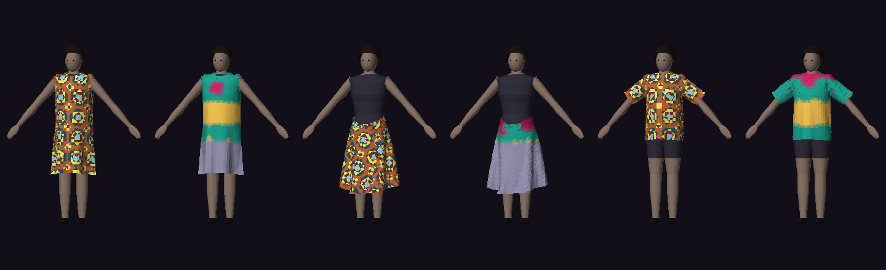
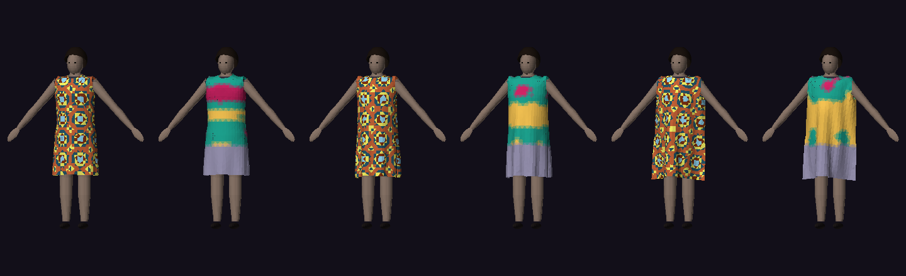
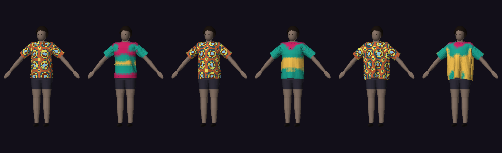
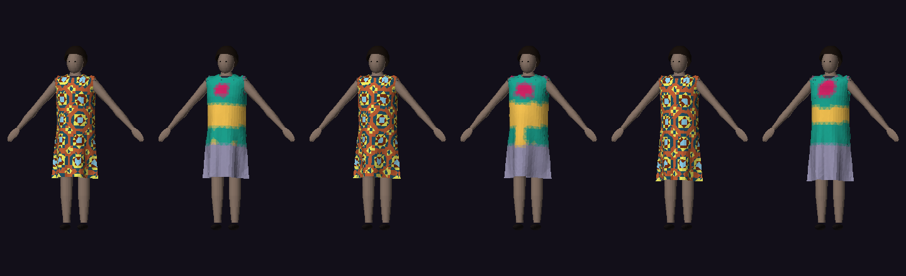

# R4 spike: physics drape, fit heatmaps and tailor pattern-to-3D

**Status:** spike, **not committed** to the roadmap. Flag `fit.heatmap_spike` (off by default).
**Plan:** implementation plan §11 (R4: "physics-based drape and fit heatmaps (pattern-based garments) · tailor pattern-to-3D custom previews … each item starts with a spike and an NLB-style evaluation before commitment").
**Builds on:** E27 garment GLBs (glTF writer), E33 parametric body, E34 wrap fit, E24 custom orders + measurement shares, FR-SIZE-01/04/08.
**Decision asked for:** Go / No-go / Iterate on investing in a production drape + fit-map feature. **Recommendation: Iterate** (details at the end).

## 1. What was built (time-boxed prototype)

| Piece | Where | Notes |
|---|---|---|
| 2D pattern model | `apps/ai/app/drape/pattern.py` | Panels are CCW polygons (m) with named edges, seam pairs, grain line, layer; fabrics have stretch, weight (gsm), bending, friction, bias stretch. Finished measurements per pattern (the size-chart numbers). |
| Graded generators | same | **A-line dress** (front/back, shift side seam bust→hip, A-line flare below the hip line; sleeveless fitted armhole or drop-shoulder top with sleeves), **wrap skirt** (one annular-sector panel that rolls into a cone, waist→hip without darts; 30% wrap overlap, tied on the body), **shirt** (drop-shoulder front/back + 2 set-in sleeves: none/short/long). Graded from the FR-SIZE profile (height, bust, waist, hips, shoulder, sleeve, neck) or a size row (S..3XL; 3XL extrapolated). Params: length, ease, sleeve. |
| Panel meshing + stitches | `drape/mesh.py` | Grid triangulation (2.5 cm), boundary snapped to the outline, corners exact; every boundary vertex tagged with its edge and arc parameter; seams pair vertices by parameter in both directions (eases mismatched lengths). |
| Body collision | `drape/collide.py` | Analytic signed distance to the E33 body (elliptical torso rings, leg tubes, arm capsules, head, floor) with a numerical gradient. Same shapes the body mesh is lofted from. Wider A-pose (42° instead of 24°, new optional `build_body(..., a_pose_deg)` argument) so cloth fits between arm and torso. |
| Drape solver | `drape/solver.py` | Position-based dynamics in numpy: arrange panels around the body (ellipse wrap / arm tube / cone) → **sew** (no gravity, stitches shrink to 0) → **drape** (gravity). Graph-coloured Gauss-Seidel batches, 10 substeps × 1 iteration per 1/60 s frame (the "small steps" scheme), 90 frames. Stretch (tension stiff, weaker on the bias for wovens, soft in compression so cloth buckles), bending (opposite-vertex distance, compression only), stay-taped edges (neckline, shoulders, waistband), a compliant **girth loop** for the tied waistband, collision projection with friction and per-layer thickness (wrap overlap). |
| Fit heatmap | `drape/fit.py` | Per vertex: **girth-direction stretch** of the cut fabric (deformation gradient, circumferential direction; lengthwise self-weight stretch is not "tight") and **gap** to the body. Bands: tight (stretch > 2% while on the body), loose (gap > 3.5 cm, or off-body in a 2 cm slab whose *measured* girth ease, cloth hull minus body ring, exceeds 9 cm), free drape (below the crotch line, not assessed), comfortable (rest). Line readings at bust / waist / hips with measured ease in cm. |
| Export | `drape/export.py` | Two GLBs with the same geometry: print (procedural wax-print tile or a product cut-out swatch, UVs = pattern metres / 18 cm, REPEAT sampler so the print keeps real scale across panels) and heatmap (COLOR_0). Static body, no clips (rest-pose drape). PIL posters for phones without WebGL2. |
| Gateway routes | `drape/api.py` | `GET /v1/drape/catalog`, `POST /v1/drape/simulate` (sync, about 2–3 s), `POST /v1/drape/eval` + `GET /v1/drape/eval/{id}` (smoke / quick / full). |
| API | `apps/api/src/modules/drape/` | `GET /drape-spike/status` (public flag), `POST /drape-spike/twin` (shopper, own 3D twin body + skin, AVATAR_3D consent and a READY twin required), `POST /drape-spike/custom-orders/:id/preview` (tailor; goes through `MeasurementsService.forTailor`, so page MANAGE + an **active share for this order** are enforced and `MEASUREMENT_VIEWED` is audited, plus `DRAPE_SPIKE_PREVIEW`), `POST /drape-spike/eval` + `GET /drape-spike/evals` (host; stores **ModelEval kind `DRAPE_SPIKE`**). Nothing is persisted: GLBs go back as data URLs and live in the browser as blob URLs. Kill switch respected. |
| Web | `components/drape-spike.tsx` | Shopper: "Physics fit preview" card on `/mirror/3d` under the twin (garment, size, fabric → drape → heatmap/print switch on the existing `Twin3dViewer`, line readings, legend with shares, **Experimental** badge, "visual guidance only" disclaimer, "not saved"). Tailor (light studio): "✂️ Preview pattern in 3D" on the custom-order page under Measurements, only while the share is active: pattern type, length slider, ease stepper, sleeve, fabric; defaults come from the customer's morph choices (length/sleeve, colour hue for the print); a **synthetic, neutral-tone body sized from the shared measurements**, never the shopper's photos, twin or skin tone. |
| Model registry | migration `20261111104528_r4_drape_spike` | Reference data only: flag `fit.heatmap_spike` (off) and `ModelVersion drape-pbd-cpu@0.1` (tier/status `SPIKE`). Eval records reuse E39's `ModelEval` table (kind `DRAPE_SPIKE`); a `SPIKE` model never serves traffic. |

### Screens (crawl `scripts/crawl-drape.mjs`, Pixel 7, flag on)

Screenshots are produced in `scripts/crawl-output/drape/` (not committed; regenerate with the crawl): `02-twin-heatmap-size-M-on-L` (size M on an L twin: tight band across the bust), `03-twin-drape-print`, `04-twin-heatmap-XXL-jersey-loose`, `21-tailor-pattern-3d-heatmap`, `22-tailor-pattern-adjusted-print` (98 cm, +2 cm ease, long sleeves, kitenge). Software renders from the harness are committed:

*A-line dress, wrap skirt, shirt (size M on an M body), print + fit heatmap each.*

*Dress M / L / XXL on an L body: M reads tight at bust (magenta), L comfortable, XXL loose (amber).*

*Shirt M / L / XXL on an L body.*

*Dress M on M in cotton, kitenge, jersey: the differences are small (see §3.4).*

## 2. Evaluation method (NLB-style harness)

`apps/ai/app/drape/evaluate.py`, run with `python scripts/drape_eval.py` (full) and stored by `POST /drape-spike/eval` as a model-registry record. Raw results: [`r4-drape-eval.json`](r4-drape-eval.json).

* **Bodies:** synthetic E33 parametric bodies from the size table, S, M, L, XL, XXL, 3XL (skin tone is irrelevant for drape, so the axis is body size).
* **Stability grid:** 6 bodies × 3 garments × 3 fabrics, garment size = body size (54 runs). A run is *stable* when: no explosion (finite, inside the scene, strain p99 ≤ 25%), max penetration ≤ 5 mm, seam gap p95 ≤ 10 mm, strain p99 ≤ 20%.
* **Sizing grid:** 6 bodies × 3 garments in cotton, garment one size down / same / two up (30 extra runs; 3XL has no "two up"). Each assessed line (bust + hips for dress/shirt; waist + hips for the wrap skirt) compares the heatmap reading to **size-chart arithmetic**: finished garment − body circumference → expected band (< −1.5 cm tight; −1.5..2.5 tight or ok; 2.5..10 ok; 10..18 ok or loose; > 18 loose). The wrap skirt is worn tied (body waist + 1.5 cm, limited by the overlap), so its finished hip depends on the body.
* **Runtime:** wall time per drape, one CPU core (Apple M2 Pro, numpy 2, standard quality: 2.5 cm mesh, 900 substeps).
* **Gate for "Go":** stability ≥ 95%, runtime p95 ≤ 5 s, agreement ≥ 85%.
* **Expert review:** checklist template in §5, to be run with real tailors (not done in this spike).

## 3. Results

Full run, 84 drapes, 191 s wall (standard quality). Gate: **stability ✗ · runtime ✓ · agreement ✓** → not passed.

### 3.1 Summary

| Metric | Result | Gate |
|---|---|---|
| Stable runs (all 84) | **74 / 84 = 88.1%** | ≥ 95% ✗ |
| Stable runs, matching size only (54) | 47 / 54 = 87.0% | |
| Runtime per drape, p50 / p95 / max | **2.1 s / 3.5 s / 5.5 s** (one core) | p95 ≤ 5 s ✓ |
| Heatmap vs size chart, assessed lines | **93 / 96 = 96.9%** | ≥ 85% ✓ |
| "One size down reads tight" (dress + shirt, bust + hips) | 79% (rest read comfortable inside the ±1.5 cm dead zone, e.g. shirt bust −1 cm) | |
| Max penetration (any run) | 5.6 mm (one run; p99 penetration 0 in all runs) | ≤ 5 mm per run |
| Worst seam gap p95 | 9.7 mm | ≤ 10 mm per run |

Runtime caveat: the dev machine is shared with other agents (load average 20–30 during the runs); a quieter earlier run of the same grid gave p95 2.8 s / max 3.2 s, and an earlier run with heavy contention had outliers up to 20 s.

### 3.2 Stability by garment, fabric and body

| | Stable | Notes |
|---|---|---|
| A-line dress | 27 / 28 (96%) | one 3XL body / XXL dress run: 5.6 mm penetration at the underarm |
| Shirt | 23 / 28 (82%) | all failures on the **3XL body** (strain p99 21–27%: the sleeve underarm is pinched between a 3XL arm and torso) |
| Wrap skirt | 24 / 28 (86%) | all failures are **jersey on L..3XL** (strain p99 27–36% around the tied waistband: hoop stress in a soft knit) |
| Cotton / kitenge / jersey (matching size) | 17/18 · 17/18 · 13/18 | |
| Body S / M / L / XL / XXL / 3XL | 15/15 · 15/15 · 14/15 · 14/15 · 10/12 · **6/12** | the larger the body, the less room under the arm in the fixed A-pose |

No run produced NaNs or left the scene; "exploded" here means the 99th-percentile edge strain passed 25%.

### 3.3 Heatmap agreement with size-chart expectations

| Garment size vs body | Lines agreeing | Readings |
|---|---|---|
| one size down | 36 / 36 | 25 tight, 11 comfortable (dead zone) |
| same size | 33 / 36 | 27 comfortable, 9 tight (wrap skirt waistband is snug by design) |
| two sizes up | 24 / 24 | 16 loose, 7 tight (wrap waist: it is tied to the body), 1 comfortable |

The 3 disagreements are all "tight" where the chart says comfortable: wrap skirt S on S and 3XL on 3XL at the hips (+4.6 cm chart ease, local stretch where the cone meets the elliptical hip), dress 3XL on 3XL at the bust (+4 cm chart ease, 1.8 cm measured). The canonical example works: **size M on an L body reads tight at bust and hips for the dress** (bust −3 cm → 56% of the ring tight) and the shirt reads tight at the hips.

Measured ease (cloth hull − body ring) systematically under-reads the chart ease (e.g. XXL dress on L: chart +23 cm, measured +12 cm) because excess fabric folds and is slightly compressed rather than standing off evenly; the loose threshold (9 cm measured) is calibrated for that.

### 3.4 Fabric sensitivity

Mean hem circumference (matching size): dress cotton 131 cm / kitenge 133 cm / jersey 129 cm; wrap skirt 79 / 81 / 68 cm (jersey skirt numbers come from unstable runs). The crisper kitenge stands off a little more and the knit clings, which is the right direction, but the **differences are small and below what a tailor would see**: fabric bending is a distance-constraint proxy, not a real bending model.

### 3.5 Things that work well
* Sewing from flat panels around the body closes every seam (p95 gap < 1 cm) in about 0.5 s; dresses hang from the shoulders, skirts stay up from the tied waistband, sleeves set into the armholes.
* The print keeps real-world scale across panels and sizes (UVs in pattern metres), so a tailor sees where the print motifs land on the cut.
* The heatmap explains itself with numbers (measured ease per line), and the tailor panel turns length/ease/sleeve changes into a new drape in about 3 s.

### 3.6 Things that do not
* Large bodies in a fixed A-pose (underarm pinch), soft knits with tied waists, no self-collision (overlapping wrap layers rely on a thickness offset), the waistband settles 6–9 cm below the waist on some bodies (compliant girth loop), and fabric differences are weak.

## 4. Cost and latency

* **Compute:** 2–3 s of one CPU core per drape at standard quality (1.3–2k cloth vertices), about 1.2 s at `fast`. On a 2-vCPU cloud instance (≈ USD 0.05/h) that is ≈ USD 0.00004 per drape, effectively free next to image generation (RWF ≤ 120/look). No GPU, no third-party API, no per-call licence.
* **Payload:** two GLBs of ≈ 210 KB each (static body + cloth, uncompressed) + two PNG posters, ≈ 640 KB of JSON per preview (base64). Production would send one Draco/meshopt-compressed GLB with the heatmap as a second vertex-colour attribute (≈ 80 KB).
* **Latency budget:** sync request ≈ 2.5–3.5 s end to end on the dev machine (gateway ≈ 2 s incl. posters + transfer). Acceptable for a deliberate "Drape it" tap, not for scrolling.

## 5. Expert review checklist (template for real tailors)

Run with 3–5 tailors (Uwase-style ateliers and one coop), each reviewing 6 previews (3 garments × 2 sizes) on the studio panel with their own customer's shared measurements, then the same garment physically on the customer at the fitting.

| # | Question | Scale |
|---|---|---|
| 1 | Does the overall silhouette match how this cut hangs on a real body of this size? | 1–5 |
| 2 | Do hem and sleeve lengths land where you would expect for the pattern? | 1–5 |
| 3 | Are the zones shown tight the ones you would expect to pull or need letting out? | 1–5 |
| 4 | Are the zones shown loose the ones you would take in? | 1–5 |
| 5 | Does the drape differ between cotton, kitenge and jersey as the real fabrics would? | 1–5 |
| 6 | Do seams sit where they should (shoulder, side, armhole)? | yes/no + note |
| 7 | Would this preview change a quote, an alteration or a size recommendation? | yes/no + note |
| 8 | Would you show this to a customer with the "visual guidance only" label? | yes/no + note |

Pass bar for production: median ≥ 4 on 1–4, ≥ 3 on 5, and "yes" on 7 from at least half the tailors.

## 6. Risks

* **Accuracy vs real fabric.** Fabric parameters are hand-set (stretch, gsm, bending), not measured; PBD stiffness depends on mesh size and substeps, so "2% stretch" is calibrated against this solver, not against a lab test (KES-F / FAST / Cusick drape). The tight/loose thresholds were tuned on the same synthetic bodies they are evaluated on (risk of circularity: the agreement number is an internal-consistency check, not validation). Real validation needs the expert review plus measured garments.
* **Body model.** The E33 body is stylised: no bust shaping, glutes, belly or posture variation; arms in a fixed A-pose. Fit maps on real bodies (the reason to build this) depend on a much better body (SMPL-X class with a commercial licence, or the E33 production provider).
* **Pattern coverage.** Three seeded constructions without darts, princess seams, collars, plackets, facings, gathers or closures. Real tailors draft per customer; importing their patterns is the real product.
* **No self-collision.** Layers are separated by thickness only; deep folds can interpenetrate.
* **Privacy.** The shopper path uses the shopper's own twin (their view only, nothing stored). The tailor path uses only the shared measurements (audited) and a synthetic neutral body; it is refused the moment the share ends. A production version must keep both properties and add rate limits (each preview is a measurement read).
* **Licensing.** No third-party solver, pattern, body or print data was used: numpy only, procedural print, in-house parametric body. Pattern blocks are textbook constructions (shift bodice, annular-sector skirt, drop-shoulder shirt). Commercial engines (CLO, Style3D, Browzwear) and SMPL-X bodies carry per-seat or per-call licences and non-commercial clauses that must be checked before any production use.
* **Misreading.** A heatmap looks authoritative. Every surface carries the Experimental badge and "visual guidance only" text; it must never drive automated size recommendations without calibration against returns (FR-SIZE-09).

## 7. What production would need

1. **Solver:** a GPU cloth solver with self-collision and measured fabric models. Options: (a) **commercial** CLO / Marvelous Designer SDK, **Style3D** cloud API (enterprise-gated, best drape fidelity, per-call cost), Browzwear VStitcher (B2B); (b) **open source** NVIDIA Warp (XPBD/VBD cloth, Apache-2.0, needs a CUDA GPU), **ContourCraft / HOOD**-style learned garment models (research licences, check terms), Taichi/Genesis cloth; (c) keep this CPU PBD as the instant fallback.
2. **Fabric library:** measured parameters per fabric family (kitenge, imigongo-inspired prints, kitambaa, jersey, linen) from a drape tester, fed into the solver; per-maker fabric selection on the product.
3. **Pattern import:** **DXF-AAMA / ASTM D6673** (the de-facto CAD exchange; piece outlines, grain lines, notches, grade rules), plus a simple photo-to-pattern capture for tailors who draft on paper; seam definitions and sewing order (auto-pairing by notches); grading rules instead of re-drafting per size.
4. **Body:** the E33 production provider (or SMPL-X with a commercial licence) in a neutral pose, with soft-tissue collision.
5. **Evaluation:** expert review (§5) + physical comparison on 30–50 real garment/body pairs; NLB-style release gate in the model registry (`DRAPE` kind) like E39 video.
6. **Product:** async jobs with caching per (pattern, size, fabric, body version), compressed single GLB, animation-aware drape (skinning or per-pose sims), RW/FR strings.

## 8. Recommendation: **Iterate** (not Go, not No-go)

**Why not Go:** the stability gate fails (88% vs 95%), and the failures sit exactly in the segments that matter for Rwandan custom tailoring: larger bodies (3XL 6/12) and soft knits. Fabric behaviour is barely distinguishable, and nothing has been validated against real garments or real tailors yet. Agreement (97%) is an internal-consistency check on synthetic bodies with thresholds tuned on the same bodies.

**Why not No-go:** the core loop is cheap and works: pattern → sewn → draped → fit map in about 2–3 s on one CPU core at near-zero cost, with no licence exposure, and the privacy model holds (shopper: own twin, nothing stored; tailor: shared measurements only, synthetic body, audited, refused when the share ends). The tailor pattern-to-3D preview is the strongest product signal (made-to-measure is our differentiator, and the tailor already holds the pattern).

**Iterate, in this order (each with a pass/fail criterion):**
1. *Tailor review first* (2 weeks): run the §5 checklist with 3–5 tailors on the existing flag-gated studio panel. **Go criterion:** median ≥ 4 on questions 1–4 and at least half say the preview would change a quote or alteration. If they don't, stop (No-go): physics accuracy won't rescue a preview tailors don't value.
2. *Fix the known failure modes* (2–3 weeks): per-size arm abduction or a T-pose for simulation, then pose back; a proper bending model (dihedral) with measured parameters for 3 local fabrics; a sewn waistband panel instead of the girth loop; self-collision for overlaps. **Criterion:** stability ≥ 95% across S..3XL × 3 fabrics, runtime p95 ≤ 5 s.
3. *Pattern import* (DXF-AAMA) for one partner tailor's real blocks plus 30 physical comparisons (garment on person vs preview at the same sizes). **Criterion:** tailors agree with ≥ 80% of tight/loose zones, and line ease is within ±3 cm of tape-measured ease.
4. Only then decide between a GPU/open-source solver (NVIDIA Warp) and a commercial engine (Style3D / CLO) for the production path, with the model-registry `DRAPE` gate.

Until then the flag stays **off** in production. The spike code is isolated (`apps/ai/app/drape/`, `modules/drape`, `components/drape-spike.tsx`) and can be deleted without touching E33/E34.

