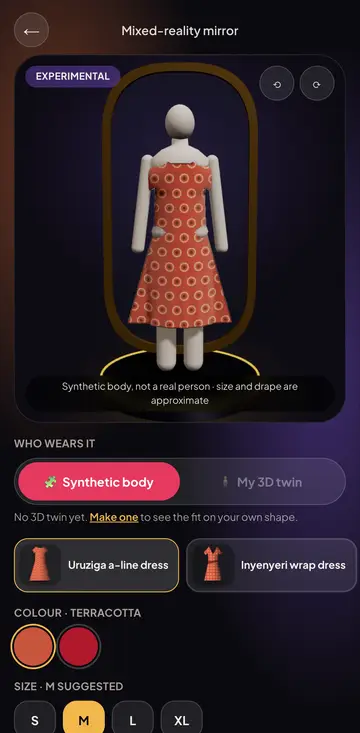
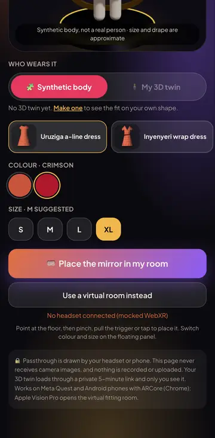
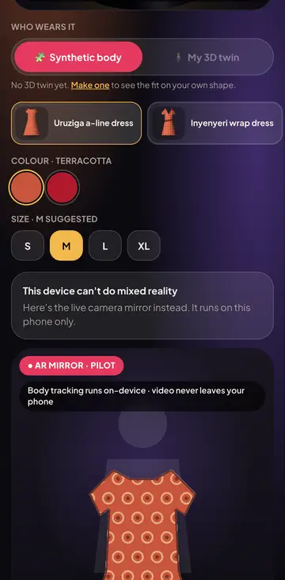
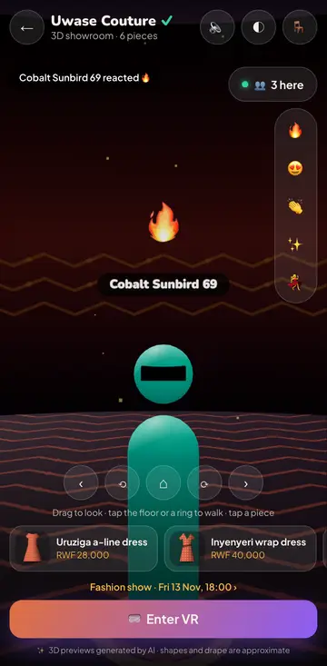
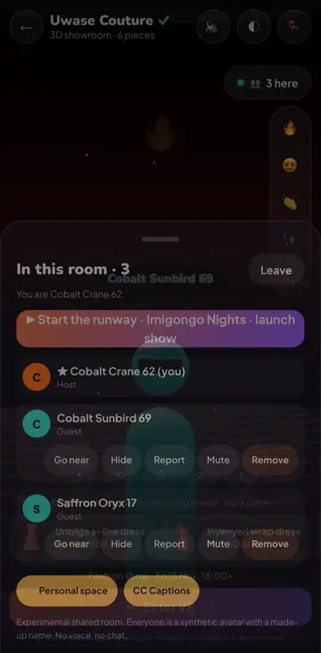
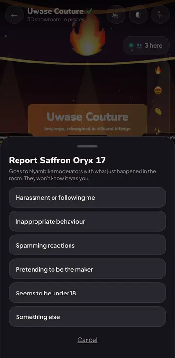
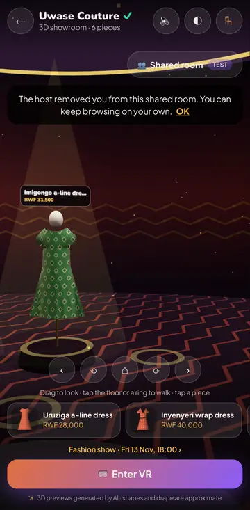
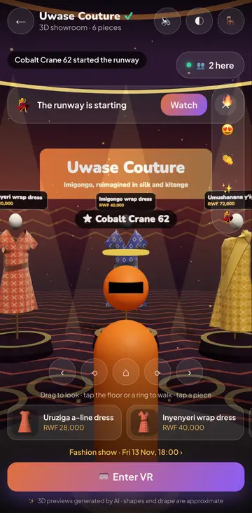

# R4 spike: mixed-reality fitting mirror and multi-user VR events

**Status:** spike, **not committed** to the roadmap. Flags `mr.mirror_spike` and `vr.multiuser_spike` (both off by default).
**Plan:** implementation plan §11 (R4: "mixed-reality fitting mirror · multi-user VR events … each item starts with a spike and an NLB-style evaluation before commitment"). SRS FR-AR-06 (MR mirror, W/C, R4) and FR-VR-06 (multi-user presence, W/C, R4).
**Builds on:** E34 AR mirror pilot (`/mirror/ar`), E35 WebXR showroom + fashion shows (three.js 0.186.1, Redis-backed SSE), E33 parametric avatar + `/twin3d/fit`, E27 garment GLBs, E18 moderation queue + audit log.
**Decision asked for:** Go / No-go / Iterate on each item. **Recommendation: Iterate on multi-user events, Iterate (lean No-go for 2027) on the MR mirror.** Criteria are in §7.

## 1. What was built (time-boxed prototype)

| Piece | Where | Notes |
|---|---|---|
| Presence protocol | `packages/contracts/src/presence.ts` | Shared by API, web and the load test. JSON frames, integer cm + mrad (a pose entry is ~30 B). Zod union for client frames (`p` pose, `r` reaction from the E35 whitelist, `h` host action, `rep` report, `ping`); no free text exists in the protocol. Token bucket, pose clamp, interest set (host + K=12 nearest within 12 m), bubble test, synthetic pseudonym/style from a 32-bit seed. Caps: 20 avatars, 200 per room. |
| Room state | `apps/api/src/modules/presence/presence-room.ts` | Replica of one room per API instance that holds a participant. Per-recipient delta by monotonic pose version, interest filter, avatars 10 Hz, spectators 2 Hz, 1 s count refresh, stale poses dropped after 5 s, ring buffer of the last 30 room events (report context). |
| Redis adapter | `presence-bus.ts` | Per-room pub/sub channels (an instance subscribes only while it holds someone there), roster in two Redis hashes with an **atomic Lua seat claim** (avatar → spectator → full, so the cap holds across instances), kick bans with TTL, one socket per user per room (`SET … GET`), instance liveness keys so seats of a crashed instance are swept. `MemoryPresenceBus` has the same semantics for tests (two services on one bus = two instances). |
| Gateway | `presence.gateway.ts`, `presence.module.ts` | `@WebSocketGateway({ path: "/vr/presence" })` on `@nestjs/websockets` + `@nestjs/platform-ws` 11.2.8 (the module installs the `ws` adapter itself, so `main.ts` is untouched). Socket opens with `?t=<ticket>`: a 60 s audience-bound JWT from `POST /vr/presence/tickets` (sign-in, flag on, 18+ attestation, 10/min/user, room must exist, ban check; host role = page managers of that page or host admins). Origin allow-list. Frames that arrive while the seat is claimed are queued. |
| Service | `presence.service.ts` | 10 Hz tick: publish local pose deltas to the bus, then one snapshot per local participant; reactions immediately; host mute (pauses reactions) / remove (close 4003 + 10 min ban) / start runway, all audited (`vr.presence_*`); **reports create `ModerationItem` kind `VR_PRESENCE_REPORT`** (room id, page id, reason, target + reporter user ids, last 15 room events), deduped per target for 10 min; per-socket rate limits and flood close (4008); send-buffer backpressure skip; flag kill switch closes every socket (4010). `GET /vr/presence/rooms/:room` (public counts), `GET /vr/presence/stats` (host admins: tick/publish/timer-lag p95, bytes, drops, CPU). |
| Showroom UI | `components/vr-presence.tsx`, `lib/presence.ts`, `components/presence-layer.ts` | "Shared room · test" pill on `/m/<handle>/showroom` (renders nothing while the flag is off). Join sheet: what others see, no voice/chat, bubble, host powers, 18+ checkbox. In the room: live count, vertical reaction bar, captions (aria-live, CC toggle), people sheet with **Go near / Hide / Report** (reason fieldset) and for the host **Mute / Remove** + **Start the runway** (guests get a banner linking the E35 show). three.js layer: stylised capsule avatars (3 shapes × 8 hues, visor shows facing, gold halo for the host, pseudonym label, seated height), 100 ms smoothing of the 10 Hz feed, spatial emoji rising from the sender, personal-space bubble (fade + hide label < 0.9 m). Additive `ShowroomEngine` hooks: `attach`, `onFrame` (runs in XR too), `viewerPose`, `moveTo`. |
| MR mirror | `app/mirror/mr/page.tsx`, `components/mr-mirror.tsx`, `components/mr-engine.ts` | `/mirror/mr` (entry chips on `/mirror/ar` and on a showroom piece when the flag is on). Inline stage preview (plinth, gold full-length mirror frame, figure; drag/turn buttons; reduced motion stops the turntable). Body: **synthetic mannequin** wearing the E27 garment GLB (size grades width, labelled approximate) or **my 3D twin** via `/twin3d/fit` (real per-size fit, owner-only 5-min signed GLB, "only you see it"). Colour swatches + size chips (recommended size from `/twin3d/garment`). `immersive-ar` with `hit-test` required, `local-floor`/`hand-tracking`/`anchors`/`dom-overlay` optional: viewer-space hit-test reticle, select (trigger / pinch / screen tap) places the stage facing you, floating panel switches colour/size/move/exit by controller ray or tap; DOM overlay on phones. `immersive-vr` only (Vision Pro, VR headsets): same stage in a neutral room, auto-placed 1.7 m ahead. No WebXR: **inline fallback = the E34 AR mirror** (or the 3D twin link when that pilot is off). The page never requests `camera-access`, so no camera frame is readable by it. "Experimental" everywhere. |
| Reference data | migration `20261111102532_r4_mr_vr_spike` | Two flags, both off. No schema change. |

### Screens (crawl `scripts/crawl-mrvr.mjs`, Pixel 7, SwiftShader, mocked `navigator.xr`)

| | | | |
|---|---|---|---|
|  |  |  |  |
| MR mirror preview, synthetic body | colour/size switched; Enter MR fails gracefully (no headset) | no WebXR → E34 AR mirror inline | host sees a guest avatar + spatial 🔥 + caption |
|  |  |  |  |
| people sheet: go near / hide / report, host mute / remove / start runway | report reasons → moderation queue | removed guest sees why (and is refused on rejoin) | host started the runway: guest banner |

## 2. Evaluation method

* **Unit (vitest, 17 tests, `presence.spec.ts`):** frame schema (whitelist, integers, no chat), clamp, pseudonyms, room ids, token bucket, interest set, ticket audience; service: welcome roster without user ids, avatar cap → spectator → full, flag off, 10 Hz delta snapshots + 2 Hz spectators, pose/reaction limits + flood close, host-only mute/kick/runway + ban + audit, moderation hook (kind, page, context, dedupe, rate limit), one socket per user, seat release; **two instances on one bus** (join, pose, reaction, kick across instances; cap counted across both).
* **Load (`scripts/vr-presence-load.mjs`):** N headless Node WebSocket clients in one room, tickets minted with the dev JWT secret, smooth random walk, 10 Hz ± 10 ms jitter, a reaction every ~8 s; 2 s settle then 20 s measured. Server CPU = `process.cpuUsage` delta from `/vr/presence/stats` per instance; latency = receiver clock − sender timestamp in the pose entry (same machine). Scenarios: default caps on 1 instance; avatar cap raised to 100 (interest management only); default caps on **2 instances** behind the Redis bus (clients split round-robin); one flooding client (66 frames/s). Results are committed in `docs/spikes/r4-results/load-*.json`.
* **Comfort/accessibility checklist, device-matrix template, safety review:** `docs/spikes/r4-results/evaluation.json` (gate records in the same shape as the E39/drape eval reports).
* **Crawl:** MR flag off → explainer; flag on with mocked immersive-ar/vr → preview, colour/size, Enter fails gracefully; no WebXR → AR mirror inline; three contexts (maker host + 2 guests) share the showroom: 3 present, host renders both avatars (`visibleCount() = 2`), reaction + caption, report → `ModerationItem`, mute disables the guest's reactions, remove → guest told why and refused on rejoin (403), runway banner, audit rows, flag off → no entry. 0 console errors / 0 5xx.

Environment: Apple M2 Pro laptop, Node 25.6, local Redis 7, API in dev mode (tsc-watch build), load generator on the same machine. **No WAN, no phones, no headsets.**

## 3. Results

### 3.1 Load (20 s per point; latency is pose end-to-end on localhost)

| Scenario | Joiners | Avatars / spectators | Down per avatar | Down per spectator | Up per avatar | p50 / p95 / p99 ms | Server CPU (1 core) | Tick p95 | Egress |
|---|---|---|---|---|---|---|---|---|---|
| default caps, 1 instance | 20 | 20 / 0 | 4.6 KB/s | – | 0.56 KB/s | 45 / 94 / 101 | 5.6 % | 1.7 ms | 90 KB/s |
| | 50 | 20 / 30 | 4.7 KB/s | 1.1 KB/s | 0.56 KB/s | 52 / 93 / 100 | 4.3 % | 1.6 ms | 124 KB/s |
| | 100 | 20 / 80 | 4.9 KB/s | 1.4 KB/s | 0.56 KB/s | 53 / 93 / 99 | 7.3 % | 0.8 ms | 205 KB/s |
| avatar cap 100, 1 instance | 20 | 20 / 0 | 4.8 KB/s | – | 0.56 KB/s | 53 / 95 / 101 | 5.6 % | 1.5 ms | 93 KB/s |
| | 50 | 50 / 0 | 5.3 KB/s | – | 0.56 KB/s | 47 / 94 / 100 | 5.8 % | 1.8 ms | 260 KB/s |
| | 100 | 100 / 0 | 5.5 KB/s | – | 0.56 KB/s | 50 / 94 / 101 | 8.3 % | 3.6 ms | 535 KB/s |
| default caps, **2 instances** | 20 | 20 / 0 | 4.7 KB/s | – | 0.56 KB/s | 77 / 145 / 163 | 2.5 + 2.6 % | 0.5 ms | 2 × 46 KB/s |
| | 50 | 20 / 30 | 4.9 KB/s | 1.2 KB/s | 0.57 KB/s | 80 / 138 / 150 | 2.5 + 3.2 % | 0.6 ms | 2 × 65 KB/s |
| | 100 | 20 / 80 | 5.0 KB/s | 1.4 KB/s | 0.56 KB/s | 71 / 139 / 148 | 3.5 + 4.0 % | 0.5 ms | 2 × 103 KB/s |
| flooding client | 20 | 19 + abuser | 4.7 KB/s | – | – | 48 / 94 / 100 | 2.2 % | 0.5 ms | 87 KB/s |

Findings:

1. **The server is not the constraint.** 100 participants cost < 10 % of one laptop core and < 4 ms per tick. Extrapolating linearly with 50 % headroom, one vCPU serves roughly **500 concurrent participants** (tens of rooms). Memory is flat (~150–270 MB RSS for the whole API process).
2. **Per-client bandwidth is phone-friendly:** ~37–44 kbit/s down and ~4.5 kbit/s up per avatar, ~11 kbit/s for spectators. Interest management (K = 12 + host) keeps it almost flat from 20 to 100 avatars (4.8 → 5.5 KB/s); server egress grows linearly with participants, not quadratically.
3. **Latency is dominated by the 10 Hz batching:** p50 ≈ 50 ms, p95 ≈ 95 ms on one instance (half to one tick wait plus delivery). A second instance adds one bus hop and the second instance's tick: p95 ≈ 140–145 ms. With the client's 100 ms smoothing that is fine for avatars and reactions; it is not good enough for anything competitive. A 20 Hz tick or publishing on receipt would cut it at ~2× messages.
4. **Graceful degradation works as designed:** joiners over 20 become spectators (receive-only, 2 Hz, nobody refused until 200), avatars are unaffected; a socket whose send buffer is > 256 KB is skipped for a tick; a flooding client is closed with 4008 after ~3 s and the others do not notice.
5. **Measurement caveat found and fixed:** with fixed-period `setInterval` clients, macOS coalesced client and server timers onto the same wake-ups and every pose waited exactly one tick (constant ~100 ms). Real clients are not phase-locked, so the load clients now jitter ±10 ms; the earlier constant-latency run was discarded.
6. "Distinct avatars received" in the JSON (`avatarsVisiblePerViewer`) is cumulative over the run (people walk in and out of interest), not concurrent; concurrent interest is ≤ 13.

### 3.2 Comfort, accessibility, safety (from `evaluation.json`)

* Pass: teleport-only + snap turn (E35), seated mode shared with others, captions for joins/reactions/host actions (DOM), reduced motion, bubble on by default, all actions as labelled DOM controls, ≥ 44 px targets, hit-test placement without precise pointing.
* Missing: **in-headset UI** (captions, people list, report and host controls are DOM only; inside immersive mode a participant sees avatars and emoji but cannot report without leaving), comfort vignette for inline glides, break reminders.
* Safety: emoji-only communication, pseudonyms + synthetic avatars, hide, report with context, host mute/remove with ban, rate limits, kill switch. Gaps: 18+ self-attestation is not age assurance; blocks do not persist across rooms; no moderator live-join/freeze; report stores ids in free text.
* Device matrix: template only. **Not one real headset or ARCore phone was run.**

### 3.3 MR mirror

* Works end-to-end inline (preview, synthetic body + E27 GLB, colour/size, twin path wired to the real `/twin3d/fit`), and the XR code paths follow the WebXR Hit Test / DOM Overlay specs with three.js controllers (tracked-pointer, hands, transient-pointer). They were exercised only up to `requestSession` with a mock.
* **Platform reality (Nov 2026):** passthrough `immersive-ar` is available in Meta Quest Browser and Chrome on Android XR and ARCore phones. **Safari on Apple Vision Pro offers `immersive-vr` only** (no `immersive-ar`, no hit-test), so it gets the virtual fitting room and transient-pointer input; iOS Safari has no WebXR at all. Most phones in our pilot market have no ARCore support, so they land on the E34 AR mirror fallback.
* The synthetic-body path is a garment on a mannequin with width grading: useful for colour and silhouette, **not fit**. Fit needs the twin path, which already exists in `/mirror/3d`; MR adds placement and scale-in-room, not new fit information.

## 4. Infra cost per concurrent user (estimate)

Self-hosted (this design):
* Egress ≈ 5 KB/s per avatar ≈ **18 MB per user-hour** (spectators ≈ 5 MB). At US$0.05–0.09/GB cloud egress that is **≈ US$0.001–0.002 per user-hour** (≈ RWF 1.5–3 at ~1,450 RWF/USD).
* Compute: ~500 participants per vCPU → a 2 vCPU node (≈ US$30–60/month) serves ~1,000 concurrent: **< US$0.0001 per user-hour** at modest utilisation. Redis: a small managed instance (≈ US$15–30/month) handles pub/sub for thousands.
* Total ≈ **US$0.002 per concurrent user-hour**, dominated by egress. An event with 200 people for 1 hour costs well under US$1.

Managed realtime: a message-metered pub/sub service would see ~10 frames/s up and ~10 snapshots/s down per avatar ≈ 72,000 messages per user-hour; at an assumed US$1–2.5 per million messages (check current list prices) that is **US$0.07–0.18 per user-hour, 35–90× self-hosted**. Managed is worth it only for operations (global edge, no WS fleet to run). Recommendation: **self-host presence** (it is a small, stateless-ish service with Redis), and consider a managed SFU only if voice is ever added.

Voice (out of scope; option documented): a WebRTC SFU (LiveKit or mediasoup, self-hosted or cloud), Opus at 24–32 kbit/s per speaker, forward only the nearest 3–4 speakers with distance attenuation (≈ 100–130 kbit/s down per listener, 3× the presence traffic), TURN relay for ~10–20 % of mobile users. Rough cost ≈ US$0.003–0.006 per user-hour self-hosted. **Privacy implications:** voice is personal data (and can be biometric) under Rwanda's DPA (Law 058/2021): explicit consent per session, push-to-talk and muted by default, no recording by default, which also means moderation has no evidence unless we add (consented) short rolling buffers or real-time ASR moderation (more processing, DPIA needed); voice reveals age and gender, which raises the minors question to a hard requirement for age assurance; host mute must also be server-enforced at the SFU; makers must never get recordings.

## 5. What production would need

1. **A separate realtime deployment** (same code, own process/pods) so long-lived sockets do not pin API pods; WS-aware load balancer with idle timeouts, per-IP connection caps and the ticket as the only auth; autoscale on connections; Redis with failover (sharded pub/sub if rooms grow); OpenTelemetry metrics for tick/publish/lag/drops.
2. **In-headset UI**: world-space people panel, report flow, host controls and captions; avatars instanced/merged (each avatar is ~5 draw calls today) with LOD; a real-device perf pass (target ≥ 72 fps with 20 avatars on Quest 2).
3. **Safety**: age policy decided with counsel before any public event; persistent per-user blocks; structured report table with retention; moderator console with live view, freeze room, remove across rooms; event code of conduct shown on join; per-event host roster (co-hosts).
4. **Product integration**: presence inside the E35 show page (shared runway, synchronized reactions already exist via SSE), scheduled "guided tour" mode (host leads, guests follow), analytics (dwell, hold-to-buy rate vs solo).
5. **Protocol hardening**: binary frames (≈ 50 % less), 20 Hz option for hosts, server-side bubble enforcement for reporting evidence, reconnect with resume.
6. **MR mirror**: real-device validation; shadow/occlusion and light estimation; anchors so the mirror stays put; the twin fit path as the default when a twin exists.

## 6. Risks

* **Audience fit (largest):** XR-capable devices are rare in the pilot market; most users will meet these features inline, where the value of shared presence is lower.
* **Platform churn:** WebXR support differs by vendor (Vision Pro VR-only, iOS none); three.js r186 + WebXR APIs may shift.
* **Safety and minors:** social VR without voice is low-risk but not no-risk; adding voice raises it sharply.
* **Untested on devices:** hit-test, hand input, DOM overlay and performance are spec-based only.
* **Ops:** a WS fleet + Redis to run; crash leaves seats until the liveness key expires (15 s) – handled, but not chaos-tested.

## 7. Recommendation

**Multi-user VR events: Iterate.** The engineering risk is retired: a 20-avatar room costs cents per event, degrades gracefully to 200, scales across instances and has the safety basics. What is unknown is device reality and demand. Go when all hold:
* device matrix run on ≥ 3 targets (Quest 3, Quest 2, an Android XR or ARCore phone) with ≥ 72 fps (headsets) / ≥ 30 fps (phones) at 20 avatars and comfort ≥ 4/5 from ≥ 5 testers;
* in-headset people/report/captions UI built and tested;
* two pilot maker events (flag on for invited shoppers) with ≥ 30 attendees each, report rate < 1 per 100 attendee-sessions with all reports resolved < 24 h, and hold-to-buy rate in the shared room not lower than the solo showroom;
* age-policy sign-off from counsel.
No-go if pilot analytics show < 3 % of showroom sessions on XR-capable devices and events draw < 15 attendees.

**Mixed-reality mirror: Iterate, lean No-go for 2027.** It works, respects privacy by construction (no camera frames, twin only via signed link), and falls back cleanly to the E34 AR mirror, but it adds placement, not fit, and reaches very few of our users. Keep the flag off; re-open when (a) E34 body-tracking quality is validated (FR-AR-06's own precondition), (b) ≥ 5 % of mirror sessions come from immersive-ar-capable browsers, and (c) a device run shows ≥ 90 % placement success with time-to-place ≤ 10 s and a twin fit GLB in ≤ 5 s. Until then the cheaper path is improving the twin fit (see the drape spike) and the phone AR mirror.

## 8. How to run

```bash
psql -d nyambika_mrvr -c "update \"FeatureFlag\" set enabled=true where key in ('mr.mirror_spike','vr.multiuser_spike')"
cd apps/api && npx vitest run src/modules/presence
node scripts/vr-presence-load.mjs --clients 20,50,100 --duration 20 --label default-cap-1-instance --host-user <HOST_ADMIN id>
BASE_URL=http://localhost:3102 node scripts/crawl-mrvr.mjs
```
Second instance for the bus scenario: `PORT=4112 node dist/main.js` (same Redis), then `--api http://localhost:4102,http://localhost:4112 --ws ws://localhost:4102/vr/presence,ws://localhost:4112/vr/presence`. Raised cap: `PRESENCE_AVATAR_CAP=100`.
