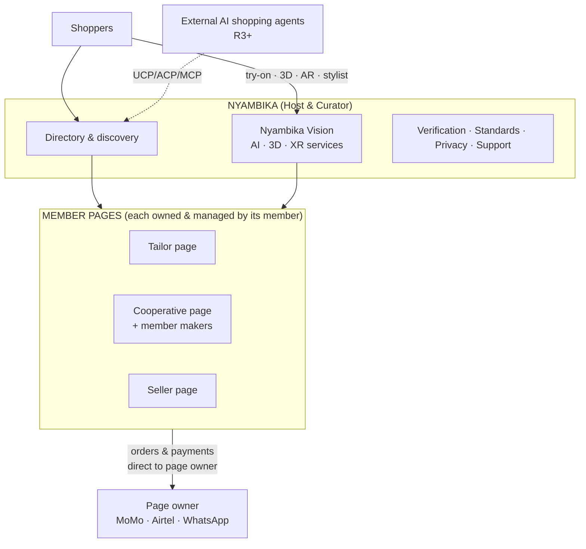
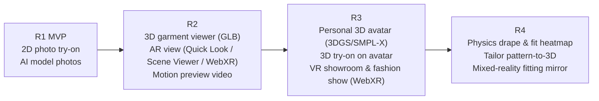
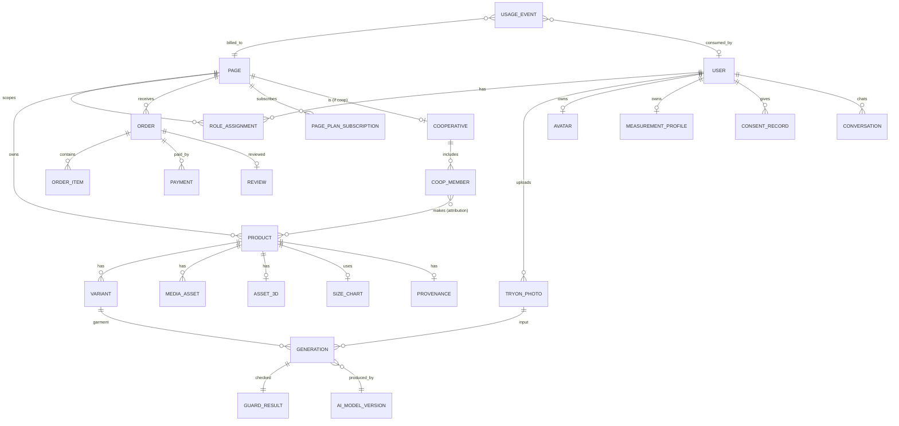
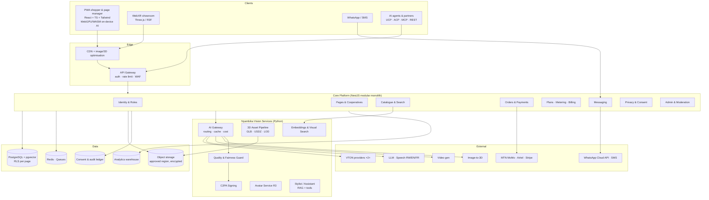
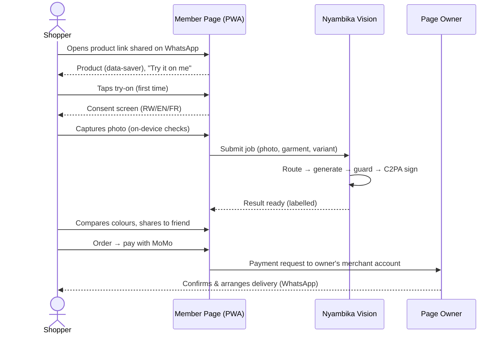

# Software Requirements Specification (SRS)

# Nyambika Platform with Nyambika Vision

**AI-, 3D- and XR-enabled fashion platform for Rwandan tailors, cooperatives and sellers**

| | |
|---|---|
| Document ID | NYA-SRS-001 |
| Version | 1.0 (Baseline draft) |
| Date | 10 November 2026 |
| Prepared by | Project Management Office: Senior Project Analyst / Project Manager |
| Standard followed | ISO/IEC/IEEE 29148:2018 (structure adapted) |
| Inputs | [proposal.md](proposal.md) · [research-report.md](research-report.md) · [feasibility-study.md](feasibility-study.md) |
| Status | For review by steering committee, technical lead and member representatives |

### Revision history
| Version | Date | Author | Change |
|---|---|---|---|
| 0.1 | 2026-11-10 | PMO | Initial structure |
| 1.0 | 2026-11-10 | PMO | Full baseline: functional, non-functional, AI, 3D, XR and compliance requirements |

### Approvals
| Role | Name | Signature | Date |
|---|---|---|---|
| Project Sponsor | | | |
| Project Manager | | | |
| Technical Lead | | | |
| Member Representative – Tailors | | | |
| Member Representative – Cooperatives | | | |
| Member Representative – Sellers | | | |
| Data Protection Officer | | | |

---

## Table of Contents
1. [Introduction](#1-introduction)
2. [Overall Description](#2-overall-description)
3. [Technology Outlook 2026+ (Design Drivers)](#3-technology-outlook-2026-design-drivers)
4. [System Features: Functional Requirements](#4-system-features--functional-requirements)
5. [AI Requirements and AI Governance](#5-ai-requirements-and-ai-governance)
6. [3D, AR and VR Requirements](#6-3d-ar-and-vr-requirements)
7. [External Interface Requirements](#7-external-interface-requirements)
8. [Data Requirements](#8-data-requirements)
9. [Non-Functional Requirements](#9-non-functional-requirements)
10. [Compliance, Legal and Ethical Requirements](#10-compliance-legal-and-ethical-requirements)
11. [System Architecture Constraints](#11-system-architecture-constraints)
12. [Release Plan and Requirement Prioritisation](#12-release-plan-and-requirement-prioritisation)
13. [Verification and Acceptance](#13-verification-and-acceptance)
14. [Appendices](#14-appendices)

---

## 1. Introduction

### 1.1 Purpose
This SRS defines the complete software requirements for the **Nyambika Platform**, designed from scratch, and its intelligent experience layer **Nyambika Vision**. It is the contractual baseline for design, development, testing and acceptance, and the reference for change control.

### 1.2 Product vision
> *"Make every online fashion purchase in Rwanda feel like trying clothes on in a real fitting room, while every tailor, cooperative and seller keeps their own page, their own customers and their own brand."*

### 1.3 Scope
The Nyambika Platform is a **multi-tenant, page-based fashion platform**. Nyambika **hosts** tailors, sewing cooperatives and sellers. **Each member owns and manages their own page**, where they promote and sell their clothing. This is Nyambika's traditional management model, and the new platform keeps it while modernising it.

Nyambika Vision adds emerging technology *inside each member's page*:

| Capability family | Examples |
|---|---|
| **Generative AI** | Photo virtual try-on, video try-on, AI product studio (on-model photos, backgrounds, lookbook video), AI listing writer, translation |
| **Conversational and agentic AI** | AI stylist in Kinyarwanda, English and French (text and voice). AI assistant for page owners. Readiness for AI shopping agents through open commerce protocols. |
| **Computer vision** | Photo quality checks, visual search ("find similar"), measurement assistance, content moderation |
| **3D** | 3D garment viewer, 3D body avatar, 3D garment drape and fit visualisation (staged) |
| **AR / VR (XR)** | AR view of 3D items on phones, immersive VR showroom and fashion show via WebXR (Android XR, Apple Vision Pro, Meta Quest) |
| **Commerce** | Orders paid straight to the page owner (MTN MoMo, Airtel Money), WhatsApp ordering, optional Nyambika checkout, page plans |
| **Trust and compliance** | Privacy-by-design photo handling, AI content credentials (C2PA), bias monitoring, readiness for digital product passports (EU export) |

**Out of scope for this SRS:** Logistics and delivery operations (handled by page owners), physical retail POS hardware, manufacturing ERP, and training a proprietary foundation model from scratch.

### 1.4 Definitions, acronyms and abbreviations
| Term | Definition |
|---|---|
| **Member** | A tailor, sewing cooperative or seller hosted by Nyambika |
| **Page** | A member's own storefront and identity on Nyambika. It is the tenant unit of the system. |
| **Page owner** | The member (person or legal entity) accountable for a page |
| **Cooperative admin / member** | The cooperative's appointed page manager / an individual maker within a cooperative |
| **Shopper** | Public user browsing pages and trying on garments |
| **Host** | Nyambika as platform operator |
| **VTON** | Virtual try-on: generative AI that renders a garment onto a person image |
| **Try-on allowance** | The number of AI generations included in a page plan |
| **GLB / glTF** | Khronos open 3D asset format used for the web |
| **USDZ** | Apple's 3D format used by AR Quick Look on iOS |
| **WebXR** | W3C API for AR/VR experiences in the browser |
| **SMPL-X** | A parametric 3D human body model widely used in research |
| **3DGS** | 3D Gaussian Splatting, a real-time neural 3D representation |
| **C2PA** | Coalition for Content Provenance and Authenticity "Content Credentials" standard |
| **UCP / ACP / AP2** | Universal Commerce Protocol (Google/Shopify) / Agentic Commerce Protocol (OpenAI/Stripe) / Agent Payments Protocol |
| **MCP** | Model Context Protocol, an open protocol for AI agents to call tools and data |
| **DPP** | Digital Product Passport (EU ESPR) |
| **NCSA** | National Cyber Security Authority (Rwanda's data protection regulator) |
| **PWA** | Progressive Web App |
| **RPO / RTO** | Recovery point objective / recovery time objective |
| **MoSCoW** | Must, Should, Could, Won't (this release) prioritisation |

### 1.5 References
1. Law No. 058/2021 on the Protection of Personal Data and Privacy (Rwanda).
2. Rwanda National Artificial Intelligence Policy (Cabinet approval, April 2023), and the Guidelines on the Ethical Development and Implementation of AI.
3. EU AI Act, Article 50 (transparency for AI-generated content). Applies to EU-facing content from 2 Aug 2026, with marking transition to 2 Dec 2026.
4. EU Ecodesign for Sustainable Products Regulation (ESPR), textile delegated act (expected 2027, with compliance around 2028–2029).
5. W3C WebXR Device API. Khronos glTF 2.0. C2PA Specification 2.x. WCAG 2.2.
6. Universal Commerce Protocol (Jan 2026) and Agentic Commerce Protocol specifications.
7. MTN MoMo Open API (Rwanda) documentation. WhatsApp Business Platform (Cloud API) documentation.
8. Nyambika research report and feasibility study (v1.1).

### 1.6 Document conventions
- **Requirement IDs:** `<AREA>-<NN>` (e.g., `FR-TRY-03`, `NFR-PERF-02`).
- **Priority (MoSCoW):** **M** = Must, **S** = Should, **C** = Could, **W** = Won't in this release.
- **Release:** **R1** MVP and pilot (week 12–16) · **R2** Grow (months 5–9) · **R3** Expand (months 10–18) · **R4** Future (18+ months).
- The keywords "shall" (mandatory), "should" (recommended) and "may" (optional) follow their normal requirements meaning.

### 1.7 Intended audience
| Audience | Use of this document |
|---|---|
| Steering committee and sponsor | Scope approval, release planning, investment decisions |
| Product and design team | User journeys, UX requirements |
| Engineering (backend, frontend, AI, 3D/XR) | Implementation and estimates |
| QA | Test plans and acceptance |
| DPO and legal counsel | Compliance verification |
| Member representatives | Validation that the page model and member needs are kept |

---

## 2. Overall Description

### 2.1 Product perspective
Nyambika is a **new system** that replaces the current hosting of member pages. It must **migrate existing pages** without loss and keep the operating model:

**Operating principles (binding on all requirements)**
- **OP-1:** Every product, order, generation, 3D asset and analytics record **belongs to exactly one page**.
- **OP-2:** Shoppers always land on, and buy from, **a member's page**. Discovery features (directory, search, stylist, agents) **route traffic to pages**. They don't replace them.
- **OP-3:** Payments go **directly to the page owner's** merchant account by default. Nyambika doesn't hold member funds unless the optional checkout is legally cleared (R2+).
- **OP-4:** Members keep their customer relationships, contacts and brand.
- **OP-5:** Shopper photos and body data are controlled by Nyambika and **never shared with page owners** unless the shopper explicitly chooses to share.
- **OP-6:** The basic page remains **free** for every existing member. No member is forced to upgrade.

### 2.2 Product functions (summary)
| # | Function group | Primary users |
|---|---|---|
| F1 | Identity, roles and membership | All |
| F2 | Member page management and page builder | Page owners, coop admins |
| F3 | Cooperative management | Coop admins, coop members |
| F4 | Catalogue and product management | Page owners |
| F5 | Directory, search and discovery (incl. visual search) | Shoppers |
| F6 | AI virtual try-on (photo) | Shoppers |
| F7 | AI video try-on and motion preview | Shoppers |
| F8 | AI product studio (on-model photos, lookbooks, listing writer) | Page owners |
| F9 | 3D garment viewer and AR view | Shoppers, page owners |
| F10 | 3D avatar and digital fit | Shoppers |
| F11 | VR showroom and virtual fashion show | Shoppers, members, host |
| F12 | AI stylist and voice assistant (RW/EN/FR) | Shoppers, page owners |
| F13 | Measurements and size guidance, tailor custom orders | Shoppers, tailors |
| F14 | Orders, payments and WhatsApp commerce | Shoppers, page owners |
| F15 | Page plans, allowances, credits and billing | Page owners, shoppers, host |
| F16 | Analytics and insights | Page owners, host |
| F17 | Host administration, moderation and support | Host |
| F18 | Privacy centre and consent | Shoppers, DPO |
| F19 | Agentic commerce, open API and integrations | External agents, partners |
| F20 | Product provenance, sustainability and DPP readiness | Page owners, export buyers |
| F21 | Migration of existing pages | Host, page owners |

### 2.3 User classes and characteristics
| User class | Description | Digital skills | Key needs | Devices |
|---|---|---|---|---|
| **Shopper** | Urban 18–35, Kigali first, then EAC and diaspora | Medium–high | Confidence before buying, privacy, low data use | Mid-range Android (2–4 GB RAM), some iPhone |
| **Tailor (page owner)** | Individual tailor or designer, often made-to-measure | Low–medium | Portfolio, customer measurements, custom orders | Low/mid Android |
| **Seller (page owner)** | Boutique or independent seller | Medium | Better photos, reach, orders, payments | Android, laptop |
| **Cooperative admin** | Appointed manager of a cooperative page | Low–medium | Simple tools in Kinyarwanda, approvals, shared payments | Shared Android |
| **Cooperative member** | Individual maker in a cooperative | **Low** | Add own items, see own sales, recognition | Basic Android, sometimes feature phone (USSD/SMS for notifications) |
| **Page staff** | Helper added by a page owner | Medium | Listing and order handling | Android |
| **Host admin / moderator** | Nyambika staff | High | Verification, moderation, metrics, support | Laptop |
| **DPO / compliance officer** | Privacy oversight | High | Consent logs, data-subject requests, audits | Laptop |
| **External AI agent / partner** | AI shopping agents, partner platforms (R3+) | n/a | Structured catalogue, availability, order handoff | API |

### 2.4 Operating environment
| Layer | Environment |
|---|---|
| Client (primary) | PWA on Android Chrome (≥ 2 major versions back), Samsung Internet, iOS Safari 17+. Desktop Chrome, Edge, Firefox, Safari. |
| Client (XR) | WebXR-capable browsers: Chrome on Android/Android XR, Meta Quest Browser, Safari on visionOS (immersive VR). AR Quick Look on iOS. Scene Viewer on Android. |
| Client (optional R3) | Native shell (Capacitor or equivalent) for app-store presence and push notifications on iOS |
| Server | Containerised services on a cloud or data centre in a region **approved under NCSA registration**. Object storage for personal data in Rwanda or an authorised location. |
| AI | Hosted AI APIs (VTON, video, LLM, 3D) behind an internal gateway. Optional self-hosted GPU inference (R3+). On-device inference via WebGPU/WASM where supported. |
| Networks | 3G/4G/5G and Wi-Fi. Must remain usable at 1 Mbps with 300 ms latency. |

### 2.5 Design and implementation constraints
| ID | Constraint |
|---|---|
| CON-01 | Shall comply with Rwanda Law No. 058/2021, including NCSA registration and authorisation of cross-border transfers **before** processing real user photos. |
| CON-02 | Shall not use AI models whose licence forbids commercial use (e.g., CC BY-NC weights such as IDM-VTON or CatVTON) in production. |
| CON-03 | Shall be built with open, portable standards: glTF/GLB, USDZ, WebXR, OpenAPI 3.1, OAuth 2.1/OIDC, C2PA. |
| CON-04 | Shall be mobile-first and data-light, with a low-end Android performance budget (§9.1). |
| CON-05 | Shall support **Kinyarwanda, English and French**. Kinyarwanda is first-class, not an afterthought. |
| CON-06 | AI providers shall be reached **only through the internal AI gateway**. No direct client-to-provider calls. |
| CON-07 | The proposed stack is React + TypeScript + Tailwind (frontend), Node.js/NestJS (core API), Python (AI and 3D services), PostgreSQL (+ pgvector), Redis, S3-compatible storage. Deviations need Technical Lead approval. |
| CON-08 | Payment flows default to direct-to-page-owner. A central-collection checkout needs legal sign-off (payment-services regulation). |

### 2.6 Assumptions and dependencies
| ID | Assumption / dependency | Impact if false |
|---|---|---|
| AS-01 | Hosted VTON APIs remain available at about US$0.05–0.08/image | Unit economics change. Gateway allows switching providers. |
| AS-02 | NCSA registration and transfer authorisation are granted in about 30 working days | Pilot delayed. Closed research pilot as fallback. |
| AS-03 | MTN MoMo and Airtel merchant APIs are available to members or through an aggregator | Fall back to manual MoMo merchant code and WhatsApp |
| AS-04 | Existing page content can be exported or captured | Manual migration effort increases |
| AS-05 | Kinyarwanda ASR/TTS of production quality is available via API (e.g., vendors reporting ~6% WER) | Voice features limited to EN/FR, or text-only |
| AS-06 | Image-to-3D and 3D avatar services reach production quality for garments by R3 | 3D avatar and fit features move to R4 |
| AS-07 | WebXR support continues to grow on Android XR, Quest and visionOS | VR showroom falls back to 3D-on-screen mode |

---

## 3. Technology Outlook 2026+ (Design Drivers)

This section records the technology trends that justify the requirements. Every emerging-tech feature is **staged** by maturity so the MVP isn't put at risk.

| Trend (2026) | State of the art | Implication for Nyambika | Release |
|---|---|---|---|
| **Photo VTON** | Hosted APIs at ~US$0.05–0.08/image. Google Vertex try-on GA (Jan 2026). | Core MVP feature through the provider-agnostic gateway | R1 |
| **Bias on African garments and skin tones** | AfriVTON-Bench (2026): −17 to −19 gSSIM on Kente/Ankara. Skin-tone-correlated failures documented. | A local benchmark gate and runtime identity/skin-tone guard are mandatory | R1 |
| **Video try-on** | Research models (Vanast CVPR 2026, Dress&Dance, DreamVVT, TripVVT) and vendor image-to-video APIs (FASHN video, Claid, Segmind ~US$0.45–3/run) | "See it move" 5-second clips from a try-on still. Premium credit feature. | R2 (from still) → R3 (direct video VTON) |
| **AI product studio** | Product-to-model, background and lookbook generation widely available | Day-one value for members. Replaces costly photo shoots. | R1 |
| **Image-to-3D** | Tripo and others at ~US$0.10–1.00/model. Display-quality meshes. | 3D viewer for selected items. Accessories first. | R2 |
| **3D human avatars** | Single-photo, animatable 3DGS avatars anchored on SMPL-X (LHM, PF-LHM, DiGS-Avatar <1 s) | A personal 3D avatar for 3D try-on and VR. Licences and quality to be validated. | R3 |
| **Cloth simulation** | Commercial engines (Style3D, CLO). APIs mostly enterprise-gated. | Physics-based fit and drape needs garment patterns. Start with tailors. | R4 |
| **WebXR** | Full support in Chrome/Android XR (hit test, anchors, depth, light estimation). Safari visionOS immersive VR (AR module not enabled). No WebXR in iOS Safari. | AR via `<model-viewer>` (Scene Viewer / Quick Look / WebXR). VR showroom via WebXR with a 3D-on-screen fallback. | R2 (AR) / R3 (VR) |
| **On-device AI** | WebGPU on Android Chrome and Safari 26. Small quantised models in-browser (transformers.js, WebLLM). | Photo quality checks, background removal and pose checks on device: privacy-friendly and cheaper | R1 (light) → R2 |
| **Kinyarwanda voice AI** | Commercial Kinyarwanda ASR/TTS reported at ~6% WER. ASR→LLM→TTS pipelines viable. | Voice stylist and voice-driven page management for low-literacy cooperative members | R2 |
| **Agentic commerce** | UCP (Google/Shopify, Jan 2026), ACP (OpenAI/Stripe), AP2 mandates. MCP for tools. | Make member catalogues readable and orderable by AI agents, always routing to the member's page | R3 |
| **AI content labelling** | EU AI Act Art. 50 (Aug/Dec 2026). California SB 942. C2PA as the de facto mechanism. Rwanda AI Policy calls for transparency. | All AI-generated images and videos carry a visible label and C2PA credentials | R1 |
| **Digital Product Passport** | EU textile DPP delegated act expected 2027, compliance ~2028–29. QR via GS1 Digital Link. | Product data model ready for fibre composition, maker and origin. "Made in Rwanda" provenance story for export. | R3 (ready) / R4 (compliant) |
| **Messaging commerce** | WhatsApp Cloud API. Per-message pricing for Rest of Africa (~US$0.004 utility, ~US$0.0225 marketing, unverified). Service messages no longer free from Oct 2026. | WhatsApp is the primary conversation channel. Message costs metered per page. | R1 |

---

## 4. System Features: Functional Requirements

> Format: **ID · Requirement · Priority · Release.** Acceptance criteria are given for key requirements, and the rest are verified through the test cases in §13.

### 4.1 F1: Identity, roles and membership

| ID | Requirement | Pri | Rel |
|---|---|---|---|
| FR-ACC-01 | The system shall allow registration and login with a **Rwandan or international phone number + OTP** (SMS, with WhatsApp OTP as an alternative). | M | R1 |
| FR-ACC-02 | The system shall support optional email/password and **passkeys (WebAuthn)**. | S | R2 |
| FR-ACC-03 | The system shall support roles: Shopper, Page Owner, Page Staff, Cooperative Admin, Cooperative Member, Host Admin, Moderator, DPO, Support Agent, API Client. | M | R1 |
| FR-ACC-04 | A user may hold several roles (e.g., a shopper who is also a cooperative member). Permissions are evaluated **per page**. | M | R1 |
| FR-ACC-05 | Page owners shall be able to invite and remove staff, with fine-grained permissions (listings, orders, analytics, billing). | M | R1 |
| FR-ACC-06 | The system shall support **member admission and verification** by the host (ID/business or cooperative registration document, phone, location), with statuses Pending, Verified, Suspended. | M | R1 |
| FR-ACC-07 | Verified pages shall display a **verification badge**. | M | R1 |
| FR-ACC-08 | The system shall support **assisted onboarding**, where a host agent sets up a page on behalf of a member, with the member's recorded consent. | M | R1 |
| FR-ACC-09 | Users shall be able to pick their language (RW/EN/FR) at first launch and change it at any time. | M | R1 |
| FR-ACC-10 | Shoppers shall be able to browse pages and products **without an account**. An account is needed only for try-on, orders and saving. | M | R1 |

### 4.2 F2: Member page management (page builder)

| ID | Requirement | Pri | Rel |
|---|---|---|---|
| FR-PAGE-01 | Each member shall have **one page** with a unique, readable URL (`nyambika.rw/<page-handle>`). Additional pages need host approval. | M | R1 |
| FR-PAGE-02 | Page owners shall manage page profile: name, logo, cover image/video, story ("about"), member type (Tailor / Cooperative / Seller), location (district, sector, map pin), opening hours, contact channels (WhatsApp, phone, Instagram), languages spoken. | M | R1 |
| FR-PAGE-03 | Page owners shall choose a **page theme** from accessible templates (colours, layout) without code. | S | R1 |
| FR-PAGE-04 | Pages shall show sections: Featured, Collections, All products, Services (for tailors), Reviews, About, Contact. | M | R1 |
| FR-PAGE-05 | Page owners shall be able to publish **stories/updates** (image, short video, text) on their page. | S | R2 |
| FR-PAGE-06 | Pages shall generate shareable links, QR codes and **WhatsApp/Instagram-ready preview cards** (Open Graph). | M | R1 |
| FR-PAGE-07 | The **AI page assistant** shall help write the page story and product descriptions in RW/EN/FR (FR-AST-10). | S | R1 |
| FR-PAGE-08 | Page owners shall be able to pause (vacation mode) or unpublish their page without losing data. | M | R1 |
| FR-PAGE-09 | Pages shall support **custom domains** (e.g., `shop.mybrand.rw`) on Business/Cooperative plans. | C | R3 |
| FR-PAGE-10 | Pages shall support an **embeddable widget** (try-on button + product grid) for members' own websites. | S | R3 |
| FR-PAGE-11 | Page owners shall be able to manage their page fully from a phone (all page-management functions must be mobile-usable). | M | R1 |

**Acceptance (FR-PAGE-01/02):** a verified member can create and publish a complete page on a 3 GB RAM Android phone in under 15 minutes with assisted onboarding, and the page link previews correctly in WhatsApp.

### 4.3 F3: Cooperative management

| ID | Requirement | Pri | Rel |
|---|---|---|---|
| FR-COOP-01 | A cooperative page shall be owned by the **cooperative as a legal entity**, with one or more appointed Cooperative Admins. | M | R1 |
| FR-COOP-02 | Cooperative Admins shall add, deactivate and assign roles to **member makers** (up to 25 on the standard plan, more on request). | M | R1 |
| FR-COOP-03 | Cooperative members shall be able to submit their own products. Submissions require **admin approval** before publication (configurable). | M | R1 |
| FR-COOP-04 | Each product shall carry **maker attribution** (one or more makers), visible to shoppers as "Made by <name>, <cooperative>" when the maker consents. | M | R1 |
| FR-COOP-05 | Cooperatives shall configure the payment destination: **shared cooperative account** or **per-maker account** for each product. | M | R1 |
| FR-COOP-06 | Each cooperative member shall see their own products, orders and sales totals. Admins see everything. | M | R1 |
| FR-COOP-07 | The system shall produce a **monthly cooperative statement** of sales by maker (PDF/CSV, Kinyarwanda and English). | S | R2 |
| FR-COOP-08 | Cooperative members with low literacy shall be able to add products through a **guided, icon-led flow with voice prompts** in Kinyarwanda. | S | R2 |
| FR-COOP-09 | The system shall send order notifications to cooperative members by **SMS** when they have no smartphone. | S | R2 |
| FR-COOP-10 | The system shall keep an **audit log** of admin actions (approvals, payment-destination changes, role changes). | M | R1 |

### 4.4 F4: Catalogue and product management

| ID | Requirement | Pri | Rel |
|---|---|---|---|
| FR-CAT-01 | Page owners shall create products with: title, description, category (taxonomy incl. African and Rwandan categories such as *imishanana*, *kitenge*, *ibitenge* sets, *umushanana*, men's *shirts*, school uniforms, bridal), price (RWF; optional USD), sizes/variants (size, colour, fabric), stock, made-to-order flag, lead time, care instructions, fibre composition, origin. | M | R1 |
| FR-CAT-02 | Products shall support up to 12 images and 1 video. The system shall auto-compress media and generate responsive variants (AVIF/WebP). | M | R1 |
| FR-CAT-03 | On upload, the system shall run an **AI garment-image quality check** (background, lighting, garment fully visible, resolution) and give fix-it guidance. | M | R1 |
| FR-CAT-04 | The system shall offer **automatic background removal** and a clean "flat-lay / ghost-mannequin" garment cut-out for try-on readiness. | M | R1 |
| FR-CAT-05 | Each product shall have a **Try-on readiness status** (Ready / Needs better photo / Not supported: e.g., shoes, bags in R1). | M | R1 |
| FR-CAT-06 | Page owners shall be able to upload **size charts** (template or custom) and attach them to products. | M | R1 |
| FR-CAT-07 | Tailors shall be able to list **services** (e.g., "custom dress from your fabric") with starting price, lead time and required measurements. | M | R1 |
| FR-CAT-08 | The system shall support collections, tags and featured products. | M | R1 |
| FR-CAT-09 | The system shall support bulk import (CSV / spreadsheet) and **bulk photo upload with AI auto-fill** (AI suggests title, category, colours and description from photos). | S | R2 |
| FR-CAT-10 | The system shall store an optional **3D asset** (GLB + USDZ) per product or variant (§6). | S | R2 |
| FR-CAT-11 | Products shall carry **provenance fields** (maker, cooperative, district, fabric origin, handmade flag) for "Made in Rwanda" storytelling and DPP readiness (§4.20). | S | R2 |
| FR-CAT-12 | Product changes shall be versioned. Price and stock history shall be kept. | S | R2 |

### 4.5 F5: Directory, search and discovery

| ID | Requirement | Pri | Rel |
|---|---|---|---|
| FR-DIR-01 | The system shall provide a **Nyambika directory** of member pages, filterable by type (Tailor / Cooperative / Seller), location, category, style, price range, "Try-on available" and "3D/AR available". | M | R1 |
| FR-DIR-02 | Product search results shall **always show the owning page** and link into it (OP-2). | M | R1 |
| FR-DIR-03 | The system shall support full-text search in RW/EN/FR with typo tolerance and synonyms (e.g., "kitenge" = "igitenge"). | M | R1 |
| FR-DIR-04 | The system shall support **visual search**: a shopper uploads or snaps a photo of an outfit or fabric and gets similar products from member pages (image embeddings + vector search). | S | R2 |
| FR-DIR-05 | The system shall support **semantic / natural-language search** ("blue kitenge dress for a wedding under 40,000") powered by embeddings and the AI stylist. | S | R2 |
| FR-DIR-06 | The host shall curate featured pages, collections and campaigns (e.g., "Kwibohora collection", "Cooperative of the month"). | M | R1 |
| FR-DIR-07 | Ranking shall be **fair and transparent**. It shall not favour paid plans in organic results beyond clearly labelled "Featured" slots, and shall rotate exposure for new and cooperative pages. | M | R1 |
| FR-DIR-08 | Shoppers shall be able to follow pages and save products (wishlist). | M | R1 |
| FR-DIR-09 | The system shall offer personalised recommendations based on consented activity, with a "why am I seeing this" explanation. | S | R2 |
| FR-DIR-10 | Pages and products shall be **indexable by search engines** (server-side rendering, structured data `schema.org/Product` and `LocalBusiness`). | M | R1 |

### 4.6 F6: AI virtual try-on (photo)

| ID | Requirement | Pri | Rel |
|---|---|---|---|
| FR-TRY-01 | Shoppers shall capture (camera) or upload a **full-body photo** to use as their try-on photo. | M | R1 |
| FR-TRY-02 | Before upload, the client shall run **on-device quality checks** (full body visible, front-facing, single person, lighting, blur) and give real-time guidance (pose outline overlay). | M | R1 |
| FR-TRY-03 | Before the first try-on, the system shall obtain **explicit, specific consent** (purpose, retention, cross-border processing, no sharing with page owners, no training without opt-in), recorded in the consent ledger. | M | R1 |
| FR-TRY-04 | The system shall block photos that appear to show a **minor** or more than one person, and NSFW content. | M | R1 |
| FR-TRY-05 | Shoppers shall start a try-on from any Try-on Ready product with one tap ("Try it on me"), choosing variant/colour. | M | R1 |
| FR-TRY-06 | Try-on shall run **asynchronously**, with progress states (Queued → Generating → Checking → Ready / Failed) and a notification when ready. | M | R1 |
| FR-TRY-07 | Before display, each result shall pass the **AI quality and fairness guard** (§5.4): identity similarity, skin-tone preservation, garment fidelity, artefact detection. Failed results shall be automatically retried once or withheld, and **not charged** to the allowance. | M | R1 |
| FR-TRY-08 | Results shall show a visible **"AI preview: not a guarantee of fit"** label and carry **C2PA Content Credentials**. | M | R1 |
| FR-TRY-09 | Shoppers shall switch colours or variants and **compare up to 4 results** side by side. | M | R1 |
| FR-TRY-10 | Shoppers shall be able to try **outfit combinations** (top + bottom, or outfit + accessory) where the provider supports multi-garment try-on. | S | R2 |
| FR-TRY-11 | Shoppers shall be able to **share** a result (WhatsApp/Instagram) with a watermark and a link back to the product's page. | M | R1 |
| FR-TRY-12 | Shoppers shall be able to save results to a private **"My fitting room"**, and delete any photo or result instantly. | M | R1 |
| FR-TRY-13 | The system shall **cache** results by (photo hash, garment, variant, model version) and never re-charge identical requests. | M | R1 |
| FR-TRY-14 | Shoppers shall be able to rate each result (👍/👎 + reason). Ratings feed quality monitoring. | M | R1 |
| FR-TRY-15 | Shoppers who don't want to upload a photo shall be able to try on with a **diverse set of AI model avatars** (skin tone, body shape, height). | S | R1 |
| FR-TRY-16 | Tailors shall be able to offer **"visualise a custom design"**: shopper selects fabric + style template from the tailor's page and sees it rendered on their photo. | S | R2 |
| FR-TRY-17 | Free usage shall be metered (default **5 shopper try-ons/week**), then served from page allowances or paid credits (§4.15). | M | R1 |

**Acceptance (FR-TRY-05–08):** For a Try-on Ready product and a valid photo, p50 time to result ≤ 15 s and p95 ≤ 30 s (§9.1). The result carries a visible label and a C2PA manifest. Guard-failed results are not shown and not charged.

### 4.7 F7: AI video try-on and motion preview

| ID | Requirement | Pri | Rel |
|---|---|---|---|
| FR-VID-01 | Shoppers shall generate a **3–5 s motion clip** ("See it move": turn, walk) from an approved try-on still. | S | R2 |
| FR-VID-02 | Page owners shall generate **lookbook/catwalk videos** of their products on AI models for social media (vertical 9:16, 720p default). | S | R2 |
| FR-VID-03 | The system should support **direct video try-on** (person image + garment + motion template, in a single pass) when a commercially licensed provider reaches the quality threshold. | C | R3 |
| FR-VID-04 | Video generation shall be a **premium credit** action, with cost shown before confirmation. | M | R2 |
| FR-VID-05 | Video outputs shall carry the AI label, watermark and C2PA credentials, and pass the identity/skin-tone guard on sampled frames. | M | R2 |
| FR-VID-06 | Videos shall stream adaptively (HLS) with a data-saver default of 480p. | M | R2 |

### 4.8 F8: AI product studio (for page owners)

| ID | Requirement | Pri | Rel |
|---|---|---|---|
| FR-PHO-01 | Page owners shall generate **on-model product photos** from a garment photo, choosing model attributes (skin tone, body type, age range, pose) from a **diverse, Rwanda-representative model library**. | M | R1 |
| FR-PHO-02 | Page owners shall generate **background scenes** (studio, Kigali street, wedding, office, nature) and consistent brand backgrounds. | S | R1 |
| FR-PHO-03 | Page owners shall approve, reject or regenerate outputs. Only approved images are published. | M | R1 |
| FR-PHO-04 | Generated images shall be labelled "AI-generated model image" on the product page and carry C2PA credentials. | M | R1 |
| FR-PHO-05 | The system shall **preserve garment fidelity** (pattern, colour, logo). A garment-fidelity score below threshold blocks auto-publish. | M | R1 |
| FR-PHO-06 | The **AI listing writer** shall draft title, description, tags and care text in RW/EN/FR from photos and a few keywords. Owners shall edit before publishing. | S | R1 |
| FR-PHO-07 | The system shall generate **social media kits** (square, story, WhatsApp status formats) with page branding and QR code. | S | R2 |
| FR-PHO-08 | Page owners may create a **digital twin model** of a consenting real person (e.g., a cooperative member modelling the brand), with written consent stored and revocable. | C | R3 |

### 4.9 F9: 3D garment viewer and AR view
See §6.2–6.3 for detailed 3D/AR requirements (FR-3D-xx, FR-AR-xx).

### 4.10 F10: 3D avatar and digital fit
See §6.4–6.5 (FR-AVA-xx, FR-FIT-xx).

### 4.11 F11: VR showroom and virtual fashion show
See §6.6 (FR-VR-xx).

### 4.12 F12: AI stylist and voice assistant

| ID | Requirement | Pri | Rel |
|---|---|---|---|
| FR-AST-01 | Shoppers shall chat with an **AI stylist** in RW/EN/FR that recommends products **from member pages** based on occasion, budget, style, colour preferences and saved measurements. | S | R2 |
| FR-AST-02 | Every recommendation shall cite the **page and product** and deep-link to it (OP-2). The stylist shall never invent products, prices or stock. Answers are grounded in the live catalogue (retrieval + tool calls). | M | R2 |
| FR-AST-03 | The stylist shall trigger actions on request: start a try-on, open 3D/AR, add to wishlist, contact the page owner on WhatsApp. | S | R2 |
| FR-AST-04 | **Voice mode:** shoppers and members shall speak and listen in **Kinyarwanda**, English and French (ASR → LLM → TTS). | S | R2 |
| FR-AST-05 | The stylist shall respect cultural context (e.g., wedding, *gusaba*, *gukwa*, church, graduation dress codes), with content reviewed by local fashion advisers. | S | R2 |
| FR-AST-06 | The stylist shall disclose that it is an AI, offer a hand-off to the page owner or human support, and refuse unrelated or harmful requests. | M | R2 |
| FR-AST-07 | Shoppers shall be able to view, export and delete their stylist conversation history. History is not used for model training without opt-in. | M | R2 |
| FR-AST-08 | The stylist shall be available on **WhatsApp** as well as in-app (§7.3). | C | R3 |
| FR-AST-09 | The stylist shall support **"complete the look"**: suggest matching items, preferably from the same page first, then from other pages, clearly labelled. | S | R2 |
| FR-AST-10 | **AI page assistant (for members):** answers "how do I…" questions, drafts descriptions, suggests prices from comparable listings, summarises weekly performance, and accepts **voice commands in Kinyarwanda** ("add a new dress, price 25,000"). | S | R2 |
| FR-AST-11 | Small, low-risk AI tasks (intent detection, translation of short UI strings, image tagging) should run **on device** via WebGPU/WASM where supported, with server fallback. | C | R2 |

### 4.13 F13: Measurements, size guidance and tailor custom orders

| ID | Requirement | Pri | Rel |
|---|---|---|---|
| FR-SIZE-01 | Shoppers shall maintain a private **measurement profile** (height, chest/bust, waist, hips, inseam, shoulder, arm length, neck) entered manually with illustrated guidance in RW/EN/FR. | M | R1 |
| FR-SIZE-02 | The system shall recommend a size by mapping the profile to the product's size chart, showing confidence and fit notes ("may be tight at hips"). | S | R2 |
| FR-SIZE-03 | The system shall offer **AI-assisted measurement estimation** from 2 photos (front + side) as a *suggestion*, labelled with expected error (±2–3 cm), and the user confirms it. | C | R3 |
| FR-SIZE-04 | Shoppers shall be able to **share their measurement profile with a specific tailor** for a custom order, with time-limited, revocable access (exception to OP-5 by explicit choice). | M | R1 |
| FR-SIZE-05 | Tailors shall keep a **customer measurement book** (for customers who consent), with history and notes. | M | R1 |
| FR-SIZE-06 | Tailors shall manage **custom-order workflow**: request → quote → deposit → fittings/appointments → in progress → ready → delivered, with status updates to the customer. | M | R2 |
| FR-SIZE-07 | The system shall support **appointment booking** for fittings at the tailor's location. | S | R2 |
| FR-SIZE-08 | Measurement data shall be treated as **potentially sensitive** personal data (encryption, access logs, §10). | M | R1 |
| FR-SIZE-09 | The system shall learn size-fit calibration per page from returns and fit feedback ("runs small"), with consent. | C | R3 |

### 4.14 F14: Orders, payments and WhatsApp commerce

| ID | Requirement | Pri | Rel |
|---|---|---|---|
| FR-ORD-01 | Shoppers shall place an **order request on the member's page** (product, variant, size, quantity, delivery or pickup, note). | M | R1 |
| FR-ORD-02 | **Default payment (direct):** the system shall initiate a payment request to the **page owner's MTN MoMo or Airtel Money merchant account** (API push or merchant code with reference), and confirm payment automatically where the API allows, or manually by the owner otherwise. | M | R1 |
| FR-ORD-03 | Shoppers shall be able to **"Order via WhatsApp"**: a pre-filled message to the page owner with product link, variant, size and optional try-on image. | M | R1 |
| FR-ORD-04 | Page owners shall manage order states: New → Accepted → Paid → In preparation → Ready / Shipped → Delivered → Completed, or Cancelled / Disputed. | M | R1 |
| FR-ORD-05 | The system shall send order notifications to page owners and shoppers by WhatsApp, SMS and in-app, based on preference. | M | R1 |
| FR-ORD-06 | Page owners shall set delivery options (pickup, own delivery, partner courier) and fees. Fulfilment stays with the page owner. | M | R1 |
| FR-ORD-07 | **Optional Nyambika checkout:** a cart across one page, card and mobile-money payment via a licensed aggregator, automatic split and payout to the page owner, and commission collection. Enabled only after legal clearance (CON-08). | S | R2 |
| FR-ORD-08 | International payments via **Stripe** (or equivalent) for diaspora and export orders, with currency display. | C | R3 |
| FR-ORD-09 | Shoppers shall review a completed order (rating, text, photo). Page owners may respond once. Reviews are moderated. | M | R1 |
| FR-ORD-10 | The system shall provide **dispute handling**: the shopper raises an issue, the page owner responds, and the host mediates with an evidence log. | M | R1 |
| FR-ORD-11 | Order data shall be **owned by the page**. Members can export their orders and customer contacts who consented (CSV). | M | R1 |
| FR-ORD-12 | The system shall issue **digital receipts** (PDF/WhatsApp) with the page owner's details, and support EBM (Rwanda Revenue Authority Electronic Billing Machine) integration for members who use it. | C | R3 |

### 4.15 F15: Page plans, allowances, credits and billing

| ID | Requirement | Pri | Rel |
|---|---|---|---|
| FR-PLAN-01 | The system shall support page plans: **Basic (free)**, **Pro**, **Business**, **Cooperative**, **Enterprise**, with configurable quotas (products, try-on allowance, AI photos, video credits, 3D assets, staff seats, analytics level). Initial values follow feasibility study §10.2. | M | R1 |
| FR-PLAN-02 | The system shall **meter** every billable AI action (try-on, photo, video, 3D, voice minutes) per page and per shopper, with real-time balance. | M | R1 |
| FR-PLAN-03 | When a shopper tries on a product, consumption shall come from (1) the shopper's free weekly quota, then (2) the page's allowance if the page enabled it, then (3) the shopper's paid credits. The order is configurable by the host. | M | R1 |
| FR-PLAN-04 | Page owners shall set a **monthly cap** on allowance use and get alerts at 80% and 100%. | M | R1 |
| FR-PLAN-05 | Page plans and shopper credits shall be payable by MoMo/Airtel (R1) and card (R3), with auto-renewal opt-in. | M | R1 |
| FR-PLAN-06 | The host shall configure **sponsored plans** (e.g., an NGO or partner pays for a cooperative's plan) with sponsor reporting. | S | R1 |
| FR-PLAN-07 | The system shall issue invoices and receipts and keep a billing history. | M | R1 |
| FR-PLAN-08 | The host shall see **unit economics**: AI cost per page, per order and per generation, against revenue (§4.16). | M | R1 |

### 4.16 F16: Analytics and insights

| ID | Requirement | Pri | Rel |
|---|---|---|---|
| FR-ANL-01 | Page owners shall see a dashboard: page views, product views, try-ons, try-on → contact/order conversion, orders, revenue, top products, traffic sources (WhatsApp, Instagram, directory, search). | M | R1 |
| FR-ANL-02 | Cooperative admins shall see analytics per maker. Makers see their own. | M | R1 |
| FR-ANL-03 | The AI page assistant shall deliver a **weekly insight summary** (RW/EN/FR) with suggestions (e.g., "your blue kitenge dress gets many try-ons but few orders: check price or sizes"). | S | R2 |
| FR-ANL-04 | Host analytics: active pages, plan conversion, AI cost and failure rates, guard-failure rates by skin tone and garment type, latency, funnel, cohort retention. | M | R1 |
| FR-ANL-05 | Analytics shall use **privacy-preserving aggregation**. Page owners never see individual shopper photos or measurements. | M | R1 |
| FR-ANL-06 | **Trend insights** across the platform (anonymised): rising styles, colours and fabrics by region and season, available to Business/Cooperative plans. | C | R3 |

### 4.17 F17: Host administration, moderation and support

| ID | Requirement | Pri | Rel |
|---|---|---|---|
| FR-ADM-01 | Host admins shall manage member admission, verification, plans, suspensions and appeals. | M | R1 |
| FR-ADM-02 | The system shall provide **AI-assisted moderation** of products, images, reviews and page content (prohibited items, counterfeits, nudity, hate), with a human review queue. | M | R1 |
| FR-ADM-03 | Admins shall configure taxonomy, featured content, campaigns, plan quotas, free-quota policy and AI provider routing. | M | R1 |
| FR-ADM-04 | The system shall provide a **support desk** (tickets from in-app and WhatsApp) with page, order and generation context. | M | R1 |
| FR-ADM-05 | Admins shall manage the **AI model registry** (provider, version, benchmark scores, status) and switch routing without redeploying (§5). | M | R1 |
| FR-ADM-06 | All admin actions shall be audit-logged and immutable. | M | R1 |
| FR-ADM-07 | The system shall support **feature flags** per page, per plan and per region. | M | R1 |

### 4.18 F18: Privacy centre and consent

| ID | Requirement | Pri | Rel |
|---|---|---|---|
| FR-PRV-01 | Users shall have a **Privacy Centre**: view and withdraw consents, view stored photos/avatars/measurements, download data (machine-readable), delete account. | M | R1 |
| FR-PRV-02 | Try-on photos and results shall be **auto-deleted after 30 days** (configurable 1–90) unless saved by the user. Avatars and measurements are kept until deleted. | M | R1 |
| FR-PRV-03 | The system shall keep an **immutable consent ledger** (who, what, purpose, version of notice, timestamp, channel). | M | R1 |
| FR-PRV-04 | Data-subject requests (access, rectification, erasure, objection) shall be completed within the legal deadline, with a DPO workflow. | M | R1 |
| FR-PRV-05 | Deletion shall cascade to caches, CDN, backups (within the backup rotation) and AI providers (via the provider deletion API or zero-retention contract). | M | R1 |
| FR-PRV-06 | **Training opt-in:** user images are never used to train or fine-tune models unless the user opts in separately. Opt-in can be withdrawn. | M | R1 |
| FR-PRV-07 | Privacy notices shall be short, layered and in RW/EN/FR, with an illustrated explanation of how try-on works. | M | R1 |

### 4.19 F19: Agentic commerce, open API and integrations

| ID | Requirement | Pri | Rel |
|---|---|---|---|
| FR-AGT-01 | The system shall publish a **public catalogue API** (OpenAPI 3.1) exposing published pages, products, availability and try-on readiness, with rate limits and API keys. | S | R3 |
| FR-AGT-02 | The system shall expose catalogue and order-handoff capabilities through **agentic commerce protocols** (UCP and/or ACP) so external AI shopping agents can discover products and start orders **on behalf of a user, routed to the owning page**. | S | R3 |
| FR-AGT-03 | The system shall provide an **MCP server** offering tools such as `search_products`, `get_page`, `check_availability` and `create_order_request` for AI assistants. | C | R3 |
| FR-AGT-04 | Agent-initiated orders shall require **explicit user confirmation** (e.g., AP2-style signed mandate or in-app/WhatsApp confirmation) before payment. | M | R3 |
| FR-AGT-05 | Members shall be able to **opt their page in or out** of agent channels and external marketplaces. | M | R3 |
| FR-AGT-06 | **Try-on as a Service (B2B API):** partners send a person image and a garment and receive a guarded, labelled result, subject to contract, consent and metering. | S | R3 |
| FR-AGT-07 | The system shall provide product feeds for **Google Merchant Center / Meta catalogue** (per page, opt-in). | S | R2 |
| FR-AGT-08 | Webhooks shall notify members' external systems of orders and stock changes. | C | R3 |

### 4.20 F20: Provenance, sustainability and DPP readiness

| ID | Requirement | Pri | Rel |
|---|---|---|---|
| FR-DPP-01 | Products shall support provenance data: maker(s), cooperative, district, fabric type and origin, fibre composition, handmade flag, production date/batch. | S | R2 |
| FR-DPP-02 | The system shall generate a **product passport page** reachable by QR code (GS1 Digital Link-compatible URI) for labels and hang-tags. | C | R3 |
| FR-DPP-03 | The data model shall be **extensible to the EU textile DPP** fields once the delegated act is published (expected 2027), for members who export. | S | R3 |
| FR-DPP-04 | Pages may display **"Made in Rwanda"** and cooperative impact stories, verified by the host where claims are made. | S | R2 |
| FR-DPP-05 | The system shall estimate and display the avoided-return impact ("AI try-on helped avoid X wrong purchases") at platform level. | C | R3 |

### 4.21 F21: Migration of existing pages

| ID | Requirement | Pri | Rel |
|---|---|---|---|
| FR-MIG-01 | The system shall import existing member pages (profile, products, images, contacts) via scripted import and manual-assist tools. | M | R1 |
| FR-MIG-02 | Each migrated page shall go through **owner review and sign-off** before going live. Old pages stay available until sign-off. | M | R1 |
| FR-MIG-03 | Old page URLs shall **301-redirect** to the new page URLs. | M | R1 |
| FR-MIG-04 | Migration shall be done in **waves** (pilot cohort, then all members), with a migration dashboard (status per page, issues). | M | R1 |
| FR-MIG-05 | Members who don't opt into new features shall be migrated to a **Basic page** with their existing content intact (OP-6). | M | R1 |

---

## 5. AI Requirements and AI Governance

### 5.1 AI capability inventory
| AI capability | Type | Default source | Data sensitivity | Rel |
|---|---|---|---|---|
| Photo virtual try-on | Generative image | Hosted VTON API (multi-provider) | **High** (person image) | R1 |
| AI product studio (on-model, backgrounds) | Generative image | Hosted API | Low (garment) | R1 |
| Garment cut-out / background removal | Vision | On-device (WebGPU/WASM), server fallback | Low | R1 |
| Photo quality and pose check | Vision | On-device | High (processed locally) | R1 |
| Identity / skin-tone / fidelity guard | Vision (evaluation) | Server (self-hosted, permissive licence) | High | R1 |
| Content moderation (NSFW, minors, prohibited) | Vision + NLP | Hosted moderation API + rules | High | R1 |
| Listing writer, translation | LLM | Hosted LLM | Low | R1 |
| AI stylist and page assistant | LLM + RAG + tools | Hosted LLM | Medium | R2 |
| Voice (Kinyarwanda/EN/FR) | ASR + TTS | Hosted speech API with Kinyarwanda support | Medium (voice) | R2 |
| Visual and semantic search | Embeddings | Hosted or self-hosted embedding model + pgvector | Low–medium | R2 |
| Video try-on / lookbook | Generative video | Hosted API | High / Low | R2–R3 |
| Image-to-3D garment | Generative 3D | Hosted API (e.g., Tripo-class) | Low | R2 |
| 3D avatar from photo | Generative 3D (3DGS/SMPL-X) | Hosted or self-hosted (licence-checked) | **High** | R3 |
| Measurement estimation | Vision regression | Hosted or self-hosted | **High** | R3 |
| Recommendations | ML ranking | In-house | Medium | R2 |

### 5.2 AI gateway requirements
| ID | Requirement | Pri | Rel |
|---|---|---|---|
| AI-GW-01 | All AI calls shall go through the **AI Gateway** service, which provides provider abstraction, routing, retries, timeouts, fallbacks, cost metering, caching, logging and kill-switches. | M | R1 |
| AI-GW-02 | The gateway shall support **at least two providers** for photo try-on, and allow routing per garment category, region or A/B experiment. | M | R1 |
| AI-GW-03 | The gateway shall **strip metadata** (EXIF, GPS) and send the minimum data needed to providers. | M | R1 |
| AI-GW-04 | The gateway shall enforce **per-provider data agreements**: zero retention, no training, approved region. Non-compliant providers can't be enabled for personal data. | M | R1 |
| AI-GW-05 | The gateway shall record for each generation: provider, model version, latency, cost, guard scores and outcome (no raw personal images in logs). | M | R1 |
| AI-GW-06 | The gateway shall support **prompt and template versioning** for LLM features, with an evaluation suite run before promotion. | M | R2 |
| AI-GW-07 | The gateway shall support a **self-hosted inference** backend (GPU) for permissively licensed models (R3+), for cost and data residency. | C | R3 |

### 5.3 AI model selection and benchmark
| ID | Requirement | Pri | Rel |
|---|---|---|---|
| AI-BM-01 | Before production use, each try-on model/provider shall be evaluated on the **Nyambika Local Benchmark (NLB)**: ≥ 100 local garments (≥ 30% kitenge/wax prints, imishanana, embroidered or layered pieces) × ≥ 30 consenting Rwandan subjects covering Monk Skin Tone scale 6–10, varied body shapes, heights and hairstyles (incl. natural hair and headwraps). | M | R1 |
| AI-BM-02 | NLB scoring shall combine automated metrics (identity similarity, skin-tone ΔE, garment fidelity/SSIM, artefact rate) and a **local human panel** (≥ 5 raters, balanced by gender). | M | R1 |
| AI-BM-03 | **Release thresholds:** ≥ 70% "acceptable" overall, ≥ 60% on patterned African garments, ≤ 2% identity/skin-tone alteration, no subgroup (skin tone × body type) more than 10 points below the overall acceptability. | M | R1 |
| AI-BM-04 | NLB shall be re-run on **every model or provider version change** and quarterly, and results recorded in the model registry. | M | R1 |
| AI-BM-05 | The model registry shall record the licence of every model and block non-commercial licences in production (CON-02). | M | R1 |

### 5.4 Runtime AI quality and fairness guard
| ID | Requirement | Pri | Rel |
|---|---|---|---|
| AI-GD-01 | Every try-on output (image, and sampled video frames) shall be checked for: **face identity similarity** vs. input (threshold set from NLB), **skin-tone drift** (ΔE in face/arm regions), garment fidelity, body distortion, and NSFW. | M | R1 |
| AI-GD-02 | On failure, the guard shall retry with an alternative route (once), then withhold the result with a friendly message. Withheld results are **not charged**. | M | R1 |
| AI-GD-03 | Guard failures shall be logged in a **bias register** with skin-tone and garment-category metadata (no raw images unless the user consents to quality review). | M | R1 |
| AI-GD-04 | Guard failure rate by subgroup shall be monitored. An alert fires if any subgroup's failure rate is more than 2× the overall rate over 7 days. | M | R1 |
| AI-GD-05 | The guard shall never apply **beautification, skin lightening or body reshaping** to the user. These are prohibited output transformations. | M | R1 |

### 5.5 Generative AI transparency and safety
| ID | Requirement | Pri | Rel |
|---|---|---|---|
| AI-TR-01 | All AI-generated images and videos shall carry a **visible label** and **C2PA Content Credentials** (generator, date, "AI-generated/edited"). | M | R1 |
| AI-TR-02 | Shared images shall carry a subtle Nyambika watermark and "AI preview" text. | M | R1 |
| AI-TR-03 | The system shall prevent try-on on photos of **other people** without consent: a consent attestation, a face-match between the account selfie and the try-on photo (optional, on device), and a report mechanism. | M | R1 |
| AI-TR-04 | LLM features shall have guardrails: grounding in the catalogue, refusal of off-topic or harmful requests, no medical or body-shaming advice, and PII redaction in logs. | M | R2 |
| AI-TR-05 | Users shall be told when they're interacting with AI (stylist, assistant, voice). | M | R2 |
| AI-TR-06 | An **AI incident process** (report → triage → fix → disclose where needed) shall exist, aligned with the Rwanda National AI Policy ethical guidelines. | M | R1 |

### 5.6 AI performance targets
| Metric | R1 target | R3 target |
|---|---|---|
| Photo try-on p50 / p95 latency | ≤ 15 s / ≤ 30 s | ≤ 8 s / ≤ 15 s |
| Try-on generation success (after guard) | ≥ 95% | ≥ 98% |
| Shopper 👍 rate on try-on | ≥ 70% | ≥ 80% |
| Guard identity/skin-tone failure | ≤ 2% | ≤ 1% |
| Cost per generation (blended) | ≤ RWF 120 | ≤ RWF 70 |
| Stylist grounded-answer accuracy (eval set) | — | ≥ 95% |
| Kinyarwanda ASR WER (domain eval) | — | ≤ 12% |

---

## 6. 3D, AR and VR Requirements

### 6.1 Staged 3D/XR roadmap

### 6.2 3D garment assets and viewer
| ID | Requirement | Pri | Rel |
|---|---|---|---|
| FR-3D-01 | Page owners shall be able to obtain a **3D model** of a product through: (a) AI image-to-3D from 1–4 photos, (b) uploading their own GLB/USDZ (e.g., from CLO or Style3D), or (c) a host-provided 3D capture service. | S | R2 |
| FR-3D-02 | The **3D asset pipeline** shall validate, optimise (Draco/Meshopt geometry, KTX2 textures, LODs) and convert assets to **GLB (web/Android)** and **USDZ (iOS)**. | M | R2 |
| FR-3D-03 | Asset budgets: ≤ 3 MB GLB for mobile (LOD0 ≤ 50k triangles), ≤ 2048² textures, with a ≤ 300 KB poster image shown first. | M | R2 |
| FR-3D-04 | Product pages shall show an **interactive 3D viewer** (rotate, zoom, colour variants) built on `<model-viewer>` or Three.js/React Three Fiber, lazy-loaded only on user action. | S | R2 |
| FR-3D-05 | 3D variants shall change colour and material (e.g., fabric swatches) without reloading the mesh where possible. | S | R2 |
| FR-3D-06 | Page owners shall review and approve AI-generated 3D models before they're published. 3D models carry an "AI-generated 3D" label. | M | R2 |
| FR-3D-07 | 3D generation shall be metered against plan quotas (FR-PLAN-02). | M | R2 |
| FR-3D-08 | The system shall fall back gracefully (images or 360° spin) on devices without WebGL2/WebGPU. | M | R2 |

### 6.3 Augmented reality
| ID | Requirement | Pri | Rel |
|---|---|---|---|
| FR-AR-01 | Products with 3D assets shall offer **"View in your space"** AR: **AR Quick Look** (iOS, USDZ), **Scene Viewer** (Android) and **WebXR immersive-ar** where available. | S | R2 |
| FR-AR-02 | AR shall prioritise categories where it adds real value and works reliably: **accessories (hats, bags, jewellery, glasses), shoes and fabric/drape visualisation**, then garments on a virtual mannequin. | S | R2 |
| FR-AR-03 | **AR face/head try-on** for hats, headwraps, earrings and glasses shall use on-device face tracking (e.g., MediaPipe Face Landmarker), with no face data leaving the device. | C | R3 |
| FR-AR-04 | AR sessions shall show real-world scale and a "true size" indicator for accessories and fabrics. | S | R2 |
| FR-AR-05 | AR shall be **optional and progressive**: never required to buy, and hidden on unsupported devices. | M | R2 |
| FR-AR-06 | A **mixed-reality fitting mirror** (avatar or garment overlay on a live camera feed) may be offered on capable devices once body-tracking quality is validated. | W/C | R4 |

### 6.4 Personal 3D avatar
| ID | Requirement | Pri | Rel |
|---|---|---|---|
| FR-AVA-01 | Shoppers shall be able to create a **personal 3D avatar** from 1–3 photos plus their measurement profile, using an animatable representation (e.g., 3DGS anchored on a parametric body model such as SMPL-X). | S | R3 |
| FR-AVA-02 | Avatar creation shall require **separate explicit consent** (avatars are biometric-adjacent data), and the avatar shall be stored encrypted, private, deletable and non-exportable to page owners. | M | R3 |
| FR-AVA-03 | Shoppers may adjust their avatar's body measurements to match their profile, and choose between a photoreal and a stylised avatar. | S | R3 |
| FR-AVA-04 | Avatars shall render in real time in the browser (≥ 30 fps on reference mid-range Android, §9.1), with server-side rendering fallback for low-end devices. | S | R3 |
| FR-AVA-05 | Avatar technology shall pass the **NLB avatar extension** (identity likeness, skin-tone fidelity, body-shape fidelity across subgroups) before release. | M | R3 |
| FR-AVA-06 | Shoppers without photos may use a **body-shape avatar** built from measurements only. | S | R3 |

### 6.5 Digital fit (3D try-on)
| ID | Requirement | Pri | Rel |
|---|---|---|---|
| FR-FIT-01 | Shoppers shall see supported 3D garments **on their avatar**, rotate 360° and play short poses or animations. | S | R3 |
| FR-FIT-02 | For garments with pattern-based 3D data (e.g., CLO/Style3D or tailor patterns), the system should simulate **physics-based drape** and show a **fit heatmap** (tight/loose areas) per size. | C | R4 |
| FR-FIT-03 | Tailors should be able to convert **standard style templates + customer measurements** into a 3D preview of a custom garment before sewing. | C | R4 |
| FR-FIT-04 | All digital-fit views shall show the disclaimer: "Visual guidance only. Actual fit may differ." | M | R3 |

### 6.6 Virtual reality: showroom and fashion show
| ID | Requirement | Pri | Rel |
|---|---|---|---|
| FR-VR-01 | The system shall provide a **Nyambika Virtual Showroom**: a 3D space (e.g., an "Inzu y'Imideli" fashion house inspired by Rwandan architecture and imigongo patterns) where member pages appear as **booths**, each managed by its page owner. | C | R3 |
| FR-VR-02 | The showroom shall run as **WebXR immersive-vr** on Meta Quest, Android XR headsets and Apple Vision Pro (Safari), and as **3D-on-screen** (touch/mouse) on phones and desktops. | C | R3 |
| FR-VR-03 | Page owners shall configure their booth (featured products, banners, 3D items, video) from the page manager. No 3D skills required (templates). | C | R3 |
| FR-VR-04 | Shoppers in the showroom shall open product cards, view 3D items, start try-on, and **jump to the member's page** to order (OP-2). | C | R3 |
| FR-VR-05 | The host shall run **virtual fashion shows / launch events** (e.g., Kigali Fashion Week tie-ins) with live-streamed or pre-rendered catwalks of AI or avatar models, scheduled and promoted on featured pages. | C | R3 |
| FR-VR-06 | Multi-user presence (see other visitors, guided tours by a page owner) may be supported for events. | W/C | R4 |
| FR-VR-07 | VR content shall respect comfort guidelines (teleport locomotion, no forced camera motion, seated mode) and accessibility (captions, high contrast). | M | R3 |
| FR-VR-08 | Showroom scenes shall load an initial view in ≤ 10 s on Wi-Fi and stream additional content progressively, with a total initial payload ≤ 25 MB. | M | R3 |

---

## 7. External Interface Requirements

### 7.1 User interfaces
| ID | Requirement |
|---|---|
| UI-01 | Mobile-first responsive PWA. The main shopper flows (discover → page → product → try-on → order) take ≤ 5 taps from a product link. |
| UI-02 | Design system with accessible components (WCAG 2.2 AA), large touch targets (≥ 44×44 px), Kinyarwanda-length-safe layouts. |
| UI-03 | Visual identity: modern Rwandan aesthetic (imigongo-inspired geometric motifs, warm earth palette), light and dark themes. |
| UI-04 | **Data-saver mode** (default on mobile data): low-res images, no autoplay video, 3D/XR on demand only, cached catalogue. |
| UI-05 | Offline support: browse cached pages and the wishlist, queue messages and orders, and draft product listings offline (members). |
| UI-06 | Icon-and-voice-led flows for low-literacy cooperative members (FR-COOP-08). |
| UI-07 | Key screens: Home/Directory, Page, Product, Try-on studio, My fitting room, Stylist chat, 3D/AR viewer, Showroom (R3), Orders, Privacy centre, Page manager (dashboard, products, orders, AI studio, analytics, plan), Cooperative manager, Host admin console. |

### 7.2 Hardware interfaces
| ID | Requirement |
|---|---|
| HW-01 | Camera access (front/back) for photo capture, AR and visual search, through browser media APIs with permission prompts. |
| HW-02 | Microphone for voice features (opt-in). |
| HW-03 | XR headsets via WebXR (controllers, hand tracking, gaze-and-pinch). |
| HW-04 | Optional Bluetooth/thermal receipt printers for members' shops (R3). |
| HW-05 | GPU acceleration via WebGL2/WebGPU where available. CPU/WASM fallback. |

### 7.3 Software and communication interfaces
| ID | System | Interface | Purpose | Rel |
|---|---|---|---|---|
| SI-01 | MTN MoMo Open API (Collections, Disbursements) | REST, OAuth/API keys, webhooks | Payment requests to page owners' accounts. Plan billing. | R1 |
| SI-02 | Airtel Money API / licensed aggregator | REST, webhooks | Payments | R1 |
| SI-03 | WhatsApp Business Platform (Cloud API) | REST, webhooks | Notifications, OTP, order chat handoff, stylist on WhatsApp (R3) | R1 |
| SI-04 | SMS gateway (local) | REST/SMPP | OTP, notifications to feature phones | R1 |
| SI-05 | VTON providers (≥ 2) | REST async jobs | Photo try-on | R1 |
| SI-06 | Image generation / product-studio provider | REST | On-model photos, backgrounds | R1 |
| SI-07 | LLM provider(s) | REST/streaming, tool calling | Stylist, listing writer, translation, assistant | R1–R2 |
| SI-08 | Speech provider with Kinyarwanda ASR/TTS | REST/WebSocket streaming | Voice mode | R2 |
| SI-09 | Video generation provider | REST async | Motion preview, lookbooks | R2 |
| SI-10 | Image-to-3D provider | REST async | 3D garment assets | R2 |
| SI-11 | 3D avatar service (hosted or self-hosted) | REST/gRPC | Avatars | R3 |
| SI-12 | C2PA signing service / library | Library / KMS | Content credentials | R1 |
| SI-13 | Google Merchant Center, Meta Catalog | Feeds/API | Product syndication (opt-in) | R2 |
| SI-14 | UCP / ACP endpoints, MCP server | HTTP/JSON, MCP | Agentic commerce | R3 |
| SI-15 | Stripe (or equivalent) | REST | International payments | R3 |
| SI-16 | Maps / geocoding | REST | Page location, directory by area | R1 |
| SI-17 | Email (transactional) | SMTP/API | Receipts, account notices | R1 |
| SI-18 | Existing Nyambika hosting | Export / scraping / DB dump | Migration | R1 |
| SI-19 | RRA EBM (where applicable) | API | Receipts for VAT-registered members | R3 |

**Communication requirements:** TLS 1.3 everywhere, HTTP/2 or HTTP/3, signed webhooks (HMAC) with replay protection, idempotency keys on all payment and order endpoints.

---

## 8. Data Requirements

### 8.1 Core logical data model

### 8.2 Data classification and retention
| Data | Classification | Storage | Retention | Shared with page owner? |
|---|---|---|---|---|
| Try-on photo (person) | **Sensitive personal** | Encrypted object storage (approved region) | 30 days default, or until user deletes | ❌ Never |
| Try-on result | Sensitive personal | Encrypted | Same as photo, or saved by user | Only if the user shares it |
| 3D avatar | **Sensitive personal (biometric-adjacent)** | Encrypted, separate key | Until user deletes, plus 12 months inactivity notice | ❌ Never |
| Measurement profile | Sensitive personal | Encrypted (field-level) | Until deleted | Only by explicit, time-limited share (FR-SIZE-04) |
| Voice recordings | Personal | Not stored by default (transcript only) | Transcript 90 days | ❌ |
| Account and contact data | Personal | DB | Account life + legal period | Name and contact for the user's own orders only |
| Orders and payments | Personal + financial | DB | 10 years (tax/accounting, confirm with counsel) | ✅ Page's own orders |
| Product and page content | Public / member-owned | DB + CDN | Until member deletes | ✅ Owner |
| Analytics | Aggregated / pseudonymised | Warehouse | 25 months | Aggregates only |
| Consent ledger, audit logs | Compliance | Append-only store | 7 years | ❌ |
| NLB benchmark images | Sensitive, consented | Isolated research store | Per research consent | ❌ |

### 8.3 Data quality requirements
| ID | Requirement |
|---|---|
| DQ-01 | Product required fields shall be validated before publishing (title, category, price, ≥ 1 image, size or made-to-order). |
| DQ-02 | Prices in RWF shall be integers. USD display uses a daily rate with source and timestamp. |
| DQ-03 | Taxonomy and attributes shall be controlled vocabularies (RW/EN/FR labels). |
| DQ-04 | Duplicate product detection (perceptual image hash) within and across pages, flagged for review (counterfeit or reposting). |

### 8.4 Data residency
| ID | Requirement |
|---|---|
| DR-01 | Sensitive personal data shall be stored in Rwanda or in a location covered by the NCSA authorisation. |
| DR-02 | Transfers to AI providers shall be **transient** (process-and-delete), under a DPA with zero-retention and no-training terms, and listed in the NCSA registration. |
| DR-03 | The system shall keep a **record of processing activities** and a data-flow map, updated on each new provider. |

---

## 9. Non-Functional Requirements

### 9.1 Performance and device budgets
| ID | Requirement |
|---|---|
| NFR-PERF-01 | **Reference low-end device:** Android, 3 GB RAM, Chrome, 4G at 1.5 Mbps / 300 ms RTT. |
| NFR-PERF-02 | Page and product screens: **LCP ≤ 2.5 s** (p75 on the reference device), INP ≤ 200 ms, CLS ≤ 0.1. |
| NFR-PERF-03 | Initial JS bundle for shopper routes ≤ 170 KB gzipped. 3D/XR/AI client code lazy-loaded. |
| NFR-PERF-04 | API p95 latency ≤ 300 ms for read endpoints and ≤ 800 ms for write endpoints (excluding AI jobs). |
| NFR-PERF-05 | Photo try-on: p50 ≤ 15 s, p95 ≤ 30 s (R1). Progress is visible within 1 s of submission. |
| NFR-PERF-06 | Uploaded photos are compressed on device to ≤ 500 KB before upload. Results delivered as ≤ 250 KB previews with full resolution on demand. |
| NFR-PERF-07 | 3D viewer: first interactive frame ≤ 4 s on Wi-Fi for a 3 MB GLB, and ≥ 30 fps on the reference mid-range device (6 GB RAM). |
| NFR-PERF-08 | Voice assistant: time to first audio response ≤ 2.5 s (p50). |

### 9.2 Scalability and capacity
| ID | Requirement |
|---|---|
| NFR-SCL-01 | R1 capacity: 1,000 pages, 50,000 products, 20,000 monthly active shoppers, 50,000 generations per month. |
| NFR-SCL-02 | R3 capacity (EAC expansion): 20,000 pages, 1M products, 500,000 MAU, 2M generations per month, by horizontal scaling **without re-architecture**. |
| NFR-SCL-03 | The AI job queue shall absorb 10× traffic spikes (e.g., campaign or fashion-show events) with back-pressure and fair queuing **per page**, so no single page starves others. |
| NFR-SCL-04 | Multi-region readiness: the tenant (page) carries a region attribute for future data-residency in Kenya, Uganda and Tanzania. |

### 9.3 Availability and reliability
| ID | Requirement |
|---|---|
| NFR-REL-01 | Core platform (pages, catalogue, orders) availability ≥ **99.5%** monthly (R1), ≥ 99.9% (R3). |
| NFR-REL-02 | AI features degrade gracefully. If all try-on providers fail, the product page and ordering keep working, and try-on shows "temporarily unavailable". |
| NFR-REL-03 | RPO ≤ 15 minutes, RTO ≤ 4 hours. Daily encrypted backups, tested restore every quarter. |
| NFR-REL-04 | Payment and order operations shall be idempotent and reconciled daily against provider statements. |

### 9.4 Security
| ID | Requirement |
|---|---|
| NFR-SEC-01 | OWASP ASVS Level 2 compliance for all services. OWASP Top 10 for LLM Applications controls for AI features. |
| NFR-SEC-02 | Encryption in transit (TLS 1.3) and at rest (AES-256). Separate KMS keys for sensitive data classes (photos, avatars, measurements). |
| NFR-SEC-03 | **Tenant isolation:** every data access is scoped by page ID and enforced at the API and database layers (row-level security). Automated tests for cross-tenant leakage. |
| NFR-SEC-04 | Signed, short-lived URLs (≤ 5 min) for private media. No public URLs for personal images. |
| NFR-SEC-05 | MFA (OTP + passkey) for page owners with billing rights, coop admins and all host staff. |
| NFR-SEC-06 | Rate limiting and bot protection on OTP, try-on and search endpoints. |
| NFR-SEC-07 | Secrets in a managed vault. No secrets in code or client. |
| NFR-SEC-08 | Independent **penetration test** before R1 launch and before each major release. Annual thereafter. |
| NFR-SEC-09 | Security event logging with alerting. Incident response plan including **NCSA breach notification** within the legal deadline. |
| NFR-SEC-10 | Prompt-injection defences for LLM features: tool allow-lists, no secrets in prompts, catalogue content treated as untrusted. |
| NFR-SEC-11 | Supply-chain security: dependency scanning, SBOM, signed container images. |

### 9.5 Privacy (privacy by design)
| ID | Requirement |
|---|---|
| NFR-PRV-01 | Data minimisation: the client processes photo checks on device. Only the needed image is uploaded. |
| NFR-PRV-02 | A DPIA shall be completed and approved before R1 and updated for each new high-risk feature (avatars, measurement estimation, voice). |
| NFR-PRV-03 | Default settings are the most privacy-protective (no sharing, auto-delete on, training opt-in off). |
| NFR-PRV-04 | Logs and analytics shall never contain raw images, measurements or voice. |

### 9.6 Usability and accessibility
| ID | Requirement |
|---|---|
| NFR-USE-01 | WCAG 2.2 AA conformance for all web screens. Captions and transcripts for video. Screen-reader labels for 3D viewers. |
| NFR-USE-02 | A first-time shopper shall complete their first try-on within 3 minutes without help (usability test, ≥ 80% success). |
| NFR-USE-03 | A first-time cooperative member shall add a product with photo within 10 minutes after a 1-hour workshop (≥ 80% success). |
| NFR-USE-04 | All UI text, notifications, AI outputs and legal notices are available in **Kinyarwanda, English and French**. Kinyarwanda strings reviewed by native speakers. |
| NFR-USE-05 | Error messages are actionable and non-technical ("Your photo is too dark: try near a window"). |
| NFR-USE-06 | XR experiences meet comfort and accessibility guidelines (FR-VR-07). |

### 9.7 Compatibility
| Area | Supported |
|---|---|
| Android | Chrome, Samsung Internet (last 2 major versions), Android 9+ |
| iOS | Safari on iOS 17+. AR via Quick Look. No WebXR on iOS Safari (3D-on-screen fallback). |
| Desktop | Chrome, Edge, Firefox, Safari (last 2 versions) |
| XR | Meta Quest Browser, Chrome on Android XR (immersive AR/VR), Safari on visionOS (immersive VR) |
| Feature phones | SMS notifications and USSD/MoMo payment prompts only |

### 9.8 Maintainability, observability and operations
| ID | Requirement |
|---|---|
| NFR-MNT-01 | Modular architecture with clear domain modules (Identity, Pages, Catalogue, Orders, Billing, AI Gateway, 3D Pipeline, XR, Messaging, Privacy). |
| NFR-MNT-02 | Automated test coverage ≥ 80% for domain logic. E2E tests for critical journeys. Contract tests for external APIs. |
| NFR-MNT-03 | CI/CD with trunk-based development, preview environments, and blue-green or canary deployment. |
| NFR-MNT-04 | Infrastructure as code. Reproducible environments (dev, staging, prod). |
| NFR-MNT-05 | Observability: distributed tracing (OpenTelemetry), metrics, structured logs, dashboards for AI cost, latency, guard failures and business KPIs. |
| NFR-MNT-06 | API versioning (semantic). 6-month deprecation notice for public APIs. |
| NFR-MNT-07 | Documentation: architecture decision records (ADRs), API docs, runbooks, member help centre (RW/EN/FR). |

### 9.9 Sustainability (green software)
| ID | Requirement |
|---|---|
| NFR-GRN-01 | Prefer cached results, on-device inference and right-sized models to reduce compute and cost. |
| NFR-GRN-02 | Track estimated compute carbon per generation category in host analytics (R3). |

### 9.10 Cost
| ID | Requirement |
|---|---|
| NFR-CST-01 | Blended AI cost per photo try-on ≤ RWF 120 (R1), with an automatic routing preference for the cheapest provider that meets NLB thresholds. |
| NFR-CST-02 | Monthly AI spend alerts at 80% and 100% of budget. A host-configurable hard cap per feature. |
| NFR-CST-03 | WhatsApp message spend is metered per page and category. Utility templates are preferred over marketing templates. |

---

## 10. Compliance, Legal and Ethical Requirements

| ID | Requirement | Source | Rel |
|---|---|---|---|
| CMP-01 | Register Nyambika as data controller (and processors as required) with **NCSA** before processing real user data. Keep the certificate current. | Law 058/2021 | R1 |
| CMP-02 | Obtain authorisation for **cross-border transfer/storage** covering each AI and cloud provider. | Law 058/2021 | R1 |
| CMP-03 | Appoint a **Data Protection Officer**. | Law 058/2021 | R1 |
| CMP-04 | Treat face/body images, avatars and measurements as **potentially sensitive** data: explicit consent, purpose limitation, enhanced security. | Law 058/2021 (per counsel) | R1 |
| CMP-05 | Conduct and maintain a **DPIA** for try-on, avatars, voice and measurement estimation. | Law 058/2021 / best practice | R1 |
| CMP-06 | Follow Rwanda's **National AI Policy** and ethical AI guidelines (fairness, transparency, accountability). Publish a short **Responsible AI statement** and NLB summary results. | National AI Policy 2023 | R1 |
| CMP-07 | Label AI-generated content and apply **C2PA** machine-readable credentials, meeting **EU AI Act Art. 50** for EU-facing content and similar regimes (e.g., California SB 942) for exports. | EU AI Act / SB 942 | R1 |
| CMP-08 | Payment flows: direct-to-merchant by default. Legal opinion on payment-service regulation (National Bank of Rwanda) before enabling central checkout. | BNR regulation | R1/R2 |
| CMP-09 | Consumer protection: accurate product information, clear prices, AI-preview disclaimers, dispute process. | Consumer protection law | R1 |
| CMP-10 | **Member hosting agreement** covering page ownership, content and IP (incl. AI-generated photos), data roles, acceptable use and plan terms. Cooperatives sign as legal entities. | Contract | R1 |
| CMP-11 | Prohibited content and counterfeit policy, with notice-and-takedown. | Platform policy | R1 |
| CMP-12 | Age: photo try-on, avatars and voice are 18+. Minors may browse. | Policy / Law 058/2021 | R1 |
| CMP-13 | Readiness for the **EU textile DPP** for exporting members (data model, QR). | EU ESPR | R3 |
| CMP-14 | Tax: support members' receipts. Nyambika's own invoicing compliant with RRA (VAT/EBM as applicable). | RRA | R1 |
| CMP-15 | Accessibility conformance (WCAG 2.2 AA) as an inclusion commitment. | Policy | R1 |
| CMP-16 | AI provider contracts: zero retention, no training, breach notification, sub-processor list, deletion on request. | Law 058/2021 | R1 |

---

## 11. System Architecture Constraints

### 11.1 Reference architecture

### 11.2 Architectural decisions (to be confirmed as ADRs)
| # | Decision | Rationale |
|---|---|---|
| ADR-01 | **Modular monolith** (NestJS) for the core, plus separate Python services for AI/3D | Small team, fast delivery, clear module boundaries that can be split later |
| ADR-02 | **Page = tenant**, enforced with PostgreSQL row-level security | Enforces OP-1 and member data ownership |
| ADR-03 | **PWA first**, native shell in R3 | Low-end Android reach, no app-store friction, shareable links |
| ADR-04 | **Provider-agnostic AI Gateway** | Quality, cost, residency and vendor-lock-in control |
| ADR-05 | **Open 3D standards** (glTF/GLB, USDZ, KTX2, Draco) and `<model-viewer>` for AR | Cross-platform AR with minimal code |
| ADR-06 | **WebXR** for VR (no native headset apps) | One codebase for Quest, Android XR and visionOS |
| ADR-07 | **Event-driven jobs** (queue) for all AI/3D work | Latency tolerance, back-pressure, retries |
| ADR-08 | **pgvector** for embeddings in R2 (move to a dedicated vector DB only if needed) | Simplicity |
| ADR-09 | **Direct-to-merchant payments** by default | Matches the traditional model and avoids holding funds |
| ADR-10 | **C2PA signing** in the generation pipeline | Transparency and compliance |

---

## 12. Release Plan and Requirement Prioritisation

### 12.1 Releases
| Release | Timing | Theme | Key requirement groups |
|---|---|---|---|
| **R1 – MVP and pilot** | Weeks 1–16 (gates at W2, W12, W16–18) | Modernised member pages + photo try-on + AI product studio | FR-ACC, FR-PAGE, FR-COOP (core), FR-CAT, FR-DIR (core), FR-TRY, FR-PHO (core), FR-SIZE-01/04/05/08, FR-ORD (direct), FR-PLAN, FR-ANL (core), FR-ADM, FR-PRV, FR-MIG, AI-GW, AI-BM, AI-GD, AI-TR, NFRs, CMP-01–12 |
| **R2 – Grow** | Months 5–9 | Intelligence and first 3D/AR | Visual and semantic search, **AI stylist and Kinyarwanda voice**, motion preview video, **3D garment viewer + AR**, size recommendation, custom-order workflow, optional checkout, social kits, catalogue feeds |
| **R3 – Expand** | Months 10–18 | Immersive and open | **Personal 3D avatar and 3D try-on**, **VR showroom and fashion shows**, direct video try-on, **agentic commerce (UCP/ACP/MCP)**, B2B try-on API, Stripe and export, DPP readiness, EAC multi-region |
| **R4 – Future** | 18+ months | Physical-digital fit | Physics drape and fit heatmaps, tailor pattern-to-3D, mixed-reality mirror, multi-user VR events, fine-tuned local model on consented data |

### 12.2 Change note against the feasibility study
- The **3D garment viewer and AR view** move from Phase 3 to **R2**. Image-to-3D costs (~US$0.10–1.00/model) and `<model-viewer>` AR maturity make an earlier, low-risk launch possible, limited to selected categories and plans.
- The **AI stylist with Kinyarwanda voice** is confirmed for R2 because production Kinyarwanda ASR/TTS now exists.
- All other scope, budget and gate decisions in the feasibility study remain valid. **R1 scope is unchanged.**

### 12.3 MoSCoW summary for R1
| Must | Should | Could | Won't (R1) |
|---|---|---|---|
| Phone/OTP auth and roles · Member pages · Cooperative pages and attribution · Catalogue with AI image checks · Directory and search · Photo try-on with guard, labels and C2PA · AI on-model photos · Measurement profile and tailor share · Direct MoMo/Airtel + WhatsApp ordering · Plans and metering · Page analytics · Admin and moderation · Privacy centre · Migration | Page themes · Background scenes · AI listing writer · Model-avatar try-on (no photo) · Sponsored plans | — | Video try-on · 3D/AR · VR · Avatars · Stylist · Voice · Agentic commerce · Central checkout · Stripe |

---

## 13. Verification and Acceptance

### 13.1 Verification methods
| Method | Applies to |
|---|---|
| **Inspection** | Compliance documents, ADRs, licences, consent copy |
| **Demonstration** | User journeys, page management, XR experiences |
| **Test** | Functional (unit, integration, E2E), performance, security, accessibility, cross-tenant isolation |
| **Analysis** | AI benchmark (NLB), unit economics, capacity models |
| **Pilot measurement** | KPIs in §13.4 |

### 13.2 Key acceptance test scenarios (R1)
| Test ID | Scenario | Expected result | Covers |
|---|---|---|---|
| AT-01 | A migrated tailor reviews and signs off their page. The old URL redirects. | Page live with all content. 301 redirect works. | FR-MIG-01–03 |
| AT-02 | A cooperative member submits a product. The admin approves it. A shopper sees "Made by …". | Attribution visible. The audit log records the approval. | FR-COOP-03/04/10 |
| AT-03 | A shopper uploads a valid photo, consents, and tries on a kitenge dress. | Result ≤ 30 s, labelled, C2PA manifest valid, allowance decremented once. | FR-TRY-03/05–08/13 |
| AT-04 | The guard detects skin-tone drift on an output. | Result withheld, retried once, user not charged, bias register entry created. | AI-GD-01–03 |
| AT-05 | A photo with two people or a minor is uploaded. | Blocked with guidance. Nothing sent to providers. | FR-TRY-04 |
| AT-06 | A shopper orders via MoMo to a seller's merchant account. | Payment request sent to the page owner's account. Order moves to Paid on confirmation. | FR-ORD-02/04 |
| AT-07 | A shopper taps "Order via WhatsApp". | WhatsApp opens with a pre-filled message, product link and try-on image (if chosen). | FR-ORD-03 |
| AT-08 | Page A's staff try to access page B's orders through the API. | 403. Security alert logged. | NFR-SEC-03 |
| AT-09 | A shopper deletes their account. | Photos, results and measurements are deleted across storage, cache and providers within SLA. Confirmation sent. | FR-PRV-01/05 |
| AT-10 | Reference low-end device on 1.5 Mbps opens a page link from WhatsApp. | LCP ≤ 2.5 s (p75). Data-saver active. | NFR-PERF-02, UI-04 |
| AT-11 | A page reaches 100% of its try-on allowance. | Owner alerted. Shopper offered free quota or credits per FR-PLAN-03. | FR-PLAN-03/04 |
| AT-12 | Accessibility audit of core journeys. | WCAG 2.2 AA, no critical issues. | NFR-USE-01 |

**R2/R3 examples:** AT-20, a 3D GLB opens in AR Quick Look on iPhone and Scene Viewer on Android. AT-25, the stylist recommends only in-stock items and deep-links to the owning page. AT-30, a Quest user enters the VR showroom, visits a cooperative booth and reaches the member page to order. AT-35, an external agent via UCP creates an order request that requires user confirmation.

### 13.3 Definition of Done (each requirement)
Implemented · unit/integration tests pass · acceptance test passes in staging · accessible · translated (RW/EN/FR) · documented · security and privacy checklist passed · analytics events in place · product owner accepted.

### 13.4 Business acceptance KPIs (pilot, from the feasibility study)
| KPI | Target |
|---|---|
| Active member pages (incl. ≥ 3 cooperatives) / try-on-ready SKUs | ≥ 20 / ≥ 300 |
| Shoppers completing ≥ 1 try-on | ≥ 500 |
| Try-on → order/contact click rate | ≥ 25% |
| Try-ons per completed order | ≤ 15 |
| Pilot members converting to a paid page plan | ≥ 30% |
| Members managing their page without help by week 4 | ≥ 70% |
| Shopper "helped me decide" / member satisfaction | ≥ 70% / ≥ 75% |
| Privacy incidents | 0 |
| Guard identity/skin-tone failure rate | ≤ 2% |

---

## 14. Appendices

### Appendix A: Key user journeys

**A1. Shopper: from WhatsApp link to try-on to order**

**A2. Cooperative member: adding a product (low literacy)**
1. Opens the cooperative page app and taps 🎤, then says "Ndashaka kongeramo umwenda mushya" ("I want to add a new garment").
2. A guided camera overlay helps take 3 photos. AI checks quality and removes the background.
3. The AI suggests category, colour and description (Kinyarwanda, read aloud). The member says the price.
4. The submission goes to the cooperative admin for approval, and the member gets a confirmation SMS.
5. Once approved, the product appears as "Made by <name>, <cooperative>".

**A3. Tailor: custom order with measurements (R2)**
Shopper views the tailor's service → visualises the design on their photo (FR-TRY-16) → shares the measurement profile for 30 days → tailor sends a quote → shopper pays a deposit via MoMo → fitting appointment → status updates → delivery → review.

**A4. VR showroom visit (R3)**
A user opens the showroom link in a headset browser → "Enter VR" → teleports to the cooperative booth → inspects a 3D basket and kitenge bag at true scale → taps "Visit page" → continues on the member page to order.

### Appendix B: State machines

**B1. Generation job:** `Created → Queued → Generating → Guarding → (Approved → Signed → Delivered) | (Failed-Guard → Retrying → Guarding) | (Withheld) | (Provider-Error → Retrying | Failed)`. Billing happens on `Delivered` only.

**B2. Order:** `New → Accepted | Declined → Awaiting payment → Paid → In preparation → Ready/Shipped → Delivered → Completed`. Exceptions: `Cancelled`, `Disputed → Resolved`.

**B3. Page:** `Draft → Pending verification → Verified/Published ⇄ Paused → Suspended → (Appeal) → Published | Closed`.

**B4. Product:** `Draft → (Coop: Pending approval) → Published ⇄ Out of stock → Archived`. Try-on readiness is tracked separately: `Not assessed → Ready | Needs better photo | Not supported`.

### Appendix C: Requirements traceability (summary)
| Feasibility / research item | SRS requirements |
|---|---|
| Keep the traditional member-page model | OP-1–6, FR-PAGE, FR-COOP, FR-DIR-02, FR-ORD-02, ADR-02, ADR-09 |
| Regulatory gate (NCSA, transfers) | CON-01, CMP-01–05, DR-01–03, FR-PRV |
| Bias and local quality risk (R2) | AI-BM-01–05, AI-GD-01–05, NFR targets §5.6 |
| Unit economics risk (R4) | FR-PLAN-01–08, FR-TRY-13/17, NFR-CST-01–03, AI-GW-01 |
| Catalogue image quality (R5) | FR-CAT-03–05, FR-PHO |
| Migration risk (R14) | FR-MIG-01–05 |
| Member adoption and digital skills (R13) | FR-ACC-08, FR-COOP-08/09, FR-AST-10, NFR-USE-03 |
| Payment regulation (R16) | CON-08, FR-ORD-07, CMP-08 |
| Future market (2026+) | §3, FR-VID, FR-3D, FR-AR, FR-AVA, FR-FIT, FR-VR, FR-AGT, FR-DPP, AI-TR-01 |

### Appendix D: Open issues and decisions pending
| # | Issue | Owner | Due |
|---|---|---|---|
| OI-01 | Legal classification of images, avatars and measurements as sensitive data | Counsel / DPO | Phase 0 |
| OI-02 | Final provider shortlist after NLB (try-on, LLM, speech, 3D) | AI Lead | Gate 1 |
| OI-03 | Hosting location for sensitive data (Rwanda data centre vs. authorised foreign region) | Tech Lead / DPO | Phase 0 |
| OI-04 | Existing page data format and export method | Tech Lead | Phase 0 |
| OI-05 | Final page plan prices and free quota | Sponsor / PM | Gate 1 |
| OI-06 | Licence review for avatar and 3DGS models (many research models restrict commercial use) | AI Lead / Counsel | Before R3 |
| OI-07 | BNR position on optional central checkout | Counsel | Before R2 |
| OI-08 | Kinyarwanda taxonomy and style vocabulary sign-off by member representatives | PM / members | W4 |

### Appendix E: Research sources for the technology outlook
- [Google Developers – Under the hood: Universal Commerce Protocol](https://developers.googleblog.com/under-the-hood-universal-commerce-protocol-ucp/)
- [Descope – What is UCP](https://www.descope.com/learn/post/ucp)
- [Android Developers – WebXR on Android XR](https://developer.android.com/develop/xr/web)
- [Wikipedia – WebXR](https://en.wikipedia.org/wiki/WebXR)
- [VR.org – WebXR interop 2026](https://vr.org/articles/webxr-interop-2026-cross-browser-standard)
- [modelviewer.dev – AR examples](https://modelviewer.dev/examples/augmentedreality)
- [Chrome Developers – model-viewer AR](https://developer.chrome.google.cn/blog/model-viewer-ar?hl=en)
- [ICCV 2025 – LHM: Large Animatable Human Reconstruction Model](https://openaccess.thecvf.com/content/ICCV2025/papers/Qiu_LHM_Large_Animatable_Human_Reconstruction_Model_for_Single_Image_to_ICCV_2025_paper.pdf)
- [arXiv – PF-LHM](https://arxiv.org/html/2506.13766v1)
- [alphaXiv – DiGS-Avatar (Aug 2026)](https://www.alphaxiv.org/abs/2608.20759)
- [NVIDIA Research – Dream, Lift, Animate](https://research.nvidia.com/labs/dair/dream-lift-animate)
- [arXiv – Vanast video try-on (CVPR 2026)](https://arxiv.org/abs/2604.04934)
- [Moonlight – Dress&Dance review](https://www.themoonlight.io/review/dressdance-dress-up-and-dance-as-you-like-it-technical-preview)
- [FASHN – Image-to-video API](https://fashn.ai/changelog/api-new-image-to-video-endpoint)
- [Segmind – AI fashion video generator API](https://www.segmind.com/pixelflows/ai-fashion-video-generator/api)
- [Style3D – 3D clothing simulation (Jun 2026)](https://www.style3d.com/blog/?p=17040)
- [Sloyd – 3D AI pricing comparison 2026](https://sloyd.ai/blog/3d-ai-price-comparison)
- [Proto – Kinyarwanda voice AI agents](https://proto.cx/resource/muraho-proto-voice-ai-agents-now-speak-kinyarwanda)
- [Gooey.AI – Language evaluation](https://wf.gooey.ai/language-evaluation)
- [arXiv – Data scaling for Kinyarwanda ASR](https://arxiv.deeppaper.ai/papers/2510.07221v1)
- [Pinggy – LLMs in the browser with WebGPU (2026)](https://pinggy.io/blog/run_llm_in_browser_webgpu/)
- [SitePoint – WebGPU vs WebGL inference benchmarks](https://www.sitepoint.com/webgpu-vs-webgl-inference-benchmarks/)
- [OECD.AI – Rwanda National AI Policy](https://oecd.ai/en/dashboards/policy-initiatives/the-national-ai-policy)
- [Rwanda AI Policy 2023 (PDF)](https://extranet.who.int/countryplanningcycles/sites/default/files/public_file_rep/RWA_Rwanda_Artificial_Intelligence_Policy_2023.pdf)
- [Access Partnership – Rwanda approves National AI Policy](https://accesspartnership.com/access-alert-rwandan-government-approves-national-ai-policy)
- [c2paviewer – EU AI Act and content credentials](https://c2paviewer.com/articles/eu-ai-act-content-credentials)
- [Sota.io – EU AI Act Art. 50 labelling checklist](https://sota.io/blog/eu-ai-act-art50-gpai-content-labelling-metadata-standards-august-2026)
- [Carbonfact – Digital Product Passport for textiles](https://www.carbonfact.com/blog/policy/eu-digital-product-passport)
- [Mimacom – DPP for textiles: timeline](https://www.mimacom.com/learning-hub/digital-product-passport-textiles)
- [Meta – WhatsApp Business Platform pricing](https://developers.facebook.com/docs/whatsapp/pricing)
- [AgentDeals – WhatsApp API pricing 2026](https://agentdeals.dev/whatsapp-business-api-pricing-2026)
- Plus all sources listed in [research-report.md](research-report.md#sources).

---
*End of document NYA-SRS-001 v1.0*
